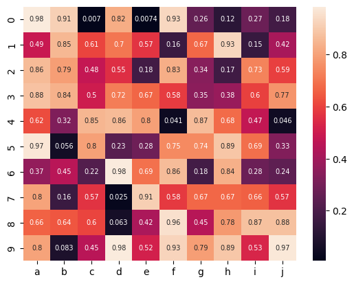
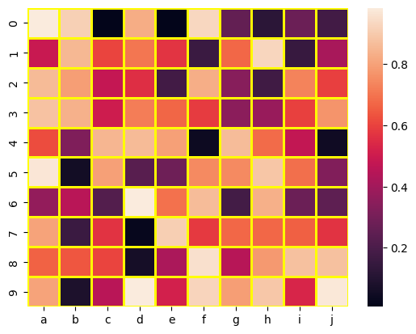
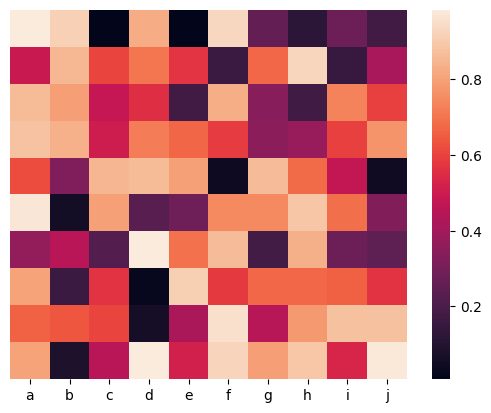
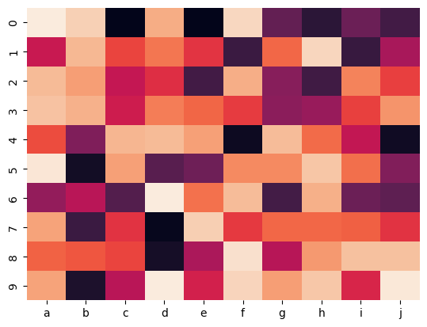
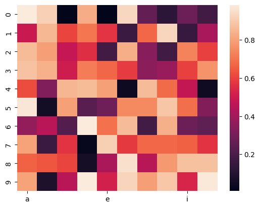

## Libraries & Dataset

First, we need to load a few libraries:

- [seaborn](/seaborn) for the heatmap
- [matplotlib](/matplotlib) for chart customization
- [pandas](/pandas) for data manipulation
- `numpy` for data generation

```python
# libraries
import seaborn as sns
import matplotlib.pyplot as plt
import pandas as pd
import numpy as np

df = pd.DataFrame(
    np.random.random((10,10)),
    columns=["a","b","c","d","e","f","g","h","i","j"]
)
```

## Annotate each cell with value

The heatmap can show the exact value behind the color. To add a label to each cell, `annot` parameter of the `heatmap()` function should be set to `True`.

```python
# plot a heatmap with annotation
sns.heatmap(df, annot=True, annot_kws={"size": 7})
plt.show()
```

:::output

:::

## Custom grid lines

The following parameters will make customizations to the heatmap plot:

- `linewidth` : the thickness of the lines
- `linecolor` : the color of the lines

```python
# plot a heatmap with custom grid lines
sns.heatmap(df, linewidths=2, linecolor='yellow')
plt.show()
```

:::output

:::

## Remove X or Y labels

`yticklabels` and `xticklabels` control the presence / abscence of labels for the Y and X axis respectively.

```python
# plot a heatmap
sns.heatmap(df, yticklabels=False)
plt.show()
```

:::output

:::

## Remove color bar

You can remove the color bar from a heatmap plot by giving **False** to the parameter `cbar`.

```python
# plot a heatmap
sns.heatmap(df, cbar=False) 
plt.show()
```

:::output

:::

## Hide a few axis labels to avoid overlapping

As you can remove x or y labels by setting `xticklabels` or `yticklabels` as **False**, you can also give an **integer** to plot only every n label.

```python
# plot a heatmap
sns.heatmap(df, xticklabels=4)
plt.show()
```

:::output

:::

## Going further

This post explains how to create a [heatmap](/heatmap) with [matplotlib](/matplotlib) and [seaborn](/seaborn).

You might be interested by:

- how to [create from different data format input](/90-heatmaps-with-various-input-format)
- how to [control colors in heatmap](/92-control-color-in-seaborn-heatmaps)
- use heatmap with [clustering and dendograms](/405-dendrogram-with-heatmap-and-coloured-leaves)
