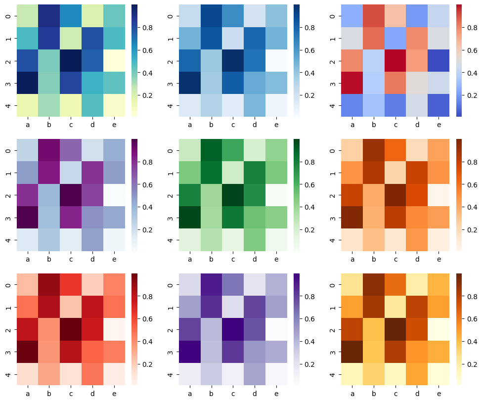
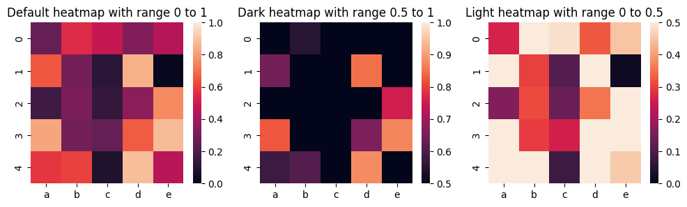
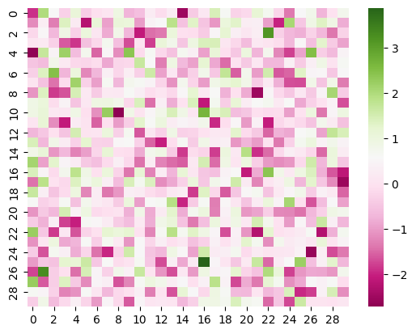
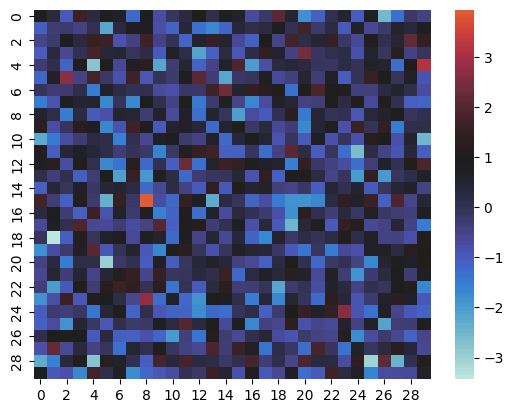
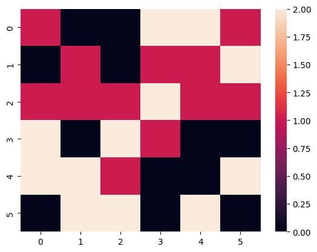

## Libraries & Dataset

First, we need to load a few libraries:

- [seaborn](/seaborn) for the heatmap
- [matplotlib](/matplotlib) for chart customization
- [pandas](/pandas) for data manipulation
- `numpy` for data generation

```python
# library
import seaborn as sns
import matplotlib.pyplot as plt
import pandas as pd
import numpy as np

# Create a dataset
df = pd.DataFrame(
    np.random.random((5, 5)),
    columns=["a", "b", "c", "d", "e"]
)
```

## Sequential Palette : one color only

You can customize the colors in your heatmap with the `cmap` parameter of the `heatmap()` function in seaborn. The following examples show the appearences of different sequential color palettes.

It's non-exhaustive but it gives you an idea of what **available palettes** can look like.

```python
fig, axs = plt.subplots(
    nrows=3, ncols=3,
    figsize=(12, 10)
)

# plot using a color palette
sns.heatmap(df, cmap="YlGnBu", ax=axs[0, 0])
sns.heatmap(df, cmap="Blues", ax=axs[0, 1])
sns.heatmap(df, cmap="coolwarm", ax=axs[0, 2])
sns.heatmap(df, cmap="BuPu", ax=axs[1, 0])
sns.heatmap(df, cmap="Greens", ax=axs[1, 1])
sns.heatmap(df, cmap="Oranges", ax=axs[1, 2])
sns.heatmap(df, cmap="Reds", ax=axs[2, 0])
sns.heatmap(df, cmap="Purples", ax=axs[2, 1])
sns.heatmap(df, cmap="YlOrBr", ax=axs[2, 2])

fig.savefig(
    '../../static/graph/92-control-color-in-seaborn-heatmaps.png', dpi=300
)
plt.show()
```

:::output

:::

## Min and max color

It is also possible to set **maximum** and **minimum** values for color bar on a [seaborn](/seaborn) [heatmap](/heatmap) by giving values to `vmax` and `vmin` parameters in the function.

```python
fig, axs = plt.subplots(
    nrows=1, ncols=3,
    figsize=(12, 3)
)

sns.heatmap(df, vmin=0, vmax=1, ax=axs[0])
axs[0].set_title('Default heatmap with range 0 to 1')

sns.heatmap(df, vmin=0.5, vmax=1, ax=axs[1])
axs[1].set_title('Dark heatmap with range 0.5 to 1')

sns.heatmap(df, vmin=0, vmax=0.5, ax=axs[2])
axs[2].set_title('Light heatmap with range 0 to 0.5')

plt.show()
```

:::output

:::

## Diverging Palette : two contrasting colors

Following example uses 2 contrast colors pink and yellow-green in the heatmap.

```python
# create dataset
df = np.random.randn(30, 30)

# plot heatmap
sns.heatmap(df, cmap="PiYG")
plt.show()
```

:::output

:::

When plotting divergant data, you can **specify the value at which to center** the colormap using `center` parameter. You can see the following example heatmap for data centered on 1 with a diverging colormap:

```python
# create dataset
df = np.random.randn(30, 30)

# plot heatmap
sns.heatmap(df, center=1)
plt.show()
```

:::output

:::

## Discrete Data

If your dataset consists of continues values, you can **turn them into discrete numbers** and use these discrete values in the heatmap. The following examples shows how to transform continues values into 3 discrete values: 0, 1, and 2.

This way, you can **fix the number** of colors in your [heatmap](/heatmap):

```python
# create data
df = pd.DataFrame(np.random.randn(6, 6))

# make the values in dataset discrete
# the values will be cut into 3 discrete values: 0,1,2
df_q = pd.DataFrame()
for col in df:
    df_q[col] = pd.to_numeric(pd.qcut(df[col], 3, labels=list(range(3))))

# plot it
sns.heatmap(df_q)
plt.show()
```

:::output

:::

## Going further

This post explains how to create a [heatmap](/heatmap) with [matplotlib](/matplotlib) and [seaborn](/seaborn).

You might be interested by:

- how to [create from different data format input](/90-heatmaps-with-various-input-format)
- how to [customize heatmaps](/91-customize-seaborn-heatmap)
- use heatmap with [clustering and dendograms](/405-dendrogram-with-heatmap-and-coloured-leaves)
