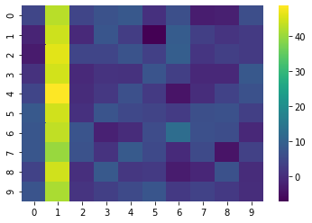
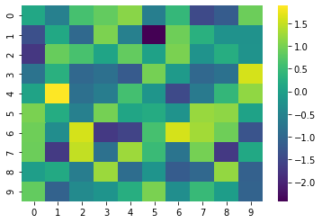
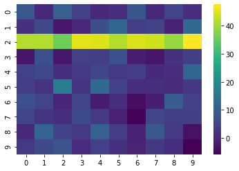
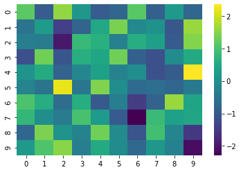

In the first chart of the first example, you can see that while one column appears as yellow, the rest of the heatmap appears as green. This column **absorbs all the color variations**. To avoid this, you can **normalize** the data frame. You can normalize on columns or on rows. Several formula can be used, read [this page](https://en.wikipedia.org/wiki/Normalization_(statistics)) to find the one you need.

## Column normalization

You can compare the charts below in order to see the difference between the initial data frame and the normalized version of it.

```python
# libraries
import seaborn as sns
import matplotlib.pyplot as plt
import pandas as pd
import numpy as np
 
# Create a dataframe where the average value of the second column is higher than others:
df = pd.DataFrame(np.random.randn(10,10) * 4 + 3)
df[1]=df[1]+40
 
# If we do a heatmap, we just observe that one column has higher values than others:
sns.heatmap(df, cmap='viridis')
plt.show()

# Now if we normalize it by column:
df_norm_col=(df-df.mean())/df.std()
sns.heatmap(df_norm_col, cmap='viridis')
plt.show()
```

:::output



:::

## Row normalization

The same principle works for row normalization.

```python
# libraries
import seaborn as sns
import matplotlib.pyplot as plt
import pandas as pd
import numpy as np
 
# Create a dataframe where the average value of the second row is higher
df = pd.DataFrame(np.random.randn(10,10) * 4 + 3)
df.iloc[2]=df.iloc[2]+40
 
# If we do a heatmap, we just observe that one row has higher values than others:
sns.heatmap(df, cmap='viridis')
plt.show()
 
# Normalize it by row:
df_norm_row = df.apply(lambda x: (x-x.mean())/x.std(), axis = 1)
 
# And see the result
sns.heatmap(df_norm_row, cmap='viridis')
plt.show()
```

:::output



:::
