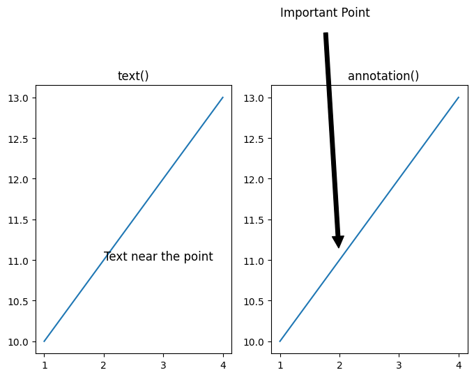
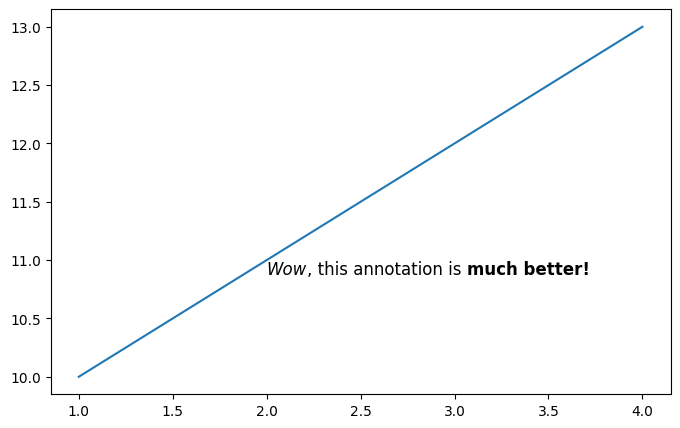
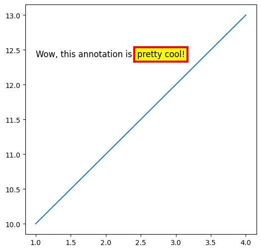
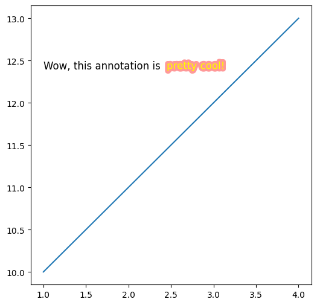

## Annotations

In data visualization, annotations have a **major role** in available information to the reader.

They can be used to:

- **highlight** specific points
- provide **additional** information
- simply **explain** the data in more depth

However, it can be quite technicaly challenging to customize annotations in [matplotlib](https://python-graph-gallery.com/matplotlib/), especially if you want specific text highlighting such as **word in bold, italic or colored differently**.

Let's see how we can create nice annotations in a few examples.

## Libraries

Default tools from [matplotlib](https://python-graph-gallery.com/matplotlib/) are unfortunately **not enough** to create nice annotations. We will use the [highlight-text package](https://github.com/znstrider/highlight_text) that simplifies the process.

Keep in mind that it would have been possible to use the [flexitext package](https://github.com/tomicapretto/flexitext) that can do approximately the same thing.

And we will also need to load `matplotlib` and `numpy` libraries.

```python
import numpy as np
import matplotlib.pyplot as plt
from highlight_text import fig_text, ax_text
```

## Simple annotation

When creating a plot with annotation in `matplotlib`, we mainly use 2 functions:

- `annotate()`
- `text()`

Concretely, the `annotate()` function allows to add a text at a specific position, with an **arrow pointing** to a specific point, while the `text()` function allows to add a text at a specific position, **without any arrow**.

Let's see how they behave with a concrete example:

```python
fig, ax = plt.subplots(ncols=2, figsize=(8, 5))
x = [1, 2, 3, 4]
y = [10, 11, 12, 13]

point_to_highlight = (2, 11)

# annotation with .text()
ax[0].plot(x, y)
ax[0].text(
    x=point_to_highlight[0],  # position on x-axis
    y=point_to_highlight[1],  # position on y-axis
    s='Text near the point',
    fontsize=12
)
ax[0].set_title('text()')

# annotation with .annotate()
ax[1].plot(x, y)
ax[1].annotate(
    text='Important Point',
    xy=point_to_highlight,  # position of the point
    xytext=(1, 14),  # position of the text
    arrowprops=dict(facecolor='black', shrink=0.05),
    fontsize=12
)
ax[1].set_title('        annotation()')

plt.show()
```

:::output

:::

## Boldness and Italics

Thanks to the `highlight_text` package, it is possible to **bold** and **italic** tp a specific part of the text. This is what will make the annotation **stand out** from the rest of the text.

The syntax is that we have to put the part of the text that we want to highlight between `<` and `>`. Then, we use the `highlight_textprops` argument to specify the style of the selected part.

```python
fig, ax = plt.subplots(figsize=(8, 5))
x = [1, 2, 3, 4]
y = [10, 11, 12, 13]
point_to_highlight = (2, 11)

ax.plot(x, y)
text = '<Wow>, this annotation is <much better!>'
ax_text(
    x=point_to_highlight[0],  # position on x-axis
    y=point_to_highlight[1],  # position on y-axis
    s=text,
    fontsize=12,
    highlight_textprops=[
        {"fontstyle": 'italic'},
        {"fontweight": 'bold'}
    ],
    ax=ax
)

plt.show()
```

:::output

:::

## Background color

You can easily add a background color to your annotation by using the `bbox` argument. You can customize lots of parameters:

- `facecolor` is the color of the background
- `edgecolor` is the **color** of the border
- `linewidth` is the **width** of the border
- `pad` is the padding **between** the text and the border

```python
# create a simple plot
fig, ax = plt.subplots(figsize=(6, 6))
ax.plot(
    [1, 2, 3, 4],
    [10, 11, 12, 13]
)

# add annotation on top
text = 'Wow, this annotation is  <pretty cool!>'
ax_text(
    x=1,  # position on x-axis
    y=12.5,  # position on y-axis
    s=text,
    fontsize=12,
    ax=ax,
    highlight_textprops=[
        {"bbox": {"edgecolor": "red",
                  "facecolor": "yellow",
                  "linewidth": 3,
                  "pad": 4}}
    ]
)

plt.show()
```

:::output

:::

## Path effects

The path effect is a way to add a **shadow** to your text, and it's highly customizable! In `highlight_text`, it relies on [matplotlib](https://python-graph-gallery.com/matplotlib/)'s `PathEffects` module.

With it, we can specify:

- `linewidth` is the **width** of the shadow
- `foreground` is the **color** of the shadow
- `alpha` is the **transparency** of the shadow
- and more! You can see the [official matplotlib documentation](https://matplotlib.org/stable/users/explain/artists/patheffects_guide.html) for more information.

```python
# create a simple plot
import matplotlib.patheffects as path_effects
fig, ax = plt.subplots(figsize=(6, 6))
ax.plot(
    [1, 2, 3, 4],
    [10, 11, 12, 13]
)

# path effects


def define_path_effect(**kwargs):
    return [path_effects.Stroke(**kwargs), path_effects.Normal()]


my_path_effect = define_path_effect(
    linewidth=6,
    foreground="red",
    alpha=0.4
)


# add annotation on top
text = 'Wow, this annotation is  <pretty cool!>'
ax_text(
    x=1,  # position on x-axis
    y=12.5,  # position on y-axis
    s=text,
    fontsize=12,
    ax=ax,
    highlight_textprops=[
        {"path_effects": my_path_effect,
         "color": "yellow"}
    ]
)

plt.show()
```

:::output

:::

## Going further

This post explains how to create **nice annotations** in [matplotlib](https://python-graph-gallery.com/matplotlib/) with the `highlight_text` package.

You might be interested in [how to have different colors in annotations](https://python-graph-gallery.com/how-to-custom-title-matplotlib) or [how to add an image in a plot](https://python-graph-gallery.com/513-add-logo-matplotlib/)
