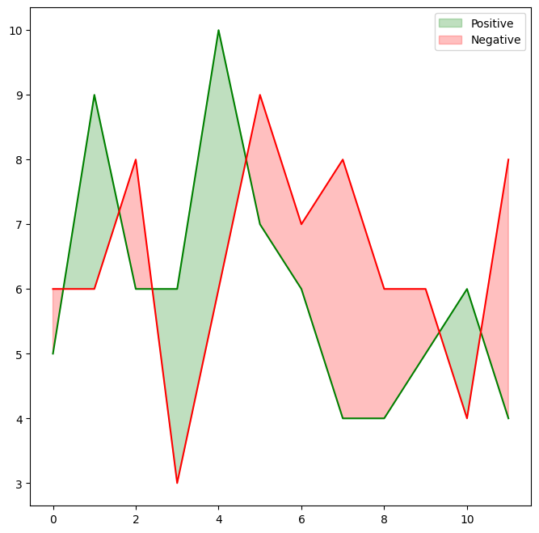
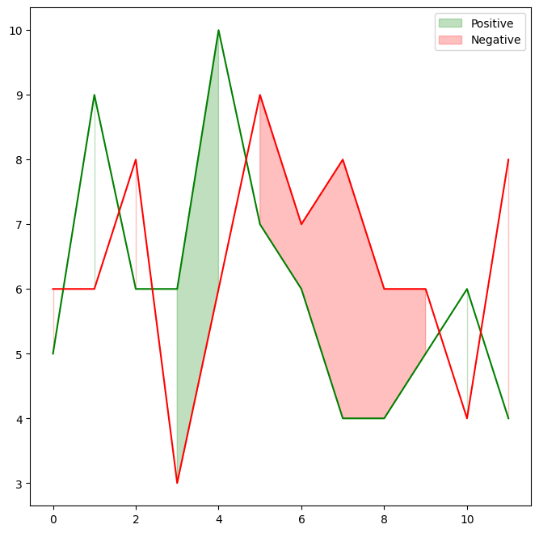

## Libraries & Dataset

Let's get started by creating some fake data and load a few libraries:

```python
import matplotlib.pyplot as plt
import pandas as pd

data = {
   'time':range(12),
   'income':[5, 9, 6, 6, 10, 7, 6, 4, 4, 5, 6, 4],
   'expenses':[6, 6, 8, 3, 6, 9, 7, 8, 6, 6, 4, 8]
}
df = pd.DataFrame(data)
df.head()
```

:::output
::output-html{src="./output-1.html"}
:::

## Plot

The code mainly relies on the `fill_between()`, that will fill the space given points.

```python
# Initialize figure and axis
fig, ax = plt.subplots(figsize=(8, 8))

# Plot lines
ax.plot(df['time'], df['income'], color="green")
ax.plot(df['time'], df['expenses'], color="red")

# Fill area when income > expenses with green
ax.fill_between(
    df['time'], df['income'], df['expenses'], where=(df['income'] > df['expenses']), 
    interpolate=True, color="green", alpha=0.25, 
    label="Positive"
)

# Fill area when income <= df['expenses'] with red
ax.fill_between(
    df['time'], df['income'], df['expenses'], where=(df['income'] <= df['expenses']), 
    interpolate=True, color="red", alpha=0.25,
    label="Negative"
)

ax.legend()
plt.show()
```

:::output

:::

## Change interpolate value

Setting `interpolate` to `True` calculates the **intersection point** between the two lines and extends the filled region up to this point, which results in the **better looking** filled area.

Let's see how it look when it's `False`:

```python
# Initialize figure and axis
fig, ax = plt.subplots(figsize=(8, 8))

# Plot lines
ax.plot(df['time'], df['income'], color="green")
ax.plot(df['time'], df['expenses'], color="red")

# Fill area when income > expenses with green
ax.fill_between(
    df['time'], df['income'], df['expenses'], where=(df['income'] > df['expenses']), 
    interpolate=False, color="green", alpha=0.25, 
    label="Positive"
)

# Fill area when income <= df['expenses'] with red
ax.fill_between(
    df['time'], df['income'], df['expenses'], where=(df['income'] <= df['expenses']), 
    interpolate=False, color="red", alpha=0.25,
    label="Negative"
)

ax.legend()
plt.show()
```

:::output

:::

## Going further

You might be interested in:

- area chart [with small multiples](/242-area-chart-and-faceting)
- real life [usecase of an area chart](/web-time-series-and-facetting-with-matplotlib)
