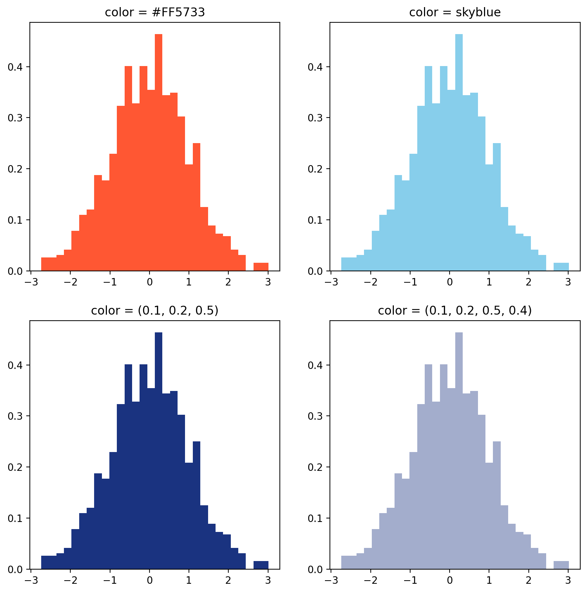

## What Matplotlib interprets as a color

In [matplotlib](/matplotlib), you can specify colors in a variety of ways:

- as a string representing a **color name** (e.g., `red` or `blue`), but only a limited number of colors are supported this way
- as a string representing a **hexadecimal** color code (e.g., `#FF0000` or `#e9edc9`), which allows you to specify _any color_
- as a string representing an **RGB or RGBA** tuple (e.g., `(1, 0, 0)` or `(0.9, 0.9, 0.8, 1)`), which also allows you to specify _any color_. RGB stands for Red, Green, Blue, and RGBA stands for Red, Green, Blue, Alpha (the alpha channel specifies the transparency of the color).

Let's see how these different ways of specifying colors work **in practice**.

```python
import matplotlib.pyplot as plt
import numpy as np

random_data = np.random.randn(1000)

# Create a figure and a set of 4 subplots
fig, axs = plt.subplots(nrows=2, ncols=2, figsize=(10, 10), dpi=200)

# Hexadecimal color codes
color = "#FF5733"
axs[0,0].hist(
    random_data,
    bins=30,
    density=True,
    color=color
)
axs[0,0].set_title(f"color = {color}")

# Pre-defined color names
color = "skyblue"
axs[0,1].hist(
    random_data,
    bins=30,
    density=True,
    color=color
)
axs[0,1].set_title(f"color = {color}")

# RGB tuple
color = (0.1, 0.2, 0.5)
axs[1,0].hist(
    random_data,
    bins=30,
    density=True,
    color=color
)
axs[1,0].set_title(f"color = {color}")

# RGBA tuple
color = (0.1, 0.2, 0.5, 0.4)
axs[1,1].hist(
    random_data,
    bins=30,
    density=True,
    color=color
)
axs[1,1].set_title(f"color = {color}")

plt.show()
```

:::output

:::

## Available color names

[Matplotlib](/matplotlib) supports a limited number of color names. You can see the full list of supported color names below.


## Short color names

[Matplotlib](/matplotlib) also supports a few short color names. You can see the full list of supported short color names below.


## Going further

### Palette finder

Browse the [color palette finder](/color-palette-finder) to find your dream palette!


<br>

### Related

- the [color section of the gallery](/python-colors)
- discover the [categorical palettes](/categorical-color-palette) and [continuous palettes](/continuous-color-palette) in Matplotlib
