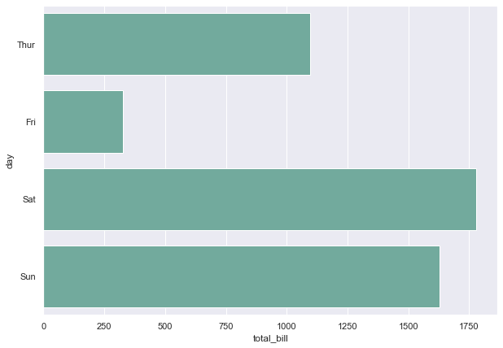
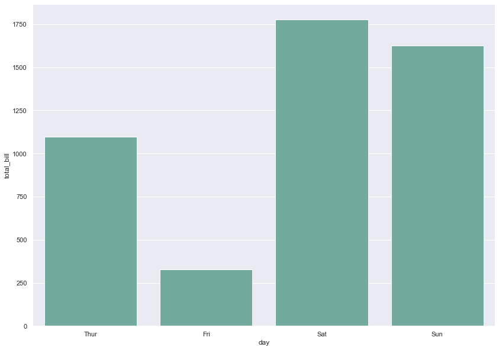
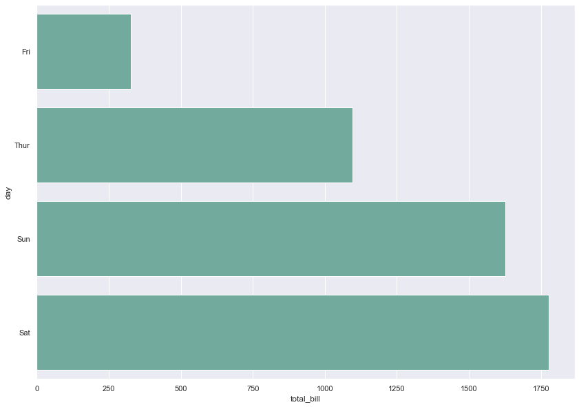
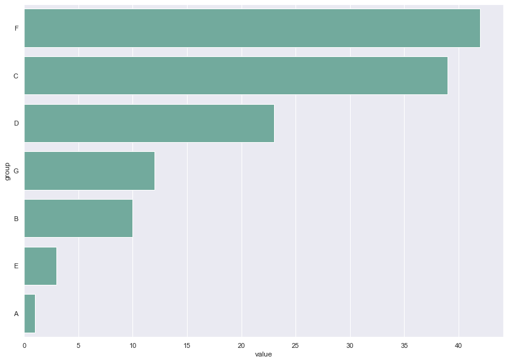

## 📍 Basic seaborn barplot

Let's start with a basic example showing the total bill paid by customers in 4 different days of the week.
The `barplot()` function of the [seaborn](http://python-graph-gallery.com/seaborn/) library is used here. The arguments passed to the function are:
* `x` : the name of the dataframe column used for the X axis.
* `data` : dataframe to use for plotting
* `estimator` : function to estimate within each category
* `ci` : size of confidence intervals (if None, error bars will not be drawn)
* `color` : the color of the bars

```python
# import libraries
import seaborn as sns
import matplotlib.pyplot as plt

# set plot style: grey grid in the background:
sns.set_theme(style="darkgrid")

# load dataset
tips = sns.load_dataset("tips")

# Set the figure size
plt.figure(figsize=(10, 7))

# plot a bar chart
sns.barplot(
    x="total_bill", 
    y="day", 
    data=tips, 
    estimator=sum, 
    ci=None, 
    color='#69b3a2');
```

:::output

:::

## 📊 Vertical version

You just have to swap the `x` and `y` parameter to get a vertical barplot instead of a horizontal version:

```python
# Set the figure size
plt.figure(figsize=(14, 10))

# plot a bar chart
sns.barplot(
    y="total_bill", 
    x="day", 
    data=tips, 
    estimator=sum, 
    ci=None, 
    color='#69b3a2');
```

:::output

:::

## 🔀 Bar order

It is easy to control the bar order in a `seaborn` barplot. You can pass the `order` parameter with a list of explicit order to the function.  
I will order the days according to their bill amount in the example below:

```python
# Set the figure size
plt.figure(figsize=(14, 10))

# plot a bar chart with given order of bars ["Fri","Thur","Sun","Sat"]
sns.barplot(
    x="total_bill", 
    y="day", 
    data=tips, 
    estimator=sum, 
    ci=None, 
    order=["Fri","Thur","Sun","Sat"], 
    color='#69b3a2'
);
```

:::output

:::

Another common need is to reorder the barplot by group rank. For instance, you want to have the group with the highest value on top, and the one with the lowest value at the bottom.

To do so you have to reorder the dataframe using the `sort_values()` function as follow:

```python
# Create a dataframe
import pandas as pd
df = pd.DataFrame({
        'group': ['A', 'B', 'C', 'D', 'E', 'F', 'G'],
        'value': [1, 10, 39, 23, 3, 42, 12]
})

# Set the figure size
plt.figure(figsize=(14, 10))

# Reorder this data frame
df = df.sort_values(['value'], ascending=False).reset_index(drop=True)

# Make a barplot
sns.barplot(
    x="value", 
    y="group", 
    data=df, 
    estimator=sum, 
    ci=None, 
    color='#69b3a2'
);
```

:::output

:::
