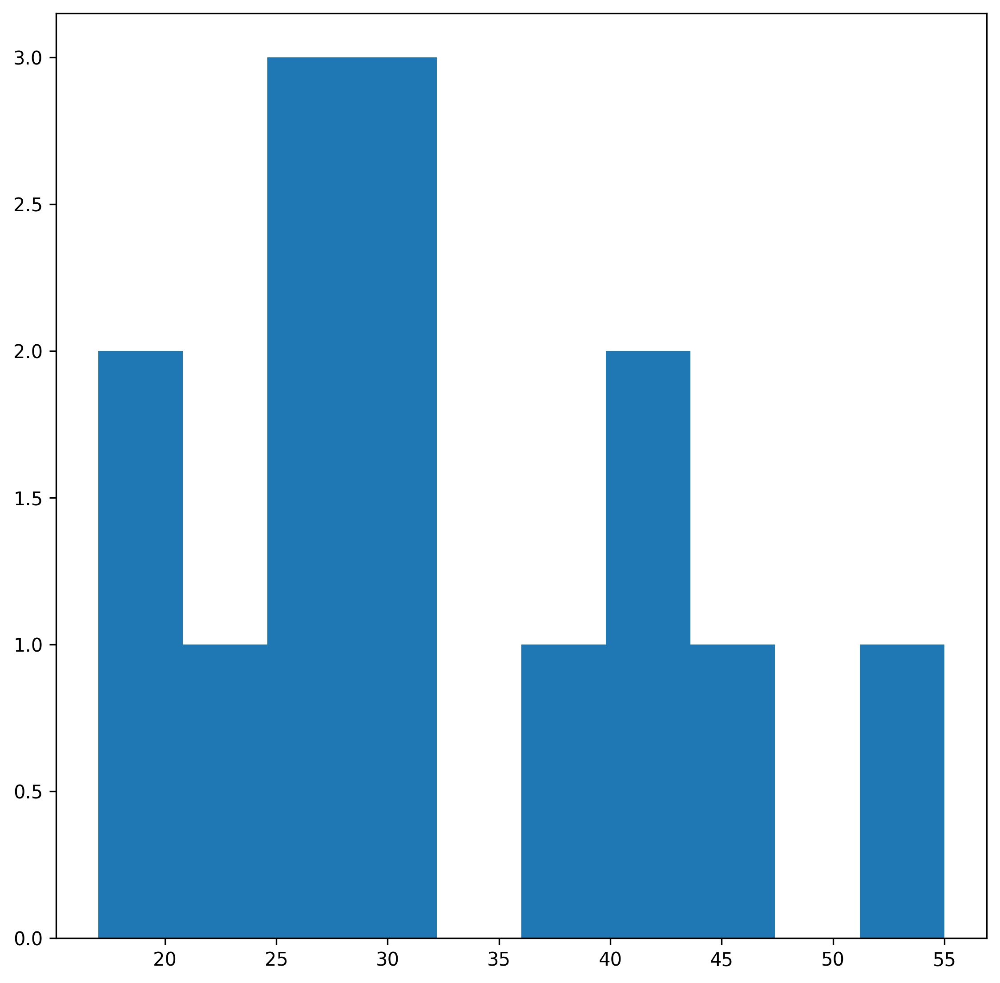
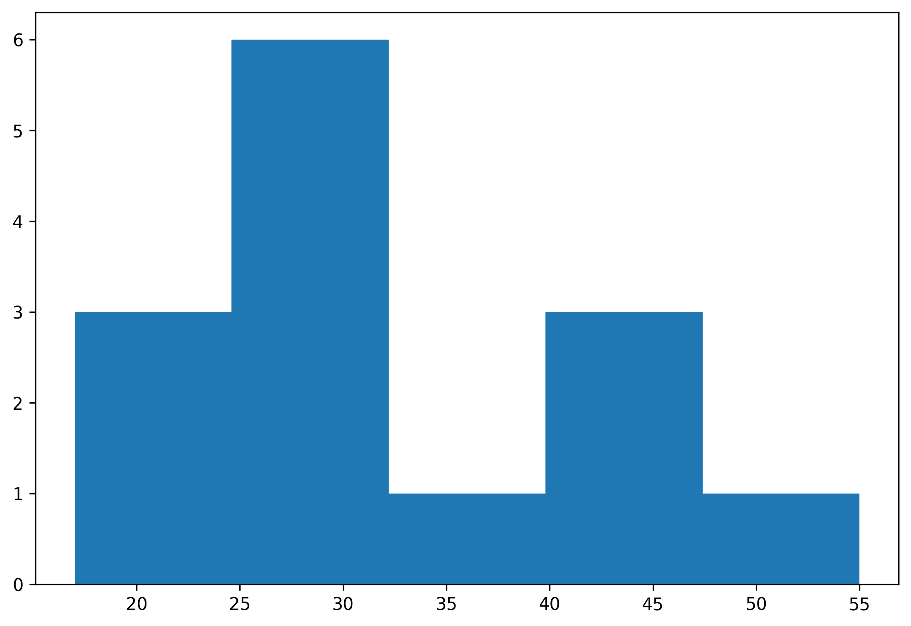
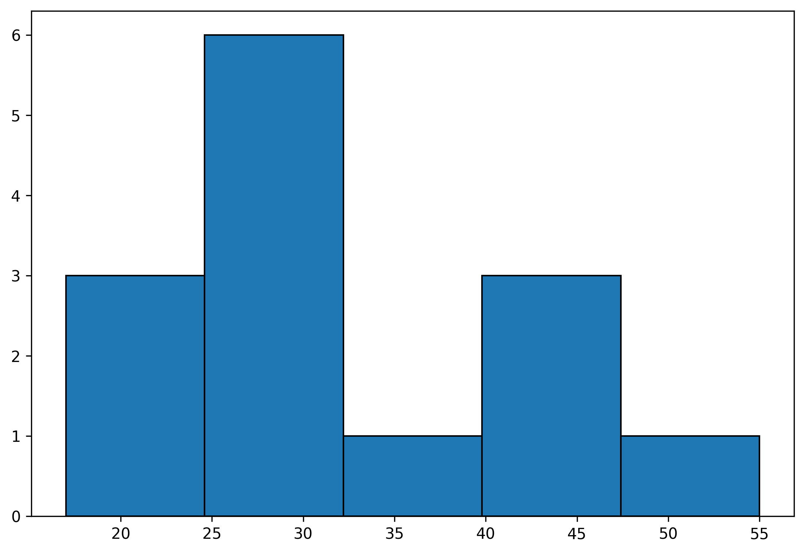
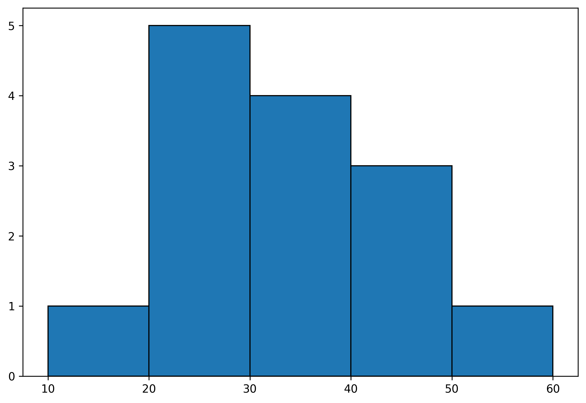
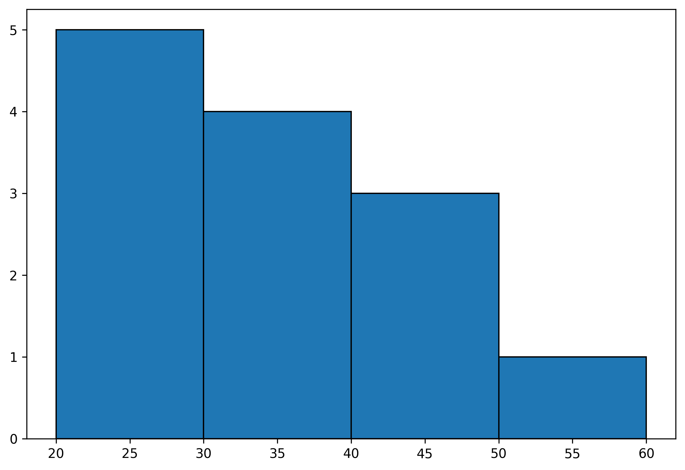
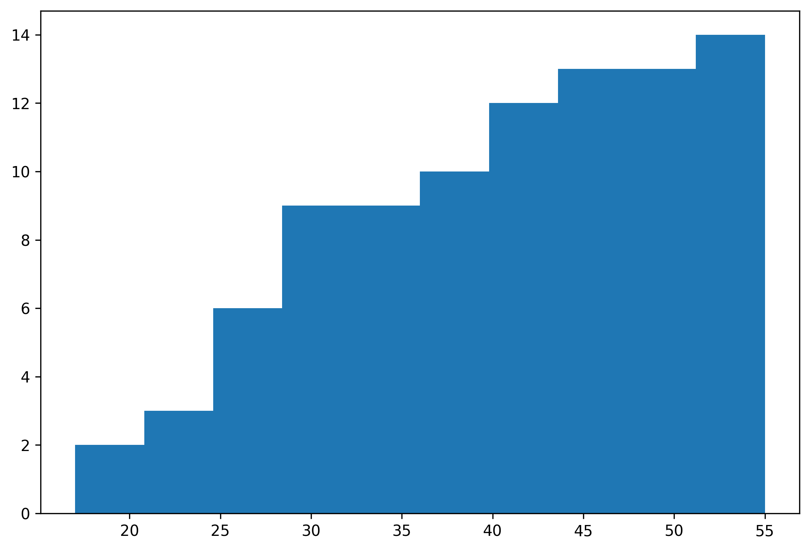
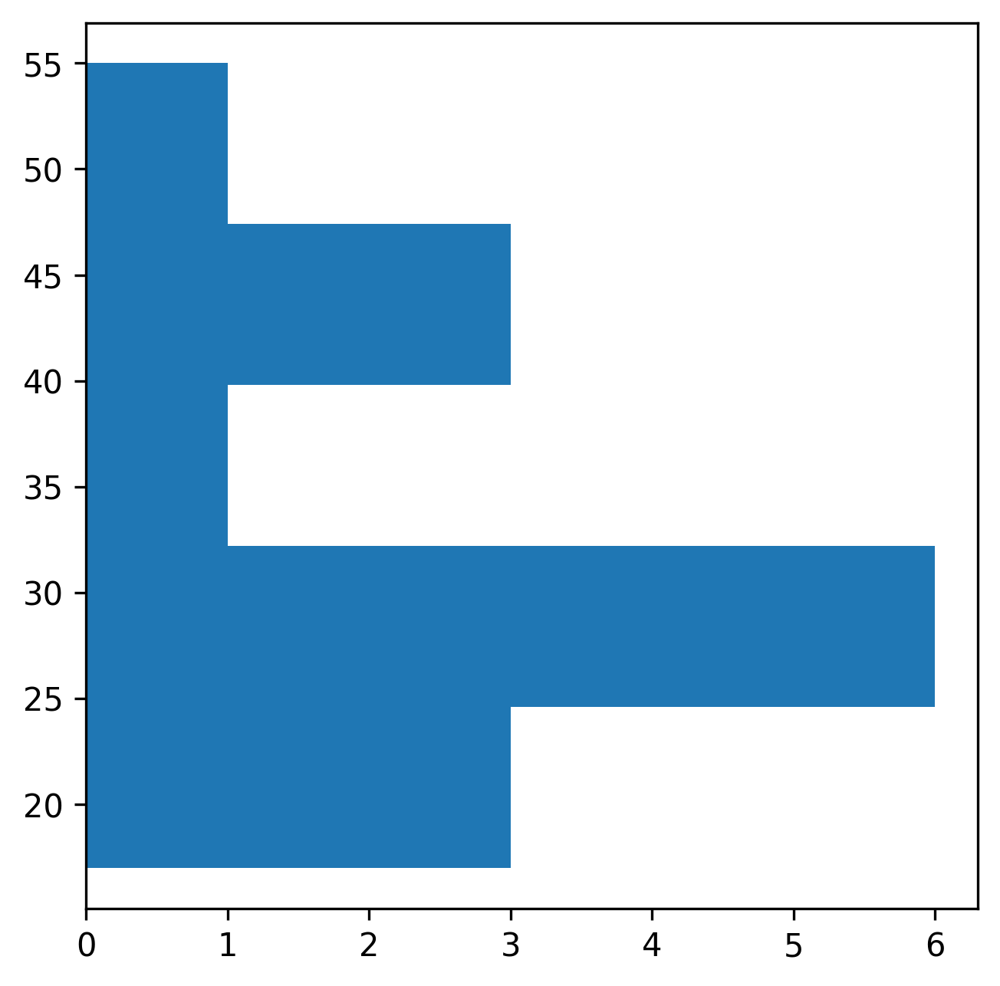
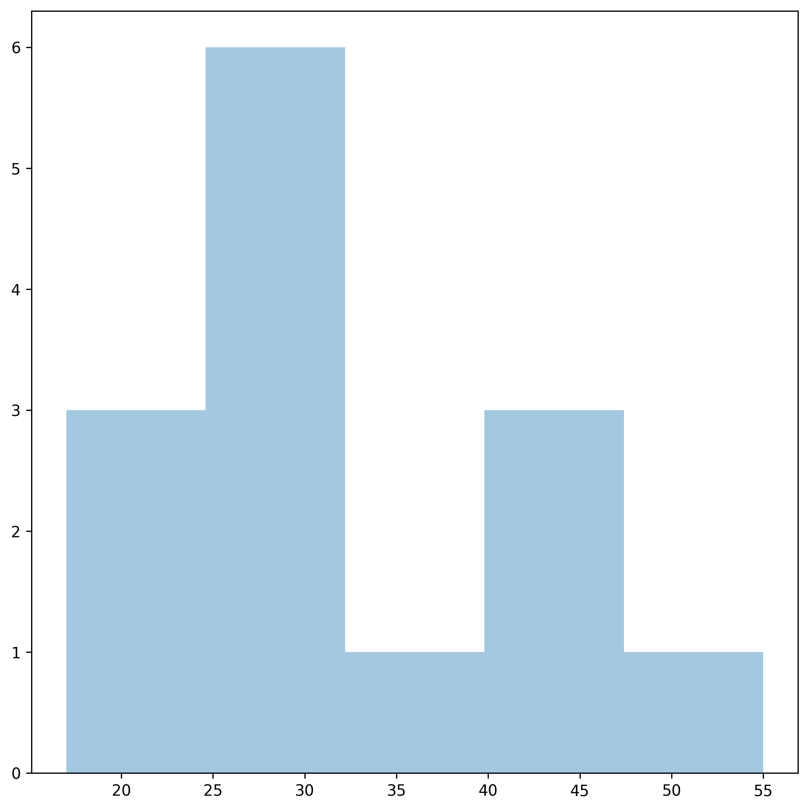
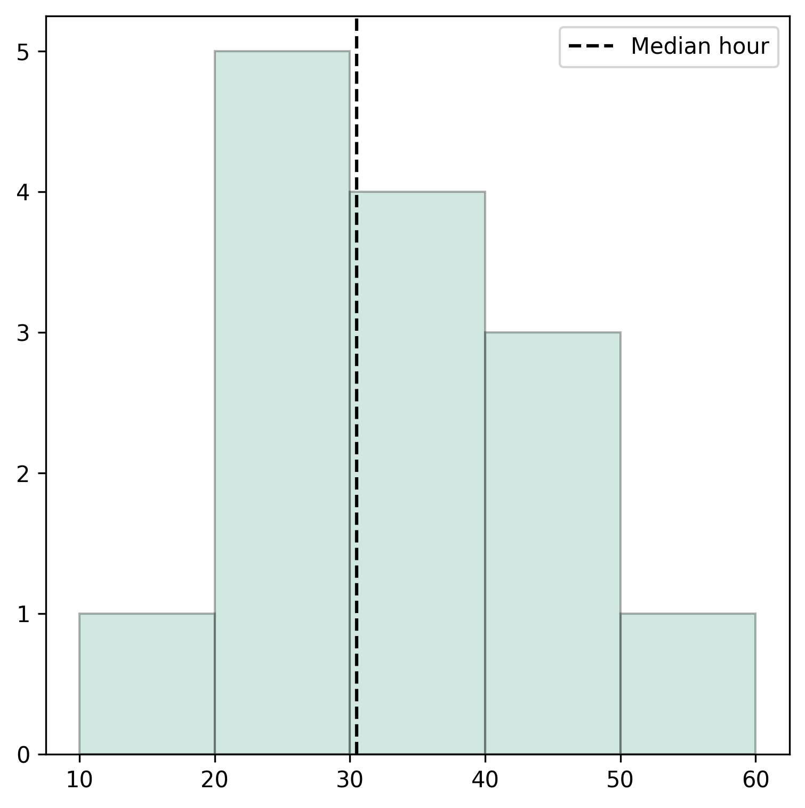

## Most basic histogram

First of all, let's import Matplotlib and Numpy, two widely used libraries for data visualization and data wrangling.

```python
import matplotlib.pyplot as plt
import numpy as np # only used to compute a median value

# set a higher resolution
plt.rcParams['figure.dpi'] = 300
```

Now, let's pretend the following are weekly hours of work reported by people in a survey. This is the dataset required to build a histogram: an array of numeric value. Note that it could also be a column of a `pandas` data frame.

```python
hours = [17, 20, 22, 25, 26, 27, 30, 31, 32, 38, 40, 40, 45, 55]
```

Creating a histogram is as simple as calling `plt.hist(hours)` or using `ax.hist(hours)` with Matplotlib's object-oriented interface:

```python
# Initialize layout
fig, ax = plt.subplots(figsize = (9, 9))

# Make histogram
ax.hist(hours)

plt.show()
```

:::output

:::

## Specify the number of bins

One problem is that we are not certain about the binning being used. Fortunately, it is possible to specify the binning by passing an integer that specifies the number of bins, or a list of values that represent the bins.

```python
fig, ax = plt.subplots(figsize = (9, 6))

# Use 5 bins
ax.hist(hours, bins=5)

plt.show()
```

:::output

:::

## Color edges

The chart may not be clear because there's nothing separating the bins. Let's specify a color for the edges with the `edgecolor` argument.

```python
fig, ax = plt.subplots(figsize = (9, 6))
ax.hist(hours, bins=5, edgecolor="black")
plt.show()
```

:::output

:::

Now the bins are much clearer. Let's see how it looks when we pass a list of values for the bins:

```python
bins = [10, 20, 30, 40, 50, 60]
fig, ax = plt.subplots(figsize = (9, 6))
ax.hist(hours, bins=bins, edgecolor="black")
plt.show()
```

:::output

:::

## Zoom on a specific sample

It's possible to remove a particular bin. That will also remove the values from the data that fall in that bin. Values smaller than 20 won't be included in the following histogram.

```python
bins = [20, 30, 40, 50, 60]
fig, ax = plt.subplots(figsize = (9, 6))
ax.hist(hours, bins=bins, edgecolor="black")
plt.show()
```

:::output

:::

## Cumulative histogram

Thanks to the `cumulative` argument, you can easily specify whether you want your histogram to be cumulative or not

```python
fig, ax = plt.subplots(figsize = (9, 6))
ax.hist(hours, cumulative=True)
plt.show()
```

:::output

:::

## Horizontal histogram

You can return your **histogram horizontally**s by adding `orientation='horizontal'` to the `hist()` function.

```python
fig, ax = plt.subplots(figsize=(5,5))
ax.hist(hours, orientation='horizontal', bins=5)
plt.show()
```

:::output

:::

## Control opacity

The `alpha` argument allows you to control the opacity of the histogram:

```python
fig, ax = plt.subplots(figsize = (9, 9))
ax.hist(hours, alpha=0.4, bins=5)
plt.show()
```

:::output

:::

## Add annotation

And finally, let's see how to add a vertical line indicating some interesting quantity. In this case, the line is going to reprsent the median hours of work per week.

Note: read this [specific blogpost](https://python-graph-gallery.com/193-annotate-matplotlib-chart) of the gallery for more on matplotlib annotation.

```python
median_hour = np.median(hours)
bins = [10, 20, 30, 40, 50, 60]

fig, ax = plt.subplots(figsize = (6, 6))
ax.hist(hours, bins=bins, edgecolor="black", color="#69b3a2", alpha=0.3)

# axvline: axis vertical line
ax.axvline(median_hour, color="black", ls="--", label="Median hour")
ax.legend()

plt.show()
```

:::output

:::
