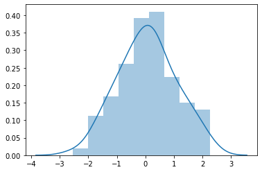

Welcome in the introductory template of the python graph gallery. Here is how to proceed to add a new `.ipynb` file that will be converted to a blogpost in the gallery!

## Notebook Metadata

It is very important to add the following fields to your notebook. It helps building the page later on:
- **slug**: the URL of the blogPost. It should be exactly the same as the file title. Example: `70-basic-density-plot-with-seaborn`
- **chartType**: the chart type like density or heatmap. For a complete list see [here](https://github.com/holtzy/The-Python-Graph-Gallery/blob/master/src/util/sectionDescriptions.js), it must be one of the `id` options.
- **title**: what will be written in big on top of the blogpost! use html syntax there.
- **description**: what will be written just below the title, centered text.
- **keyword**: list of keywords related with the blogpost
- **seoDescription**: a description for the bloppost meta. Should be a bit shorter than the description and must not contain any html syntax.

## Add a chart description

A chart example always come with some explanation. It must:

contain keywords
link to related pages like the parent page (graph section)
give explanations. In depth for complicated charts. High level for beginner level charts

By the way we should be able to include emojis &#11088; &#127881; &#127752; &#128077; &#128079 .

```python
import seaborn as sns, numpy as np
np.random.seed(0)
x = np.random.randn(100)
ax = sns.distplot(x)
```

:::output

:::

## A few notes

> It is possible to write in a quote to highlight an important message
