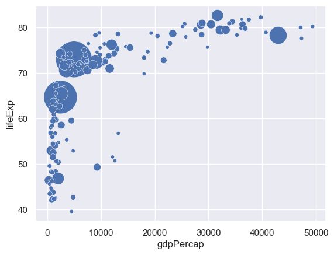
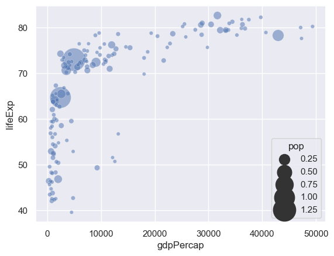
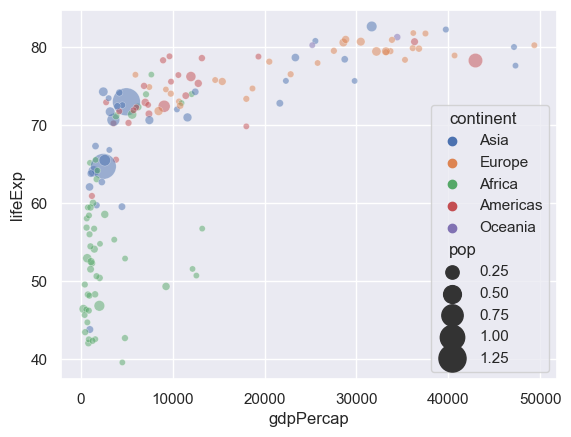

## Libraries & Dataset

Let's start by load a few libraries and the dataset.

- [matplotlib](https://python-graph-gallery.com/matplotlib/): for displaying the plot
- [pandas](https://python-graph-gallery.com/pandas/): for data manipulation
- [seaborn](https://python-graph-gallery.com/seaborn/): for the `sns.scatterplot()` function

```python
import matplotlib.pyplot as plt
import seaborn as sns
import pandas as pd

gapminder = pd.read_csv(
    'https://raw.githubusercontent.com/holtzy/The-Python-Graph-Gallery/master/static/data/gapminderData.csv'
)
data = gapminder.loc[gapminder.year == 2007]
```

## Most Basic Bubble Chart

A **bubble plot** is basically a scatterplot with an additional dimension: **size of points**. Using [seaborn](https://python-graph-gallery.com/seaborn/) library, a bubble plot can be constructed using the `scatterplot()` function. In the example, the following parameters are used to build a basic bubble plot:

- `data` : Input data structure
- `x` : The data position on the x axis
- `y` : The data position on the y axis
- `size` : Grouping variable that will produce points with different sizes
- `alpha` : Transparancy ratio

Here, the **gapminder** data set is used and the relationship between life expectancy (y) and gdp per capita (x) of world countries is represented. The population of each country is represented through dot size.

```python
sns.set_theme(style="darkgrid")

# use the scatterplot function to build the bubble map
sns.scatterplot(
    data=data,
    x="gdpPercap",
    y="lifeExp",
    size="pop",
    legend=False,
    sizes=(20, 2000)
)

# show the graph
plt.show()
```

:::output

:::

## Control Bubble Size

You can control the **size of bubbles** using the `sizes` argument. You should pass the **minimum and maximum size** to use such that other values are normalized within this range.

```python
sns.set_theme(style="darkgrid")

# use the scatterplot function
min, max = 20, 800
sns.scatterplot(
    data=data,
    x="gdpPercap",
    y="lifeExp",
    size="pop",
    alpha=0.5,
    sizes=(min, max),
)

# show the graph
plt.show()
```

:::output

:::

## Bubble color

We added a **third dimension** to our [scatterplot](/scatter-plot) with the sizes of bubbles. Now, we will add a forth dimension by mapping colors to variables. Here, the continent of each country is used to control bubble color and passed to the function with the `hue` argument.

```python
sns.set_theme(style="darkgrid")

# use the scatterplot function
sns.scatterplot(
    data=data,
    x="gdpPercap",
    y="lifeExp",
    size="pop",
    hue="continent",
    alpha=0.5,
    sizes=(20, 400)
)

# show the graph
plt.show()
```

:::output

:::

## Going further

This post explains how to build and customize a [bubble plot](/bubble-plot) using the [seaborn](/seaborn) library.

You might be interested in this [excellent real life use case of a bubble plot](/web-bubble-plot-with-annotations-and-custom-features) and how to use [more advanced customizations of a bubble plot](/271-custom-your-bubble-plot).
