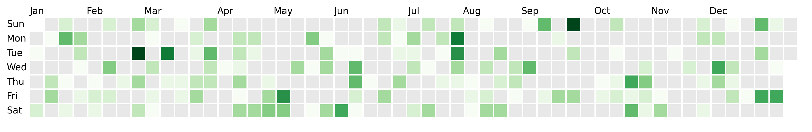
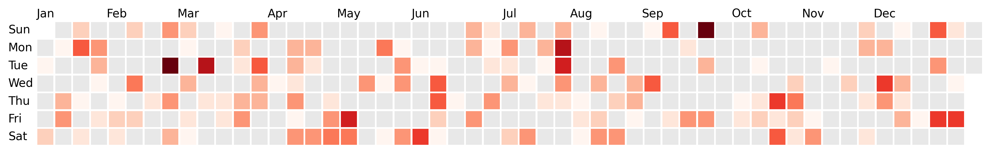
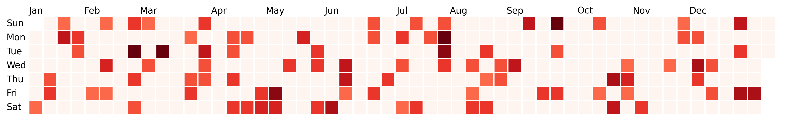
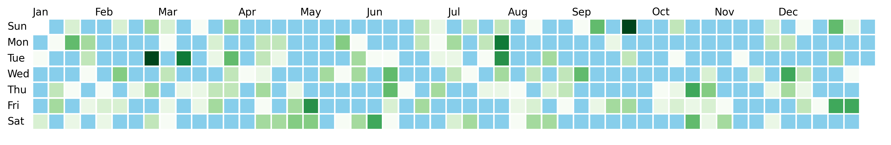
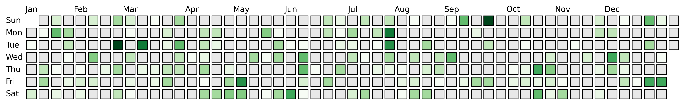
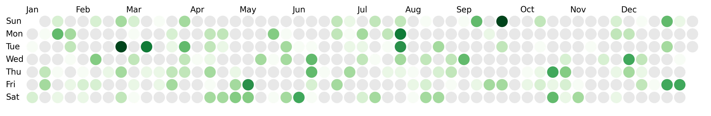
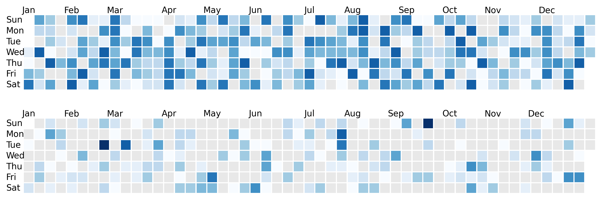
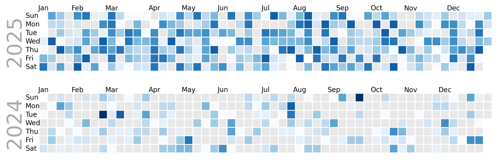

## Libraries

The easiest way to create calendar heatmaps is to use the `dayplot` library, which is based on matplotlib.

```python
import matplotlib.pyplot as plt
import dayplot as dp
```

Install with `pip install dayplot requests pandas`. Note that `pandas` and `requests` are only required to load the built-in dataset, used below.

If you don't need it, just use: `pip install dayplot`

## Dataset

`dayplot` provides a built-in dataset with simple features, that we can access with:

```python
df = dp.load_dataset()
df
```

:::output
::output-html{src="./output-1.html"}
:::

## Quick start

The easiest way to create your first calendar heatmap is to call the `calendar()` function, with the following argument:

- `dates`: a list of dates
- `values`: value for each date
- `start_date`: when should the calendar heatmap start?
- `end_date`: when should the calendar heatmap end?
- `ax`: the matplotlib Axes to use. Optionnal but recommended to avoid unexpected results.

```python
fig, ax = plt.subplots(figsize=(15, 6), dpi=300)
dp.calendar(
    dates=df["dates"],
    values=df["values"],
    start_date="2024-01-01",
    end_date="2024-12-31",
    ax=ax,
)
plt.show()
```

:::output

:::

## Colors

### Colormap

All colormap from matplotlib, or any colormap you might have created (using [pypalettes](https://python-graph-gallery.com/color-palette-finder/) or manually with a `LinearSegmentedColormap` object) can be used to change the colormap

```python
fig, ax = plt.subplots(figsize=(15, 6), dpi=300)
dp.calendar(
    dates=df["dates"],
    values=df["values"],
    start_date="2024-01-01",
    end_date="2024-12-31",
    cmap="Reds",  # red-ish colormap
    ax=ax,
)
plt.show()
```

:::output

:::

You can also control the range of the colormap with `vmin`, `vmax` and `vcenter`. Those can be important arguments as they control how the colormap behaves depending on the values.

```python
fig, ax = plt.subplots(figsize=(15, 6), dpi=300)
dp.calendar(
    dates=df["dates"],
    values=df["values"],
    start_date="2024-01-01",
    end_date="2024-12-31",
    cmap="Reds",
    vmin=2,
    vcenter=3,
    vmax=10,
    ax=ax,
)
plt.show()
```

:::output

:::

### Color for missing values

By default, dates with no values are lightgrey, but we can change that with the `color_for_none` argument:

```python
fig, ax = plt.subplots(figsize=(15, 6), dpi=300)
dp.calendar(
    dates=df["dates"],
    values=df["values"],
    start_date="2024-01-01",
    end_date="2024-12-31",
    color_for_none="skyblue",  # light blue color
    ax=ax,
)
plt.show()
```

:::output

:::

### Edgecolor

```python
fig, ax = plt.subplots(figsize=(15, 6), dpi=300)
dp.calendar(
    dates=df["dates"],
    values=df["values"],
    start_date="2024-01-01",
    end_date="2024-12-31",
    edgecolor="black",  # black egdecolor
    edgewidth=1,  # required to make the edges visible
    mutation_scale=0.8,  # smaller boxes
    ax=ax,
)
plt.show()
```

:::output

:::

## Boxstyle

By default, `dayplot` draws square, but we can easily change it with the `boxstyle` argument:

```python
fig, ax = plt.subplots(figsize=(15, 6), dpi=300)
dp.calendar(
    dates=df["dates"],
    values=df["values"],
    start_date="2024-01-01",
    end_date="2024-12-31",
    boxstyle="circle",  # circle
    ax=ax,
)
plt.show()
```

:::output

:::

```python
fig, ax = plt.subplots(figsize=(15, 6), dpi=300)
dp.calendar(
    dates=df["dates"],
    values=df["values"],
    start_date="2024-01-01",
    end_date="2024-12-31",
    boxstyle="round",  # round
    ax=ax,
)
plt.show()
```

:::output

:::

```python
fig, ax = plt.subplots(figsize=(15, 6), dpi=300)
dp.calendar(
    dates=df["dates"],
    values=df["values"],
    start_date="2024-01-01",
    end_date="2024-12-31",
    boxstyle="sawtooth",  # sawtooth
    ax=ax,
)
plt.show()
```

:::output

:::

## Multiple years

`dayplot` draws the calendar heatmap on a matplotlib Axes (or subplot, if you prefer).

This gives full control in the layout of the final chart. For example, in order to plot 2 calendar heatmaps on top of each other, we just have to create a Figure with 2 Axes:

```python
fig, (ax1, ax2) = plt.subplots(nrows=2, figsize=(16, 4), dpi=300)

# 2025 heatmap
dp.calendar(
    dates=df["dates"],
    values=df["values"],
    start_date="2025-01-01",
    end_date="2025-12-31",
    cmap="Blues",
    ax=ax1,  # top axes
)

# 2024 heatmap
dp.calendar(
    dates=df["dates"],
    values=df["values"],
    start_date="2024-01-01",
    end_date="2024-12-31",
    cmap="Blues",
    ax=ax2,  # bottom axes
)

plt.show()
```

:::output

:::

In order to make it obvious which year is which heatmap, let's add labels:

```python
fig, (ax1, ax2) = plt.subplots(nrows=2, figsize=(16, 4), dpi=300)

# 2025 heatmap
dp.calendar(
    dates=df["dates"],
    values=df["values"],
    start_date="2025-01-01",
    end_date="2025-12-31",
    cmap="Blues",
    ax=ax1,  # top axes
)

# 2024 heatmap
dp.calendar(
    dates=df["dates"],
    values=df["values"],
    start_date="2024-01-01",
    end_date="2024-12-31",
    cmap="Blues",
    ax=ax2,  # bottom axes
)

# labels
text_args = dict(x=-4, y=3.5, size=30, rotation=90, color="#aaa", va="center")
ax1.text(s="2025", **text_args)
ax2.text(s="2024", **text_args)

plt.show()
```

:::output

:::

## Going further

- [dayplot full documentation](https://y-sunflower.github.io/dayplot/)
- [learn more about time series in general](/timeseries)
