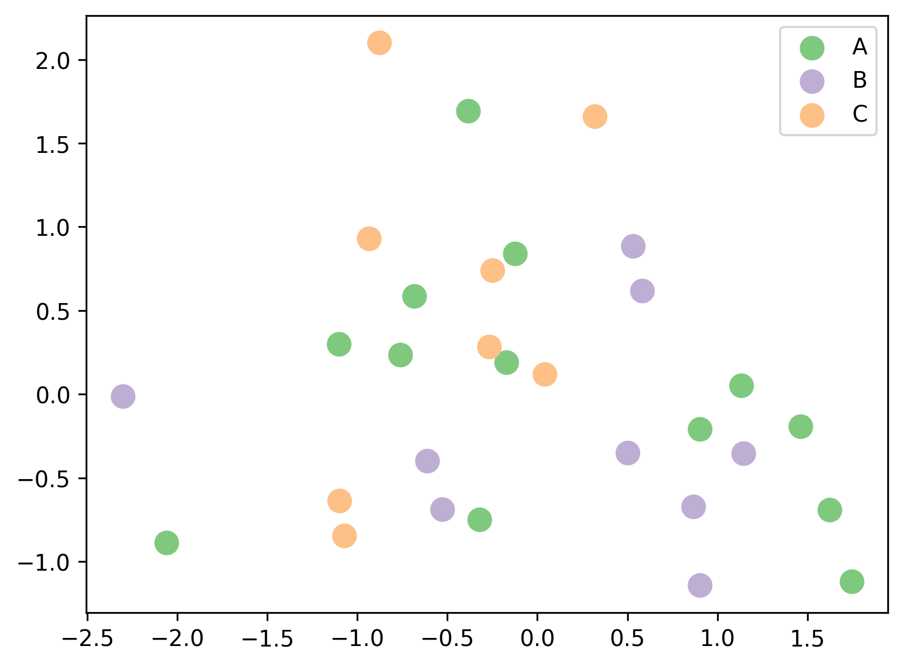

## Palettes

When working with colors, it's important to understand the difference between

- **sequential** palettes, which are used for ordered/numerical data that progresses from low to high
- **diverging** palettes, which are used for ordered/numerical data that has a critical midpoint, such as zero
- **qualitative** palettes, which are used for unordered/categorical data

In this post, we'll focus on **qualitative palettes**. These palettes are used to represent unordered/categorical data, such as different species of animals or different types of fruits.

## Available palettes by default

Here are the available default qualitative palettes in [matplotlib](/matplotlib):


## How to use a qualitative palette

Now let's see how to use them in practice. We start by looking at how they look and then choose the one that fits our taste the best.

```python
import matplotlib.pyplot as plt
```

```python
plt.get_cmap('Pastel1')
```

:::output

:::

```python
plt.get_cmap('tab20')
```

:::output

:::

```python
plt.get_cmap('Accent')
```

:::output

:::

Let's say you like the `Accent` palette and want to use to **color the points** in a [scatter plot](/scatter-plot) in matplotlib. Here's how you can do it:

- Load the necessary libraries

```python
# Load libraries
import matplotlib.pyplot as plt
import pandas as pd
import numpy as np
import random

# Fix random seed for reproducibility
np.random.seed(1)
```

- Create some data

```python
# Create some data
size = 30
data = pd.DataFrame({
   'x': np.random.randn(size),
   'y': np.random.randn(size),
   'cat': random.choices(['A', 'B', 'C'], k=size)
})
data.head()
```

:::output
::output-html{src="./output-4.html"}
:::

- Create a scatter plot with the `Accent` palette

```python
# Iniate a figure for the scatter plot
fig, ax = plt.subplots(dpi=300)

# Define our colormap
cmap = plt.get_cmap('Accent')

# Create a scatter plot with Accent colormap
for i, (cat, df) in enumerate(data.groupby('cat')):
   ax.scatter(df['x'], df['y'], label=cat, color=cmap(i), s=100)

# Add a legend
ax.legend()

# Display the plot
plt.show()
```

:::output

:::

## Going further

### Palette finder

Browse the [color palette finder](/color-palette-finder) to find your dream palette!


<br>

### Related

- the [color section of the gallery](/python-colors)
- discover the [continuous palettes](/available-continuous-palettes) available in Matplotlib
- available [named colors](/available-colors-in-matplotlib) in Matplotlib
