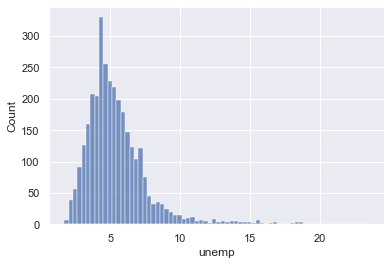

> This example comes directly from the plotly [official documentation](https://plotly.com/python/choropleth-maps/). Plotly nicely agreed to share this example here, but you should definitely have a look to their doc.

## Numeric data

A [choropleth map](https://python-graph-gallery.com/choropleth-map) displays the value of a numeric variable as a color for each region of a map. In this example, we will consider the unemployment rate of each county in the US. Let's load this variable and check its distribution:

```python
# Import the pandas library
import pandas as pd
import matplotlib.pyplot as plt

# Import the data from the web
df = pd.read_csv("https://raw.githubusercontent.com/plotly/datasets/master/fips-unemp-16.csv",
                   dtype={"fips": str})

                   # Check the distribution of the variable with seaborn:
import seaborn as sns
sns.set_theme(style="darkgrid")
sns.histplot(data=df, x="unemp")
plt.show();
```

:::output

:::

## Choropleth

`plotly.express` allows to build the choropleth map thanks to its `choropleth()` function. Note that setting the `scope` parameter to `usa` allows to set states like the Hawaii or Alaska to be moved close to the rest of the country.

```python
# Load the county boundary coordinates
from urllib.request import urlopen
import json
with urlopen('https://raw.githubusercontent.com/plotly/datasets/master/geojson-counties-fips.json') as response:
    counties = json.load(response)

# Build the choropleth
import plotly.express as px
fig = px.choropleth(df, 
    geojson=counties, 
    locations='fips', 
    color='unemp',
    color_continuous_scale="Viridis",
    range_color=(0, 12),
    scope="usa",
    labels={'unemp':'unemployment rate'}
)
fig.update_layout(margin={"r":0,"t":0,"l":0,"b":0})

# Improve the legend
fig.update_layout(coloraxis_colorbar=dict(
    thicknessmode="pixels", thickness=10,
    lenmode="pixels", len=150,
    yanchor="top", y=0.8,
    ticks="outside", ticksuffix=" %",
    dtick=5
))

fig.show()
```

Save as html if needed:

```python
# If you need to save this file as a standalone html file:
fig.write_html("../../static/interactiveCharts/choropleth-map-plotly-python.html")
```

Include it in a jupyter notebook with an `iframe`:

```html
%%html
<iframe src="../../interactiveCharts/choropleth-map-plotly-python.html" width="800" height="600" title="Choropleth map with plotly" style="border:none"></iframe>
```

:::output
::output-html{src="./output-2.html"}
:::
