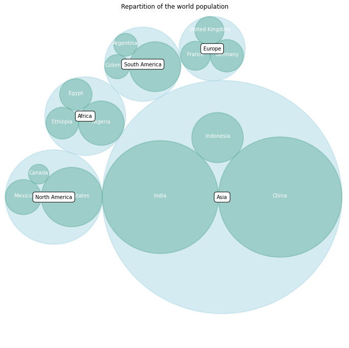

## 📍 The Data

This example considers a hierarchical dataset. The world is split by continents. Continents are split by country. Each country has a value (population size). Our goal is to represent each country as a circle, its size being proportional to its population.

Let's create such a dataset:

```python
data = [{'id': 'World', 'datum': 6964195249, 'children': [
    {'id': "North America", 'datum': 450448697,
               'children': [
                   {'id': "United States", 'datum': 308865000},
                   {'id': "Mexico", 'datum': 107550697},
                   {'id': "Canada", 'datum': 34033000}
               ]},
    {'id': "South America", 'datum': 278095425,
     'children': [
         {'id': "Brazil", 'datum': 192612000},
         {'id': "Colombia", 'datum': 45349000},
         {'id': "Argentina", 'datum': 40134425}
     ]},
    {'id': "Europe", 'datum': 209246682,
     'children': [
         {'id': "Germany", 'datum': 81757600},
         {'id': "France", 'datum': 65447374},
         {'id': "United Kingdom", 'datum': 62041708}
     ]},
    {'id': "Africa", 'datum': 311929000,
     'children': [
         {'id': "Nigeria", 'datum': 154729000},
         {'id': "Ethiopia", 'datum': 79221000},
         {'id': "Egypt", 'datum': 77979000}
     ]},
    {'id': "Asia", 'datum': 2745929500,
     'children': [
                   {'id': "China", 'datum': 1336335000},
                   {'id': "India", 'datum': 1178225000},
                   {'id': "Indonesia", 'datum': 231369500}
     ]}
]}]
```

## 🙇‍♂️ Compute circle position

We need an algorithm that computes the position of each country and continent circles, together with their radius. Fortunately, the `circlize` library is here. Its `circlify()` function does exactly that 😍

```python
# import the circlify library
import circlify

# Compute circle positions thanks to the circlify() function
circles = circlify.circlify(
    data,
    show_enclosure=False,
    target_enclosure=circlify.Circle(x=0, y=0, r=1)
)
```

Have a look to the `circles` object, it provides exactly that 🎉.

## 🔨 Build the viz

Let's be honnest, that's quite a bit of code to get a decent graph 😞. The `circlize` library has a `bubble()` function that allows to do a simple circle pack with one line of code, but it does not allow to customize the chart.

So once more `matplotlib` is our best friend for the rendering part. Here I'm printing the layers from the bottom to the top of the figure: first the cirles for the highest level of hierarchy (continent), then circle and labels for countries, then continent labels.

```python
# import libraries
import circlify
import matplotlib.pyplot as plt

# Create just a figure and only one subplot
fig, ax = plt.subplots(figsize=(14, 14))

# Title
ax.set_title('Repartition of the world population')

# Remove axes
ax.axis('off')

# Find axis boundaries
lim = max(
    max(
        abs(circle.x) + circle.r,
        abs(circle.y) + circle.r,
    )
    for circle in circles
)
plt.xlim(-lim, lim)
plt.ylim(-lim, lim)

# Print circle the highest level (continents):
for circle in circles:
    if circle.level != 2:
        continue
    x, y, r = circle
    ax.add_patch(plt.Circle((x, y), r, alpha=0.5,
                 linewidth=2, color="lightblue"))

# Print circle and labels for the highest level:
for circle in circles:
    if circle.level != 3:
        continue
    x, y, r = circle
    label = circle.ex["id"]
    ax.add_patch(plt.Circle((x, y), r, alpha=0.5,
                 linewidth=2, color="#69b3a2"))
    plt.annotate(label, (x, y), ha='center', color="white")

# Print labels for the continents
for circle in circles:
    if circle.level != 2:
        continue
    x, y, r = circle
    label = circle.ex["id"]
    plt.annotate(label, (x, y), va='center', ha='center', bbox=dict(
        facecolor='white', edgecolor='black', boxstyle='round', pad=.5))
```

:::output

:::
