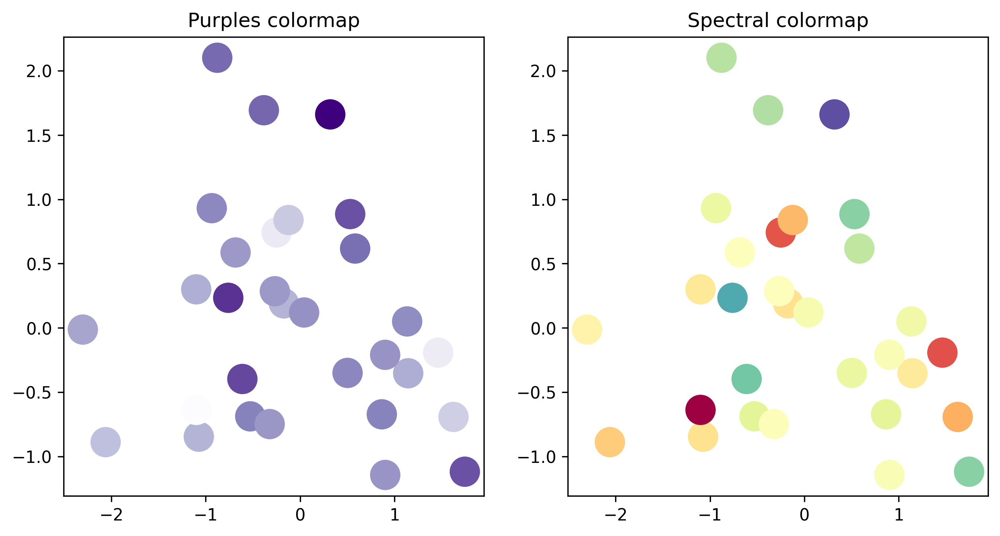

## Palettes

When working with colors, it's important to understand the difference between

- **sequential** palettes, which are used for ordered/numerical data that progresses from low to high
- **diverging** palettes, which are used for ordered/numerical data that has a critical midpoint, such as zero
- **qualitative** palettes, which are used for unordered/categorical data

In this post, we'll focus on **sequential and diverging palettes**. These palettes are used to represent ordered data, such as a range of temperatures or a scale of emotions.

## Available palettes by default

Here are the available default continuous palettes in [matplotlib](/matplotlib):


## How to use a continuous palette

### Sequential palettes

Sequential palettes are used for ordered data that progresses **from low to high**. For example, a sequential palette can be used to represent a range of temperatures.

### Diverging palettes

Diverging palettes are used for ordered data that has a **critical midpoint**, such as zero. For example, a diverging palette can be used to represent a scale of emotions, where zero represents a neutral emotion.

Let's see how these palettes look in practice:

```python
import matplotlib.pyplot as plt
```

- this is a sequential palette:

```python
plt.get_cmap('Purples')
```

:::output

:::

We easily see the progression from low to high values.

- this is a diverging palette:

```python
plt.get_cmap('Spectral')
```

:::output

:::

Here we see the midpoint at zero, with values diverging in both directions.

Now that we understand the difference between **sequential** and **diverging** palettes, let's see how to use them in Python using matplotlib. Here's what to do:

- Load the necessary libraries

```python
# Load libraries
import matplotlib.pyplot as plt
import pandas as pd
import numpy as np
import random

# Fix random seed for reproducibility
np.random.seed(1)
```

- Create some data

```python
# Create some data
size = 30
data = pd.DataFrame({
   'x': np.random.randn(size),
   'y': np.random.randn(size),
   'z': np.random.randn(size)
})
data.head()
```

:::output
::output-html{src="./output-3.html"}
:::

- Create 2 scatter plots with both palettes

```python
# Iniate a figure for the scatter plot
fig, axs = plt.subplots(ncols=2, dpi=300, figsize=(10, 5))

# Define our colormaps
cmap1 = plt.get_cmap('Purples')
cmap2 = plt.get_cmap('Spectral')

# Left chart
axs[0].scatter(data['x'], data['y'], c=data['z'], s=300, cmap=cmap1)
axs[0].set_title('Purples colormap')

# Right chart
axs[1].scatter(data['x'], data['y'], c=data['z'], s=300, cmap=cmap2)
axs[1].set_title('Spectral colormap')

# Display the plot
plt.show()
```

:::output

:::

## Going further

### Palette finder

Browse the [color palette finder](/color-palette-finder) to find your dream palette!


<br>

### Related

- the [color section of the gallery](/python-colors)
- discover the [categorical palettes](/categorical-color-palette/) available in Matplotlib
- available [named colors](/available-colors-in-matplotlib) in Matplotlib
