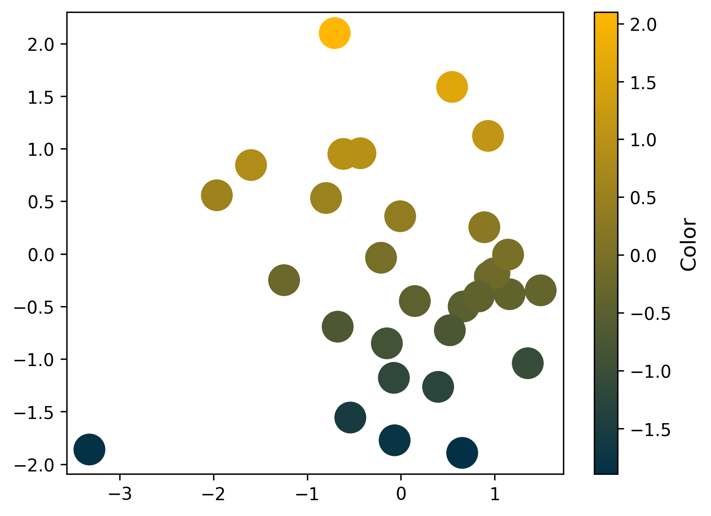
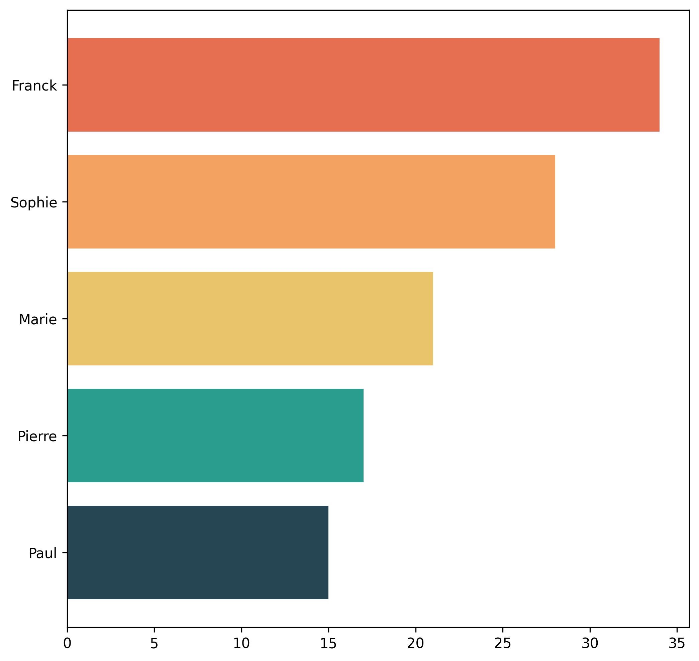

## Create your own continuous colormap

With [matplotlib](/matplotlib), you can easily work with **your own custom** qualitative palettes thanks to the `ListedColormap()` class.

Here's how you can create one:

```python
from matplotlib.colors import LinearSegmentedColormap

# Define your custom color palette
custom_colors = [
   '#023047', # first color
   '#ffb703' # last color
]

# Create a ListedColormap
custom_cmap = LinearSegmentedColormap.from_list("custom_gradient", custom_colors)
custom_cmap
```

:::output

:::

And in order to use it, it's pretty **easy**. We just have to specify: `cmap=custom_cmap` (since that's the named with gave it), and done!

```python
import matplotlib.pyplot as plt
import numpy as np
import pandas as pd

size = 30
x = np.random.randn(size),
y = np.random.randn(size),

# Iniate a figure for the scatter plot
fig, ax = plt.subplots(dpi=300)

# Create a scatter plot
ax.scatter(x, y, c=y, s=300, cmap=custom_cmap)

# Add a colorbar
cbar = plt.colorbar(ax.collections[0], ax=ax, orientation='vertical')
cbar.set_label('Color', fontsize=12)

# Display the plot
plt.show()
```

:::output

:::

## Create your own categorical colormap

For creating [categorical palettes](/categorical-color-palette/), you have to use the `ListedColormap()` class. Here's how you can create one:

```python
from matplotlib.colors import ListedColormap

# Define your custom color palette
custom_colors = ['#264653', '#2a9d8f', '#e9c46a', '#f4a261', '#e76f51']

# Create a ListedColormap
custom_cmap = ListedColormap(custom_colors)
custom_cmap
```

:::output

:::

And in order to use it, it's pretty much the **same as before**. The difference is that we use the `color` argument and pass it the `custom_cmap.colors`, which is a list with the colors.

```python
# load libraries
import pandas as pd
import matplotlib.pyplot as plt

# some simple data
x = ['Paul', 'Pierre', 'Marie', 'Sophie', 'Franck']
y = [15, 17, 21, 28, 34]

# create a bar plot
fig, ax = plt.subplots(figsize=(8,8), dpi=300)
ax.barh(x, y, color=custom_cmap.colors)
plt.show()
```

:::output

:::

## Create Palettes vs. Use Existing Ones

Even though color is a **crucial** element in a chart, you don't have to do **everything yourself**. Many people have already created thousands of **excellent** colormaps specifically for this purpose.

Creating a good color palette is **far more challenging** than it seems and requires a solid understanding of color compatibility.

Fortunately, Matplotlib provides a variety of [categorical palettes](/categorical-color-palette) and [continuous ones](/continuous-color-palette), and the [pypalettes library](/color-palette-finder) adds **2,500 additional palettes**. With these tools, **you're sure to find** your dream palette.

_Note: The gallery has a dedicated page to browse all these palettes, so go [check it out here](/color-palette-finder)._

## Going further

### Palette finder

Browse the [color palette finder](/color-palette-finder) to find your dream palette!


<br>

### Related

- the [color section of the gallery](/python-colors)
- learn [how to use a colormaps](/587-how-to-use-colormap)
- available [named colors](/available-colors-in-matplotlib) in Matplotlib
