## The data

Let's get started by importing libraries and loading the data

```python
import palmerpenguins

import matplotlib.pyplot as plt
import numpy as np
```

The Penguins data set used here was collected and made available by [Dr. Kristen Gorman](https://www.uaf.edu/cfos/people/faculty/detail/kristen-gorman.php) at the [Palmer Station, Antarctica LTER](https://pal.lternet.edu/). This dataset was popularized by [Allison Horst](https://www.allisonhorst.com/) in her R package [`palmerpenguins`](https://allisonhorst.github.io/palmerpenguins/) with the goal to offer an alternative to the iris dataset for data exploration and visualization.

```python
data = palmerpenguins.load_penguins()
data.head()
```

:::output
::output-html{src="./output-1.html"}
:::

Today's goal is to show you **a lot of examples** that show how to customize different aspects of a legend. Hopefully, after reading this post, you will be able to take the pieces you need and build your own custom legend.

The base plot is going to be a scatterplot of flipper length vs bill length, colored by species.

```python
FLIPPER_LENGTH = data["flipper_length_mm"].values
BILL_LENGTH = data["bill_length_mm"].values

SPECIES = data["species"].values
SPECIES_ = np.unique(SPECIES)

COLORS = ["#1B9E77", "#D95F02", "#7570B3"]
```

## Default legend

Let's get started by creating the chart and calling `ax.legend()` to see what is matplotlib default behavior when it come to adding legends.

```python
fig, ax = plt.subplots(figsize=(8, 8))
for species, color in zip(SPECIES_, COLORS):
    idxs = np.where(SPECIES == species)
    # No legend will be generated if we don't pass label=species
    ax.scatter(
        FLIPPER_LENGTH[idxs],
        BILL_LENGTH[idxs],
        label=species,
        s=50,
        color=color,
        alpha=0.7,
    )

ax.legend()
plt.show()
```

:::output

:::

By default, Matplotlib automatically generates a legend that correctly reflects the colors and labels we passed. Usually, it also places the legend in a good place. But that's not the case here since the legend overlaps with one of the dots.

## Markers are automatically accurate

In addition, Matplotlib also reflects the different markers in the chart. So you should just care about using some nice markers and the legend will update for free:

```python
# The markers we use in the scatterplot
MARKERS = ["o", "^", "s"]  # circle, triangle, square

fig, ax = plt.subplots(figsize=(8, 8))

for species, color, marker in zip(SPECIES_, COLORS, MARKERS):
    idxs = np.where(SPECIES == species)
    ax.scatter(
        FLIPPER_LENGTH[idxs],
        BILL_LENGTH[idxs],
        label=species,
        s=50,
        color=color,
        marker=marker,
        alpha=0.7,
    )

ax.legend()
plt.show()
```

:::output
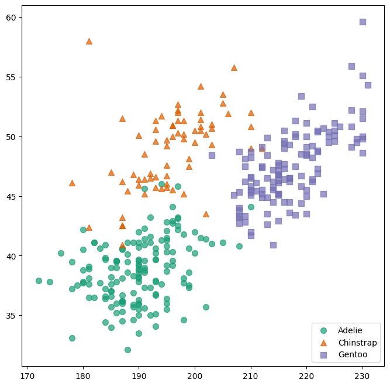
:::

Now, let's see a lot of different approaches one can use to position the legend in different places.

## Adjust the legend position with `loc`

The first thing one can do is pass something to the `loc` argument. This can be either a string in plain English indicating the position of the label, or a number. A complete description of these codes can be found in the [matplotlib doc](https://matplotlib.org/stable/api/_as_gen/matplotlib.pyplot.legend.html) of the `loc` argument.

```python
fig, ax = plt.subplots(figsize=(8, 8))
for species, color in zip(SPECIES_, COLORS):
    idxs = np.where(SPECIES == species)
    ax.scatter(
        FLIPPER_LENGTH[idxs],
        BILL_LENGTH[idxs],
        label=species,
        s=50,
        color=color,
        alpha=0.7,
    )

# Lower right corner is a better place for this legend
ax.legend(loc="lower right")
plt.show()

# The same result with
# ax.legend(loc=4);
```

:::output
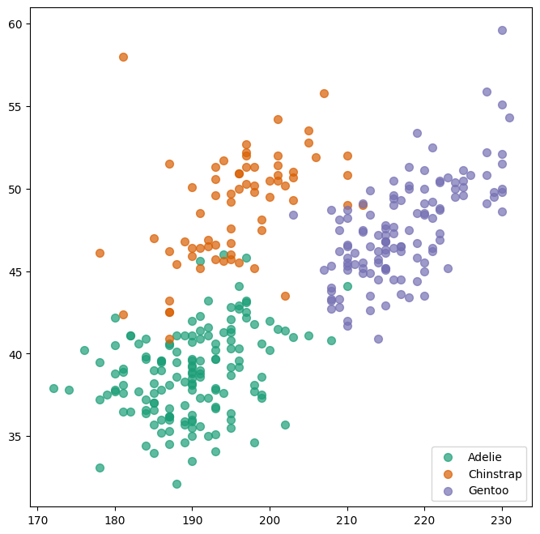
:::

## Legend outside the plot area with `subplots_adjust`

It's also possible to take it position the legend outside the plotting region (i.e. out of the the Axis). To do so, we need to make room in the figure real estate thanks to the `subplots_adjust()` function, and then use the same `loc` argument described above:

```python
fig, ax = plt.subplots(figsize=(8, 8))
for species, color in zip(SPECIES_, COLORS):
    idxs = np.where(SPECIES == species)
    ax.scatter(
        FLIPPER_LENGTH[idxs],
        BILL_LENGTH[idxs],
        label=species,
        s=50,
        color=color,
        alpha=0.7,
    )

# Let's say we want it on the right side.
# First, make room on the right side of the figure.
fig.subplots_adjust(right=0.8)


# Add the legend
# Pass `fig.transFigure` as the bounding box transformation 'bbox_transform'
# loc="center left" and bbox_to_anchor=(0.8, 0.5) indicate the left border
# of the legend is placed at 0.8 in the x axis of the figure, and it is
# vertically centered at y = 0.5
ax.legend(loc="center left", bbox_to_anchor=(0.8, 0.5), bbox_transform=fig.transFigure)
plt.show()
```

:::output
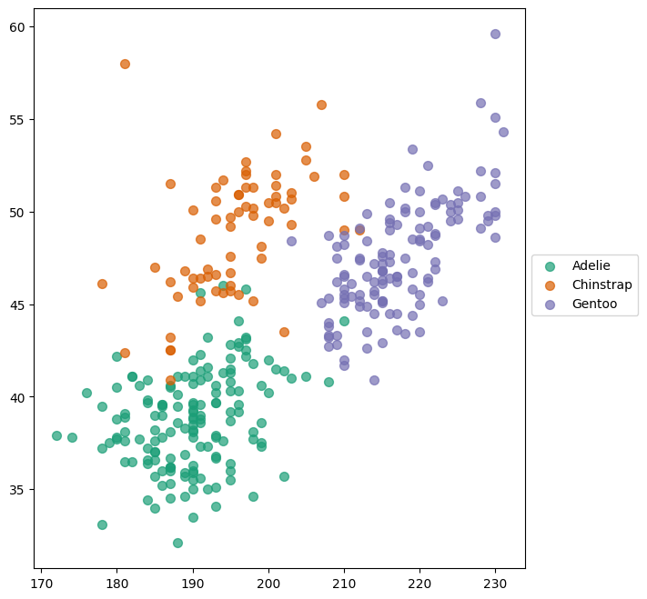
:::

One could do the same thing to place the legend on the left side of the plot

```python
fig, ax = plt.subplots(figsize=(8, 8))
for species, color in zip(SPECIES_, COLORS):
    idxs = np.where(SPECIES == species)
    ax.scatter(
        FLIPPER_LENGTH[idxs],
        BILL_LENGTH[idxs],
        label=species,
        s=50,
        color=color,
        alpha=0.7,
    )


# Make room on the left side of the figure.
fig.subplots_adjust(left=0.2)

# Add the legend
# Now x = 0.16 to leave some space for the axis tick labels
ax.legend(
    loc="center right", bbox_to_anchor=(0.16, 0.5), bbox_transform=fig.transFigure
)
plt.show()
```

:::output
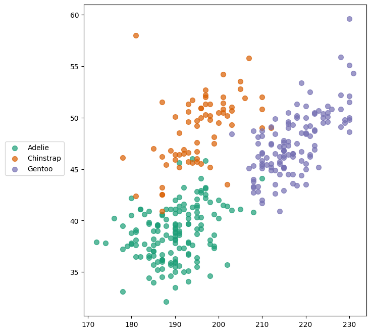
:::

Can we have the legend on top/bottom? Of course we can! In this case, it makes much more sense to have the entries one next to each other, so we use `ncol=3` to tell Matplotlib the legend has three columns.

```python
fig, ax = plt.subplots(figsize=(8, 6))
for species, color in zip(SPECIES_, COLORS):
    idxs = np.where(SPECIES == species)
    ax.scatter(
        FLIPPER_LENGTH[idxs],
        BILL_LENGTH[idxs],
        label=species,
        s=50,
        color=color,
        alpha=0.7,
    )

# Make room on top now
fig.subplots_adjust(top=0.8)

ax.legend(
    loc="lower center",  # "upper center" puts it below the line
    ncol=3,
    bbox_to_anchor=(0.5, 0.8),
    bbox_transform=fig.transFigure,
)
plt.show()
```

:::output
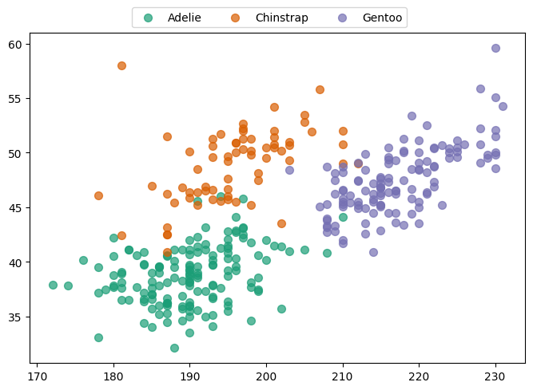
:::

```python
fig, ax = plt.subplots(figsize=(8, 6))
for species, color in zip(SPECIES_, COLORS):
    idxs = np.where(SPECIES == species)
    ax.scatter(
        FLIPPER_LENGTH[idxs],
        BILL_LENGTH[idxs],
        label=species,
        s=50,
        color=color,
        alpha=0.7,
    )

# Make room on below
fig.subplots_adjust(bottom=0.2)

# Again, leave some extra space for the axis tick labels
ax.legend(
    loc="upper center",
    ncol=3,
    bbox_to_anchor=(0.5, 0.16),
    bbox_transform=fig.transFigure,
)
plt.show()
```

:::output
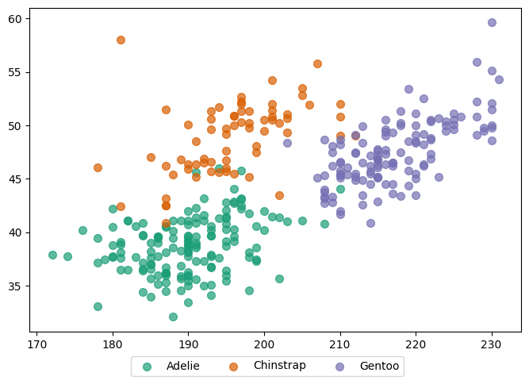
:::

## Align legend with axis

Is it possible to align the plot to the right or left? Sure!

One difference with the plots above, is that here we don't use `bbox_transform=fig.transFigure`. If we want to align the boundary of the legend with the boundary of the axis, it's easier to use the default which is the axis. Note the value `1.05`. It means the legend is 5% of the height of the axis above its top boundary.

```python
fig, axes = plt.subplots(2, 1, figsize=(8, 12), tight_layout=True)
for species, color in zip(SPECIES_, COLORS):
    idxs = np.where(SPECIES == species)
    axes[0].scatter(
        FLIPPER_LENGTH[idxs],
        BILL_LENGTH[idxs],
        label=species,
        s=50,
        color=color,
        alpha=0.7,
    )

    axes[1].scatter(
        FLIPPER_LENGTH[idxs],
        BILL_LENGTH[idxs],
        label=species,
        s=50,
        color=color,
        alpha=0.7,
    )

# borderaxespad = 0 means there's no padding between the border
# of the legend and the axis
axes[0].legend(
    loc="center left",
    ncol=3,
    bbox_to_anchor=[0, 1.05],
    borderaxespad=0,
)

axes[1].legend(
    loc="center right",
    ncol=3,
    bbox_to_anchor=[1, 1.05],
    borderaxespad=0,
);
```

:::output
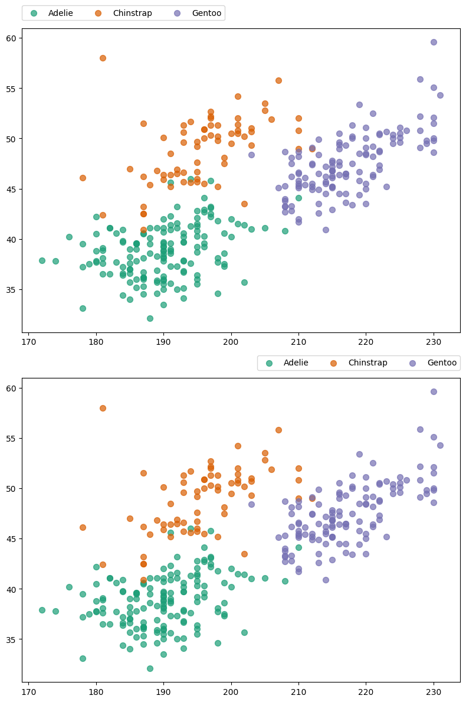
:::

## Customize labels

One can store the object returned by `ax.legend()` and do lot of interesting things with it.

The legend returned has a method `.get_texts()` that return a list of `matplotlib.text.Text` objects. These objects have **a lot** of methods one can use to customize the appearence of the text.

```python
fig, ax = plt.subplots(figsize=(8, 6))
for species, color in zip(SPECIES_, COLORS):
    idxs = np.where(SPECIES == species)
    ax.scatter(
        FLIPPER_LENGTH[idxs],
        BILL_LENGTH[idxs],
        label=species,
        s=50,
        color=color,
        alpha=0.7,
    )

legend = ax.legend(loc="lower right")

# Iterate over texts.
# Method names are quite self-describing
for text in legend.get_texts():
    text.set_color("#b13f64")
    text.set_fontstyle("italic")
    text.set_fontweight("bold")
    text.set_fontsize(14)

plt.show()
```

:::output
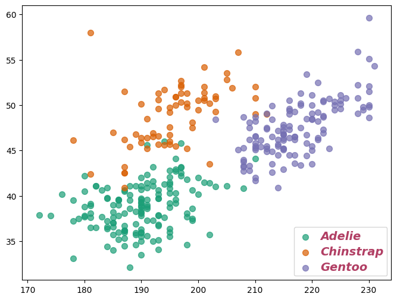
:::

Let's see another example with more tweaks:

```python
fig, ax = plt.subplots(figsize=(8, 8))
for species, color in zip(SPECIES_, COLORS):
    idxs = np.where(SPECIES == species)
    ax.scatter(
        FLIPPER_LENGTH[idxs],
        BILL_LENGTH[idxs],
        label=species,
        s=50,
        color=color,
        alpha=0.7,
    )

legend = ax.legend(loc="lower right", frameon=False)

for i, text in enumerate(legend.get_texts()):
    text.set_rotation(20)
    text.set_text(f"Label {i}")
    text.set_backgroundcolor("#d1afe8")
    text.set_fontsize(18)
    text.set_alpha(0.3)

plt.show()
```

:::output
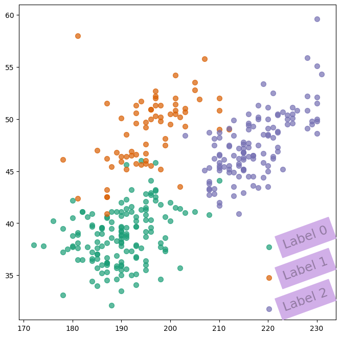
:::

So many things can be customized!

If you're interested in doing some research on your own, you can always call `dir(text)` to see what are the attributes and methods of the `text` object.

## Customize the title

So far, the legend does not have a title. Let's add one and customize some of its attributes:

```python
fig, ax = plt.subplots(figsize=(8, 6))
for species, color in zip(SPECIES_, COLORS):
    idxs = np.where(SPECIES == species)
    ax.scatter(
        FLIPPER_LENGTH[idxs],
        BILL_LENGTH[idxs],
        label=species,
        s=50,
        color=color,
        alpha=0.7,
    )

# Add a title
legend = ax.legend(title="Species", loc="lower right", title_fontsize=13)

# Align it to the left ("right" is also possible)
legend._legend_box.align = "left"

plt.show()
```

:::output

:::

Let's push a little further:

```python
fig, ax = plt.subplots(figsize=(8, 8))
for species, color in zip(SPECIES_, COLORS):
    idxs = np.where(SPECIES == species)
    ax.scatter(
        FLIPPER_LENGTH[idxs],
        BILL_LENGTH[idxs],
        label=species,
        s=50,
        color=color,
        alpha=0.7,
    )

# Legend without title
legend = ax.legend(loc="lower right")

# Set title manually. Just specify the text.
legend.set_title("Species")

# Object of class 'matplotlib.text.Text'.
# We can use any of the methods we have used for the label texts above.
title = legend.get_title()
title.set_color("#ca699d")
title.set_weight("bold")
title.set_size(16)

plt.show()
```

:::output
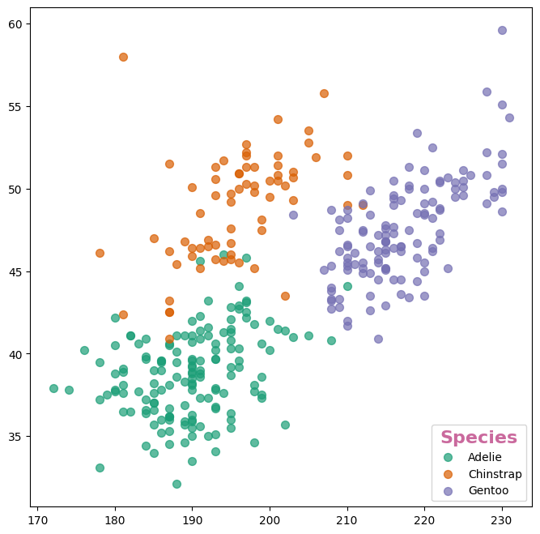
:::

And even further?!

```python
fig, ax = plt.subplots(figsize=(8, 6))
for species, color in zip(SPECIES_, COLORS):
    idxs = np.where(SPECIES == species)
    ax.scatter(
        FLIPPER_LENGTH[idxs],
        BILL_LENGTH[idxs],
        label=species,
        s=50,
        color=color,
        alpha=0.7,
    )

# Legend without title
legend = ax.legend(loc="lower right", frameon=False)

# Set title manually. Just specify the text.
legend.set_title("Species")

# It's possible to move the title to arbitrary positions with
# .set_x() and .set_y()... but play with caution!
title = legend.get_title()
title.set_color("#ca699d")
title.set_size(12)
title.set_x(-60)
title.set_y(-60)
title.set_rotation(90)

plt.show()
```

:::output
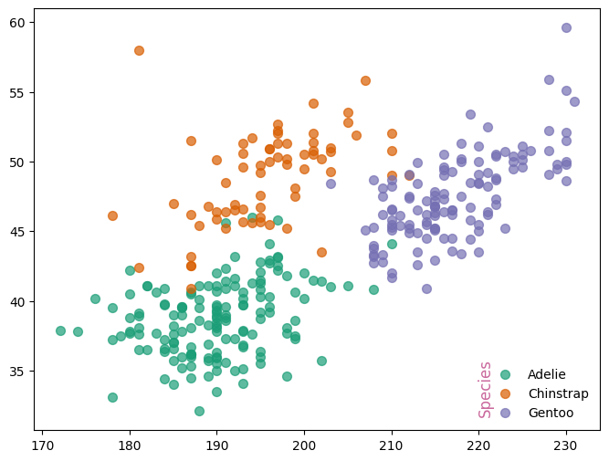
:::

## Customize the handles

```python
fig, ax = plt.subplots(figsize=(8, 8))
for species, color in zip(SPECIES_, COLORS):
    idxs = np.where(SPECIES == species)
    ax.scatter(
        FLIPPER_LENGTH[idxs],
        BILL_LENGTH[idxs],
        label=species,
        s=50,
        color=color,
        alpha=0.7,
    )

legend = ax.legend(
    loc="lower right", fontsize=14, markerscale=4, labelspacing=2, frameon=False
)
handles = legend.legend_handles

# There are many more hatches available in matplotlib
hatches = ["+", "x", "o"]
colors = ["#f6d2a9", "#ea8171", "#b13f64"]

for i, handle in enumerate(handles):
    handle.set_edgecolor("#6c2167")  # set_edgecolors
    handle.set_facecolor(colors[i])
    handle.set_hatch(hatches[i])
    handle.set_alpha(0.7)

plt.show()
```

:::output
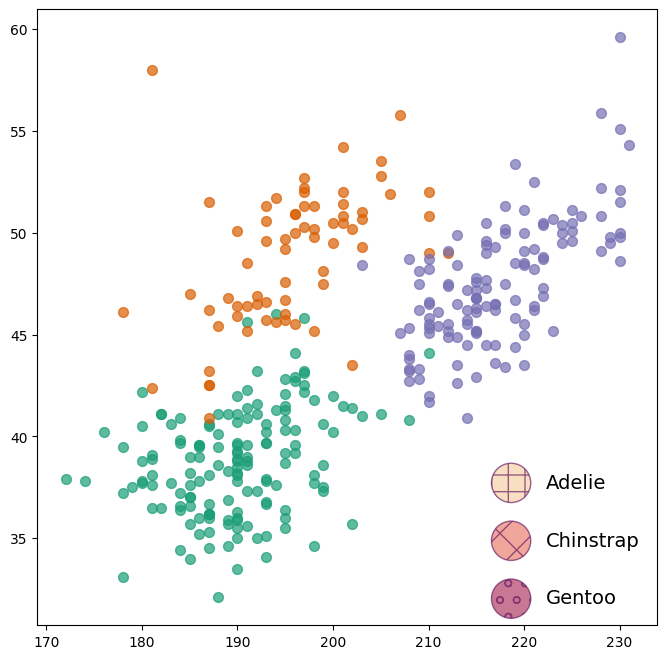
:::

## Customize the layout

Some relevant argument names and their meaning:

- `borderaxespad`: The pad between the axes and legend border, in font-size units.
- `borderpad`: The fractional whitespace inside the legend border, in font-size units.
- `columnspacing`: The spacing between columns, in font-size units.
- `handlelength`: The length of the legend handles, in font-size units.
- `handletextpad`: The pad between the legend handle and text, in font-size units.
- `labelspacing`: The vertical space between the legend entries, in font-size units.
- `markerscale`: The relative size of legend markers compared with the originally drawn ones.

```python
fig, ax = plt.subplots(figsize=(8, 6))
for species, color in zip(SPECIES_, COLORS):
    idxs = np.where(SPECIES == species)
    ax.scatter(
        FLIPPER_LENGTH[idxs],
        BILL_LENGTH[idxs],
        label=species,
        s=50,
        color=color,
        alpha=0.7,
    )

legend = ax.legend(
    loc="lower right",
    fontsize=14,
    borderaxespad=0.2,  # Legend closer to the border
    handletextpad=0.1,  # Distance between circle and label is smaller
    labelspacing=1.5,  # Vertical space between labels
    markerscale=2,  # The size of the dots is twice as large.
)

plt.show()
```

:::output
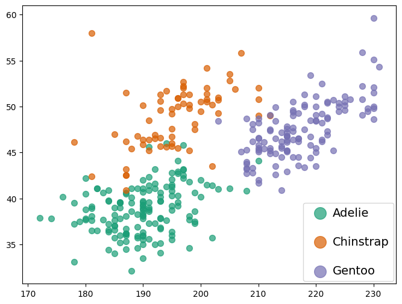
:::

Let's use a 3-column layout and customize the space between the columns:

```python
fig, ax = plt.subplots(figsize=(8, 6))
for species, color in zip(SPECIES_, COLORS):
    idxs = np.where(SPECIES == species)
    ax.scatter(
        FLIPPER_LENGTH[idxs],
        BILL_LENGTH[idxs],
        label=species,
        s=50,
        color=color,
        alpha=0.7,
    )

# Make room on top now
fig.subplots_adjust(top=0.8)

ax.legend(
    loc="lower center",
    ncol=3,
    bbox_to_anchor=(0.5, 0.8),
    bbox_transform=fig.transFigure,
    handletextpad=0.1,
    columnspacing=0.3,
);
```

:::output
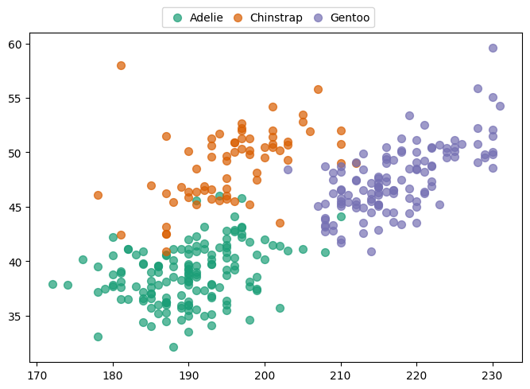
:::

And finally, an example customizing several aspects at the same time:

```python
fig, ax = plt.subplots(figsize=(8, 8))
for species, color in zip(SPECIES_, COLORS):
    idxs = np.where(SPECIES == species)
    ax.scatter(
        FLIPPER_LENGTH[idxs],
        BILL_LENGTH[idxs],
        label=species,
        s=50,
        color=color,
        alpha=0.7,
    )

legend = ax.legend(loc="lower right", fontsize=14, markerscale=2)

# Let's only pass the text here
legend.set_title("Species")

# Object of class 'matplotlib.text.Text'. We can use any of the methods
# we have used for the label texts above.
title = legend.get_title()
title.set_color("white")
title.set_weight("bold")
title.set_size(18)

# Customize legend patch
legend.legendPatch.set_facecolor("#d1afe8")
legend.legendPatch.set_edgecolor("#a9a9a9")
legend.legendPatch.set_linewidth(3)

plt.show()
```

:::output
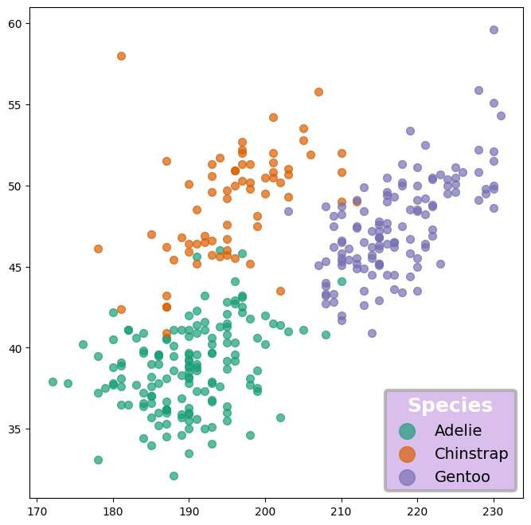
:::

## Where to go next? Some real examples

Wouldn't it be really cool to see how these things are used in real-life examples? Of course it would! The following is a list of highly customized visualizations made in Matplotlib that contain beautiful legends made with the tricks shown above. Have a look!

- [Circular barplot with Matplotlib](https://python-graph-gallery.com/web-circular-barplot-with-matplotlib): Actually not a legend, but a colorbar with discrete scales that looks very cool.
- [Radar chart with Matplotlib](https://python-graph-gallery.com/web-radar-chart-with-matplotlib): Shows how to manually overlay lines and dots in the same handle.
- [Chris Claremont's X-Men comics exploration with streamcharts in Matplotlib](https://python-graph-gallery.com/web-streamchart-with-matplotlib): One of the most beautiful charts in this collection. Shows how to position a legend in a visualization with multiple panels and customize several aspects.
- [Mario Kart 64 World Records with Python and Matplotlib](https://python-graph-gallery.com/web-lollipop-plot-with-python-mario-kart-64-world-records): Showcases how to put both a legend and a colormap.
- [The Office Ratings with Python and Matplotlib](https://python-graph-gallery.com/web-lollipop-plot-with-python-the-office): Shows how to mimic a legend from scratch when built-in functions aren't enough.
- [Time series with filled area and custom facetting in Matplotlib](https://python-graph-gallery.com/web-time-series-and-facetting-with-matplotlib): Shows how to create a legend with both lines and patches and how to place it in an arbitrary position in a visualization with multiple panels.
