## Libraries

In order to change the theme of our matplotlib charts, we need to use the `morethemes` package, that you can install with `pip install morethemes`.

```python
import morethemes as mt
```

## Default chart

`morethemes` provides a function that generates 4 charts with matplotlib. It's convenient to easily compare themes.

```python
# This displays various matplotlib charts
fig = mt.preview_theme()
```

You might recognize all the default matplotlib style. Let's improve them with **one line of code**.

## All themes

To apply a theme, you only have to run `mt.set_theme("theme_name")` before your matplotlib code. `"theme_name"` is the name of the theme and you can find [all available theme here](https://y-sunflower.github.io/morethemes/).

### Financial Times

To use the Financial Times theme, run `mt.set_theme("ft")`

```python
mt.set_theme("ft")

# This displays various matplotlib charts
mt.preview_theme()
```

:::output
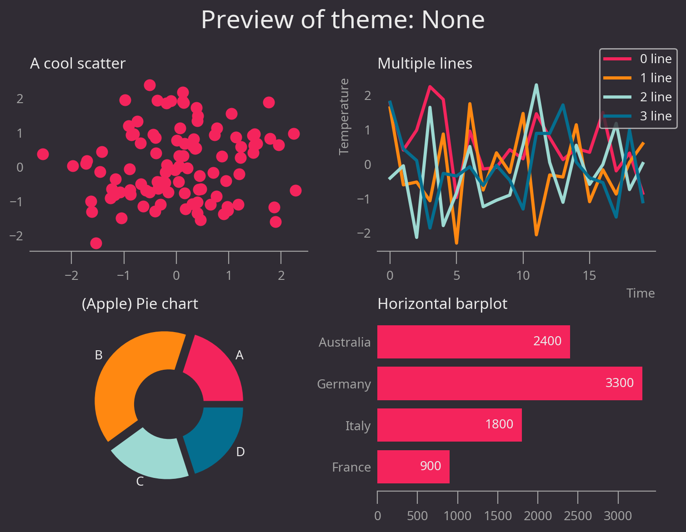
:::

### Wall Street Journal

To use the Wall Street Journal theme, run `mt.set_theme("wsj")`

```python
mt.set_theme("wsj")

# This displays various matplotlib charts
mt.preview_theme()
```

:::output
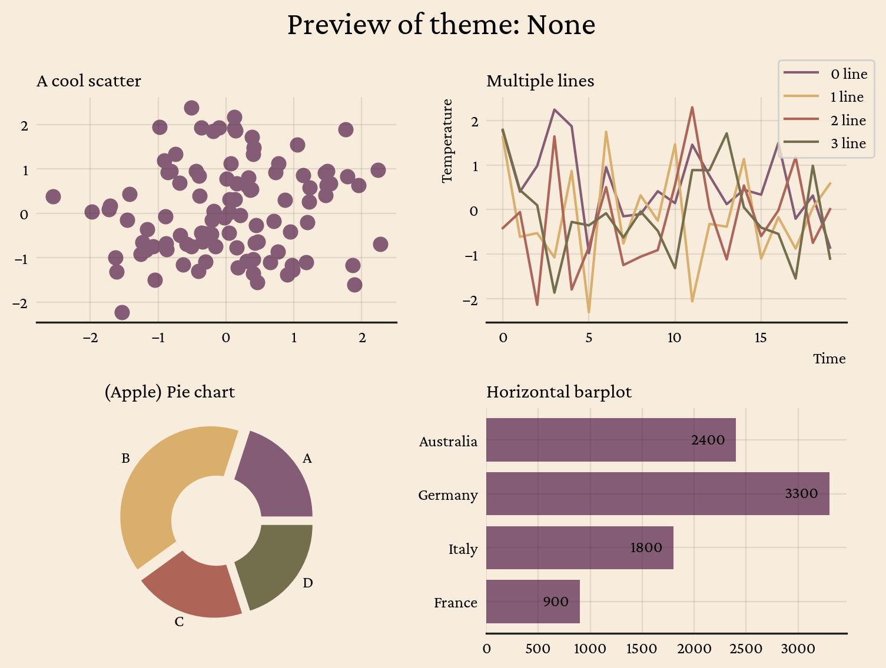
:::

### The Economist

To use the Economist theme, run `mt.set_theme("economist")`

```python
mt.set_theme("economist")

# This displays various matplotlib charts
mt.preview_theme()
```

:::output
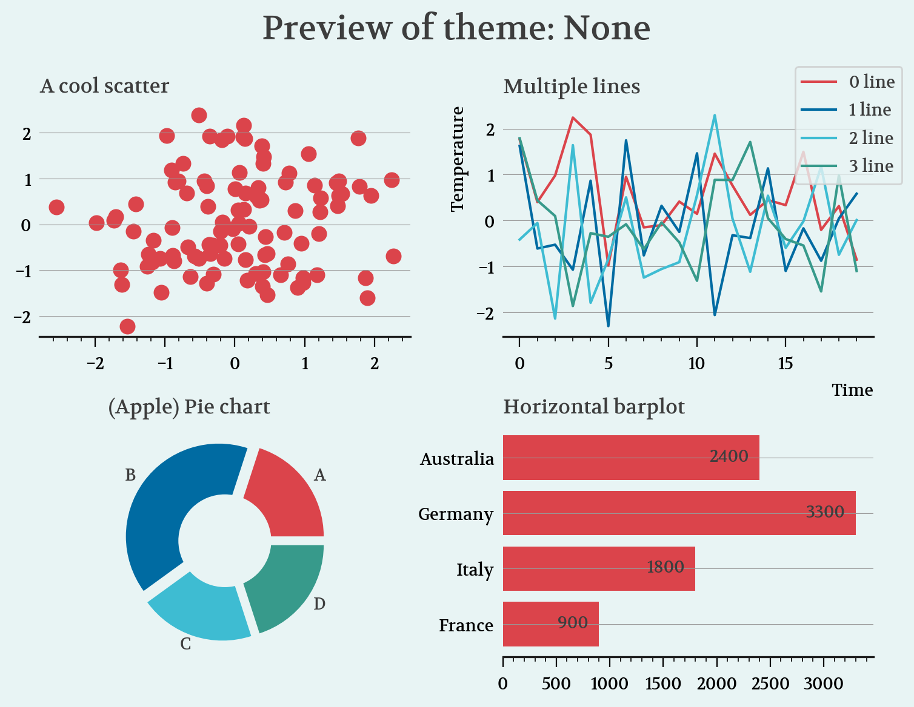
:::

### Urban

To use the Urban theme, run `mt.set_theme("urban")`

```python
mt.set_theme("urban")

# This displays various matplotlib charts
mt.preview_theme()
```

:::output
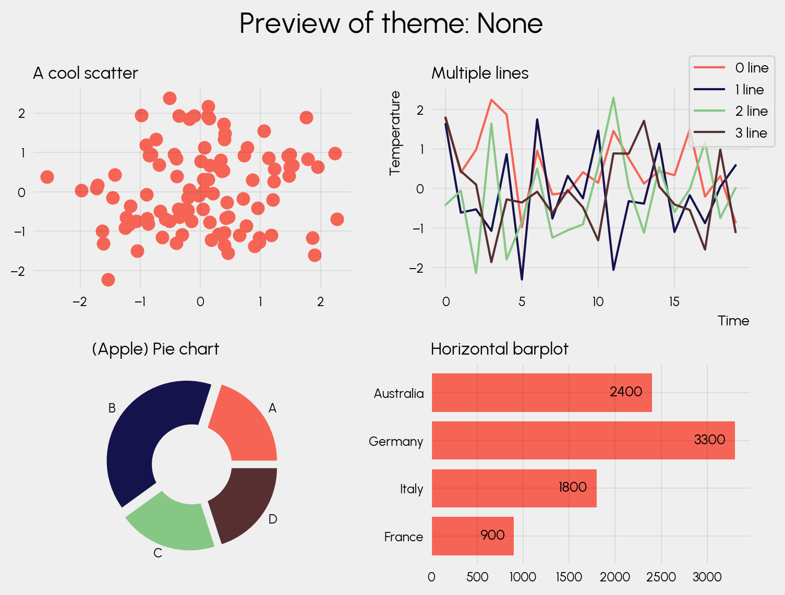
:::

### Minimal

To use the Minimal theme, run `mt.set_theme("minimal")`

```python
mt.set_theme("minimal")

# This displays various matplotlib charts
mt.preview_theme()
```

:::output
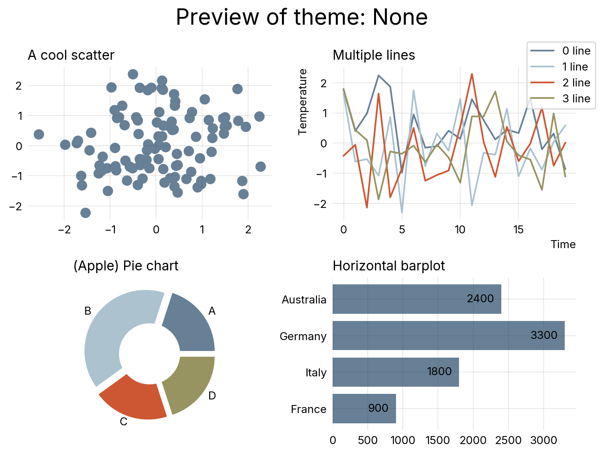
:::

## Nature

```python
mt.set_theme("nature")

# This displays various matplotlib charts
mt.preview_theme()
```

:::output
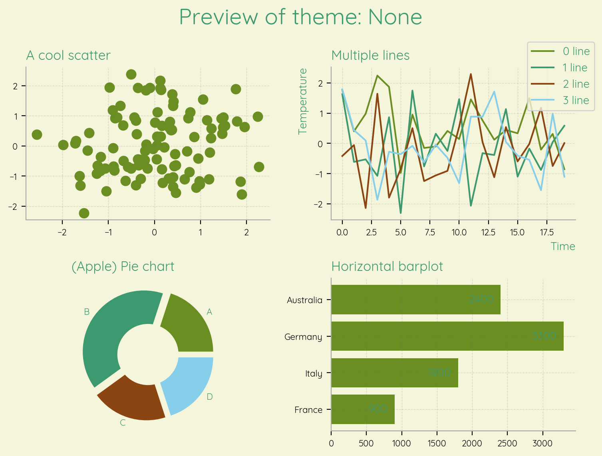
:::

## Greenwave

```python
mt.set_theme("greenwave")

# This displays various matplotlib charts
mt.preview_theme()
```

:::output
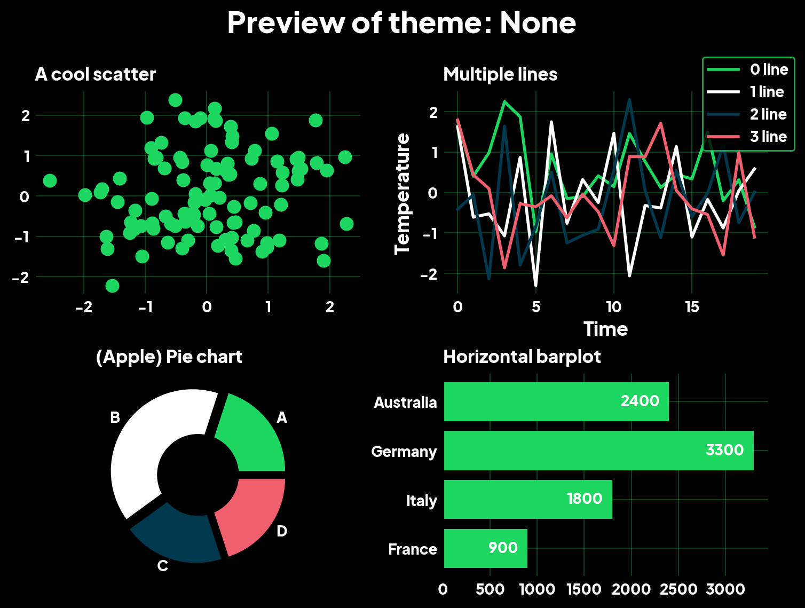
:::

## Lumen

```python
mt.set_theme("lumen")

# This displays various matplotlib charts
mt.preview_theme()
```

:::output
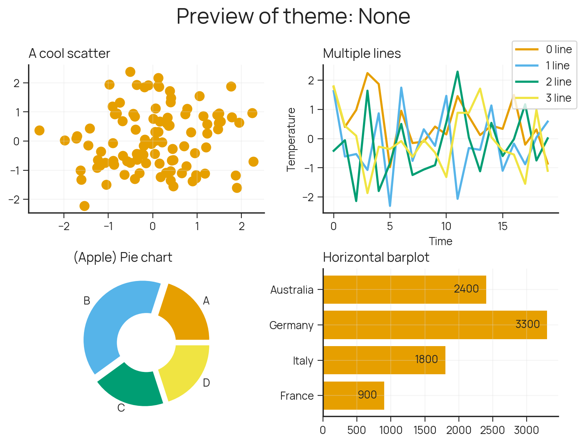
:::

## Ebonis

```python
mt.set_theme("ebonis")

# This displays various matplotlib charts
mt.preview_theme()
```

:::output
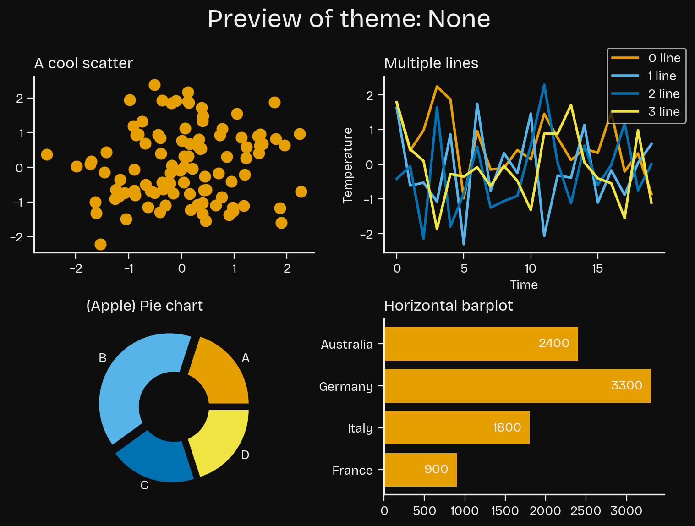
:::

## Lighter

```python
mt.set_theme("lighter")

# This displays various matplotlib charts
mt.preview_theme()
```

:::output
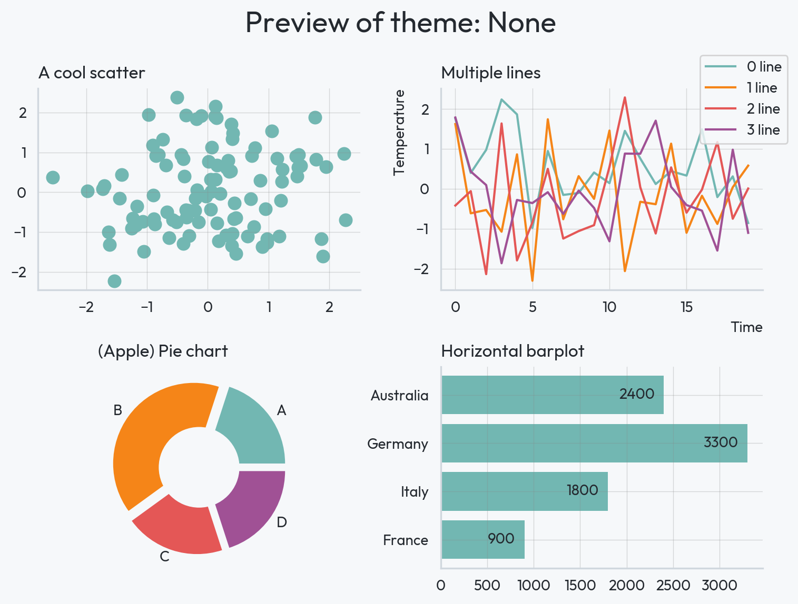
:::

## VS Code dark

```python
mt.set_theme("vscode-dark")

# This displays various matplotlib charts
mt.preview_theme()
```

:::output
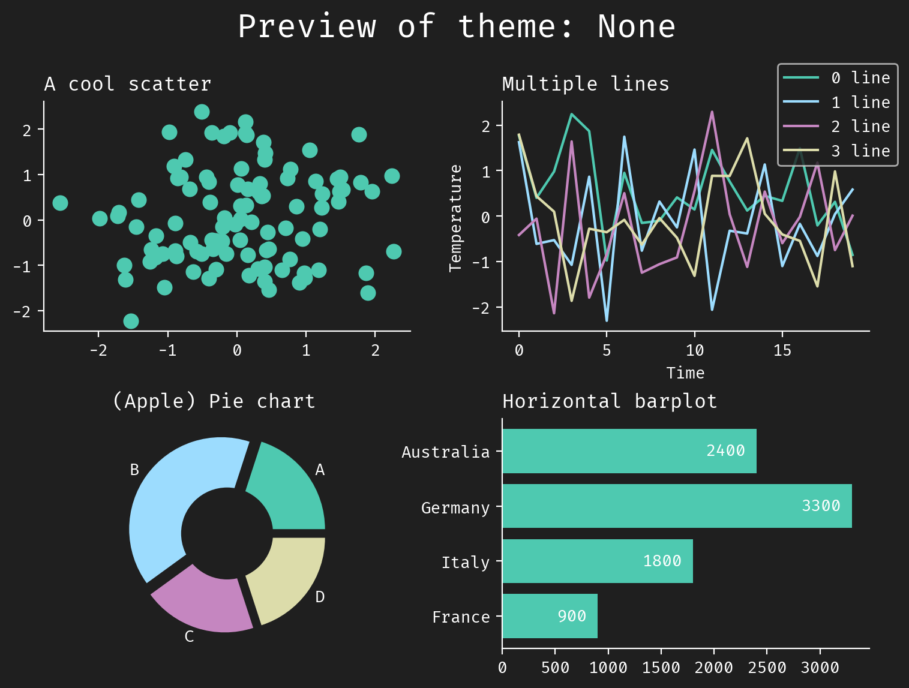
:::

## Nord

```python
mt.set_theme("nord")

# This displays various matplotlib charts
mt.preview_theme()
```

:::output
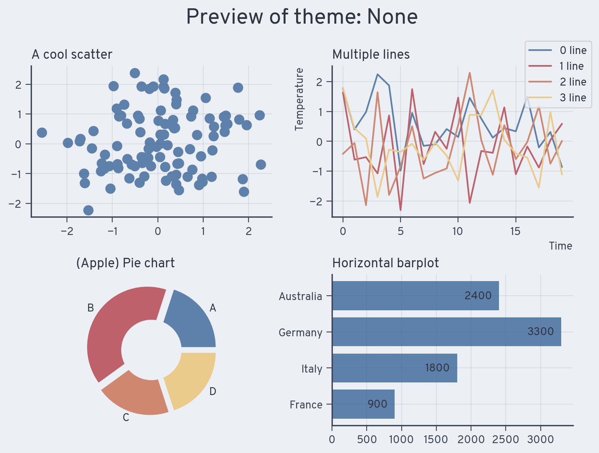
:::

## Retro

```python
mt.set_theme("retro")

# This displays various matplotlib charts
mt.preview_theme()
```

:::output
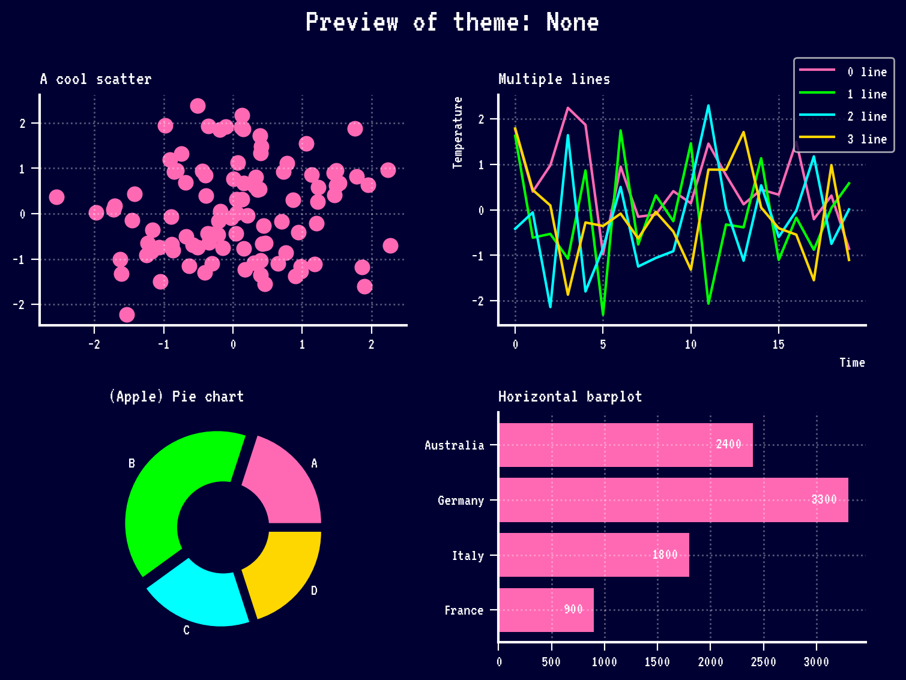
:::

### Other themes

If you want to browse all themes, check out the [dedicated documentation](https://y-sunflower.github.io/morethemes/).

## Going further

- Give morethemes a [star on Github](https://github.com/y-sunflower/morethemes)!
- [morethemes full documentation](https://y-sunflower.github.io/morethemes/)
