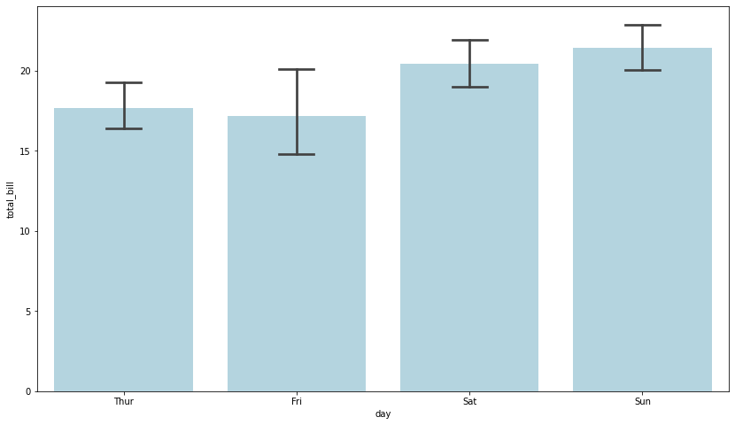

If you are using **aggregated values** in a barplot, **error bars** will give you a general idea of how precise a measurement is. This example shows how to add error bars into your chart.  

By default, the `barplot()` function draws error bars in the plot with 95% confidence interval. You can remove error bars by passing `ci=None` argument. `ci` parameter controls the size of **confidence intervals** to draw around estimated values (Note that if you want to draw the standard deviation of the observations, you should pass `ci="sd"`).  

Additionally, you can change the **width of the caps** on error bars with the `capsize` parameter.

```python
# import libraries
import seaborn as sns
import numpy as np
import matplotlib.pyplot as plt

# load dataset
tips = sns.load_dataset("tips")

# Set the figure size
plt.figure(figsize=(14, 8))

# plot a bar chart
ax = sns.barplot(x="day", y="total_bill", data=tips, estimator=np.mean, ci=85, capsize=.2, color='lightblue')
```

:::output

:::
