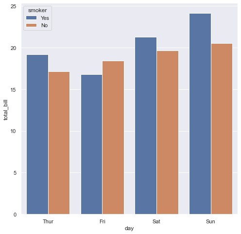
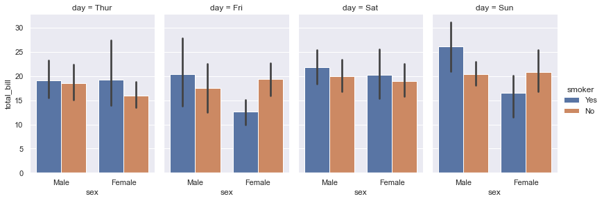
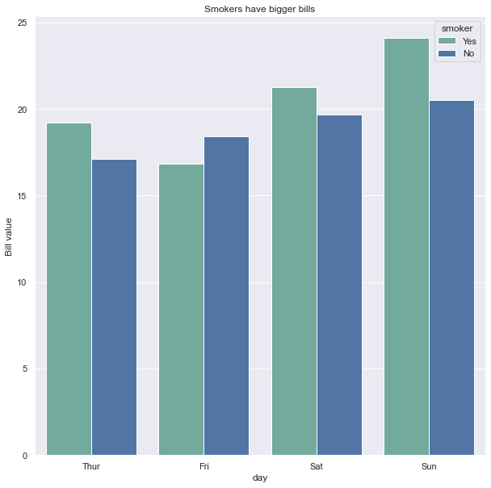

## Grouped barplot

Let's consider the total bills paid by a set of people at a restaurant. Those bills are split:
- in groups: the day of the week
- in subgroups: wether the clients were smokers or not

This kind of data allows to build a grouped barplot. Each bar represents the mean bill price for each group and subgroups. The groups are provided the the `x` parameter of the `barplot()` function, the subgroups are passed to the `hue` parameter and will control the color.

```python
# import libraries
import seaborn as sns
import matplotlib.pyplot as plt

# set plot style: grey grid in the background:
sns.set_theme(style="darkgrid")

# load dataset
tips = sns.load_dataset("tips")

# Set the figure size
plt.figure(figsize=(8, 8))

# grouped barplot
sns.barplot(x="day", y="total_bill", hue="smoker", data=tips, ci=None);
```

:::output

:::

## More than 2 groups

With more than 2 groups you can use the `catplot()` function to split the plot window. There will be one distinct plot for each of the last subgroup levels.

```python
 sns.catplot(x="sex", y="total_bill",
                 hue="smoker", col="day",
                 data=tips, kind="bar",
                 height=4, aspect=.7);
```

:::output

:::

## Color

You can create an array of colors to use on the chart, pass it to the `color_palette()` function to create a palette with it, and set it as the palette to use thanks to `set_palette()`

```python
# Create an array with the colors you want to use
colors = ["#69b3a2", "#4374B3"]
sns.set_palette(sns.color_palette(colors))

# Set the figure size
plt.figure(figsize=(10, 10))

# grouped barplot
ax = sns.barplot(
    x="day", 
    y="total_bill", 
    hue="smoker", 
    data=tips, 
    ci=None
    )

# Customize the axes and title
ax.set_title("Smokers have bigger bills")
ax.set_ylabel("Bill value")

# Remove top and right borders
ax.spines['top'].set_visible(False)
ax.spines['right'].set_visible(False)
```

:::output

:::
