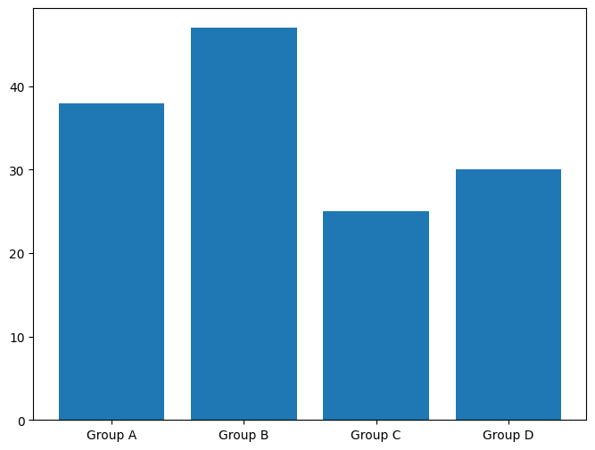
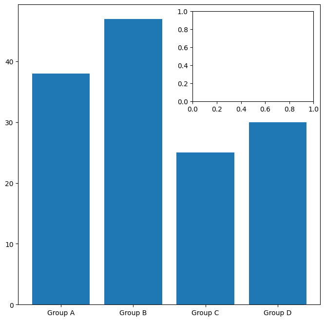
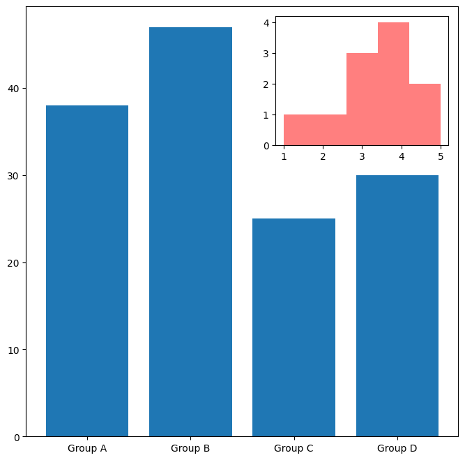
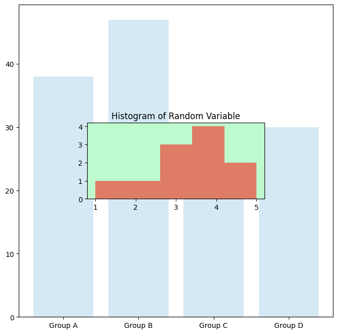

## Libraries

First, we need to install the following libraries:

- [matplotlib](https://python-graph-gallery.com/matplotlib/): for plotting
- `mpl_toolkits`: for adding sub plots
- [pandas](https://python-graph-gallery.com/pandas/): for data manipulation

```python
import matplotlib.pyplot as plt
from mpl_toolkits.axes_grid1.inset_locator import inset_axes

import pandas as pd
```

## Dataset

Let's create a simple dataset for this post:

```python
x = ['Group A', 'Group B', 'Group C', 'Group D']
y = [38, 47, 25, 30]

df = pd.DataFrame(
    {'x': x,
     'y': y}
)
```

## Simple chart

Here is a simple [barplot](https://python-graph-gallery.com/barplot/) using `matplotlib`:

```python
fig, ax = plt.subplots(figsize=(8, 6))
ax.bar(df['x'], df['y'])
plt.show()
```

:::output

:::

## Sub plot

Having a smaller plot inside a bigger one is a good way to **show more information**, either for a legend or a zoom-in.

In practice, we add an `Axes` object (which is **basically a plot**) inside another `Axes` object. This is done using the `inset_axes()` function from the `mpl_toolkits` library.

For this, we have to define the **parent axes** (the bigger plot) and the **size** of the smaller plot.

```python
fig, ax = plt.subplots(figsize=(8, 8))
ax.bar(df['x'], df['y'])

sub_ax = inset_axes(
    parent_axes=ax,
    width="40%",
    height="30%",
    borderpad=1  # padding between parent and inset axes
)

plt.show()
```

:::output

:::

## Add content in the sub plot

Once the sub plot is created, we can work on it as if it was a regular axes object:

```python
fig, ax = plt.subplots(figsize=(8, 8))

# main plot
ax.bar(df['x'], df['y'])

# create inset plot
sub_ax = inset_axes(
    parent_axes=ax,
    width="40%",
    height="30%",
    borderpad=1  # padding between parent and inset axes
)

# add content inside inset plot
random_variable = [1, 2, 3, 3, 3, 4, 4, 4, 4, 5, 5]
sub_ax.hist(
    random_variable,
    bins=5,
    color='red',
    alpha=0.5
)

plt.show()
```

:::output

:::

## Customize the sub plot

We can easily customize all features of the inset plot:

- **dimensions** by modifying the `width` and `height` parameters

- **position** by modifying the `loc` parameter

- **background color** by modifying the `facecolor` parameter

- and many more...

```python
fig, ax = plt.subplots(figsize=(8, 8))

# main plot
ax.bar(df['x'], df['y'], color='#d5e9f5')

# create inset plot
sub_ax = inset_axes(
    parent_axes=ax,
    width=3.5,
    height=1.5,
    loc='center',
    axes_kwargs={
        'facecolor': '#beface'
    }
)

# add content inside inset plot
random_variable = [1, 2, 3, 3, 3, 4, 4, 4, 4, 5, 5]
sub_ax.hist(
    random_variable,
    bins=5,
    color='red',
    alpha=0.5
)
sub_ax.set_title('Histogram of Random Variable')

plt.show()
```

:::output

:::

## Going further

This article explains how to create a sub plot in a chart using [matplotlib](https://python-graph-gallery.com/matplotlib/).

For more examples of **advanced customization**, check out this [beautiful chart](https://python-graph-gallery.com/web-ridgeline-by-text/) where the legend is actually a sub plot and how to [add an image in a chart](https://python-graph-gallery.com/513-add-logo-matplotlib/).
