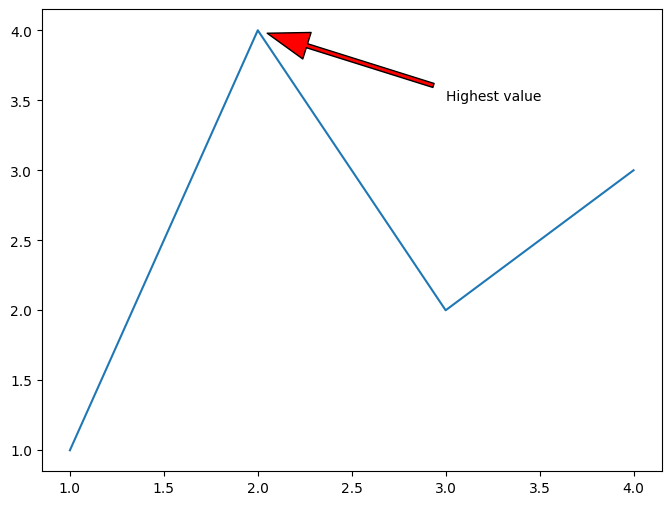
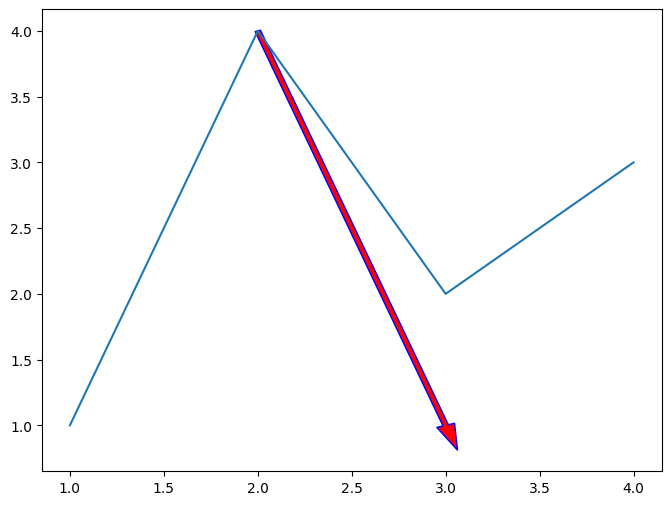
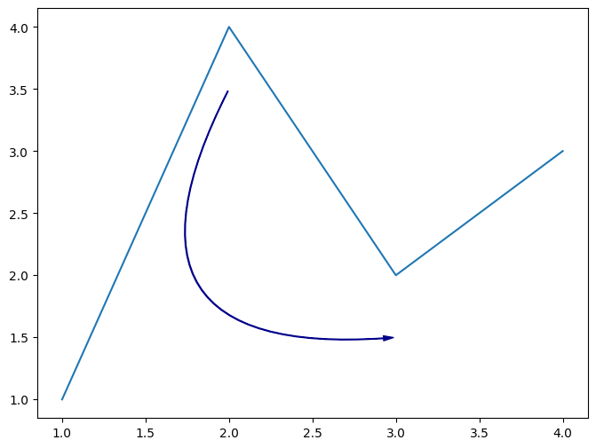

## Arrows

In data visualization, **arrows** can be used to **highlight a specific part of a chart**.

Actually, it is generally what makes a chart really insightful and makes want you to look at it. Here's a great example that illustrates this point:


Even this **simple arrow** makes the chart mure more informative and comprehensive!

In this post, you'll learn how to **add and custom arrows** to your charts using the [matplotlib](https://python-graph-gallery.com/matplotlib/) library.

## Libraries

For this post, we'll only need the load [matplotlib](https://python-graph-gallery.com/matplotlib/):

```python
import matplotlib.pyplot as plt
```

## Arrow with annotate()

When adding an annotation with `annotate()`, you can specify an arrow that points to the annotated point.

Here are the arguments to pass:

- `xy`: the point to annotate (where the **arrow points to**)
- `xytext`: the position of the text (where the **arrow starts**)
- `arrowprops`: a dictionary of **properties to customize** the arrow

```python
# simple plot
fig, ax = plt.subplots(figsize=(8, 6))
ax.plot(
    [1, 2, 3, 4],
    [1, 4, 2, 3]
)

# arrow with annotate()
ax.annotate(
    'Highest value',
    xy=(2, 4), # point to annotate
    xytext=(3, 3.5), # position of text
    arrowprops=dict(
        facecolor='red', # color of arrow
        shrink=0.05, # distance from point
        width=3, # width of arrow
        headwidth=20, # width of arrow head
        headlength=30 # length of arrow head
    )
)

plt.show()
```

:::output

:::

## Arrow with arrow()

You can also add an arrow using the `arrow()` function. It's quite similar to `annotate()`. Here are the main arguments to pass:

- `x`: the x-coordinate of the arrow
- `y`: the y-coordinate of the arrow

```python
# simple plot
fig, ax = plt.subplots(figsize=(8, 6))
ax.plot(
    [1, 2, 3, 4],
    [1, 4, 2, 3]
)

# arrow with arrow()
ax.arrow(
    2, 4, # start point
    1, -3, # direction
    width=0.03, # width of arrow
    head_width=0.1, # width of arrow head
    head_length=0.2, # length of arrow head
    fc='red', # color of arrow
    ec='blue' # color of border
)

plt.show()
```

:::output

:::

## Arrow with FancyArrowPatch()

For this method, we first need to load the `FancyArrowPatch` class from the `matplotlib.patches` module. Then, we can create an arrow by passing the following arguments:

```python
from matplotlib.patches import FancyArrowPatch
```

With this method, we can create arrows that **don't have linear shapes**.

For example, we can create a curved arrow by setting the `connectionstyle` argument, and modify the `rad` parameter to change the **curvature of the arrow**.

```python
# simple plot
fig, ax = plt.subplots(figsize=(8, 6))
ax.plot(
    [1, 2, 3, 4],
    [1, 4, 2, 3]
)

# arrow with FancyArrowPatch()
arrow_style = "Simple, tail_width=0.5, head_width=4, head_length=8"
connection_style = "arc3,rad=.9"
arrow_properties = {
    "arrowstyle": arrow_style,
    "color": "darkblue",
}
tail_position = (2, 3.5)
head_position = (3, 1.5)
arrow = FancyArrowPatch(
    tail_position,
    head_position,
    connectionstyle=connection_style,
    **arrow_properties
)
ax.add_patch(arrow)

plt.show()
```

:::output

:::

## Going further

This post explains how to create **arrows** in [matplotlib](https://python-graph-gallery.com/matplotlib/).

You might be interested in [how to math in annotations](https://python-graph-gallery.com/193-annotate-matplotlib-chart/) or [how to add an image in a plot](https://python-graph-gallery.com/513-add-logo-matplotlib/)
