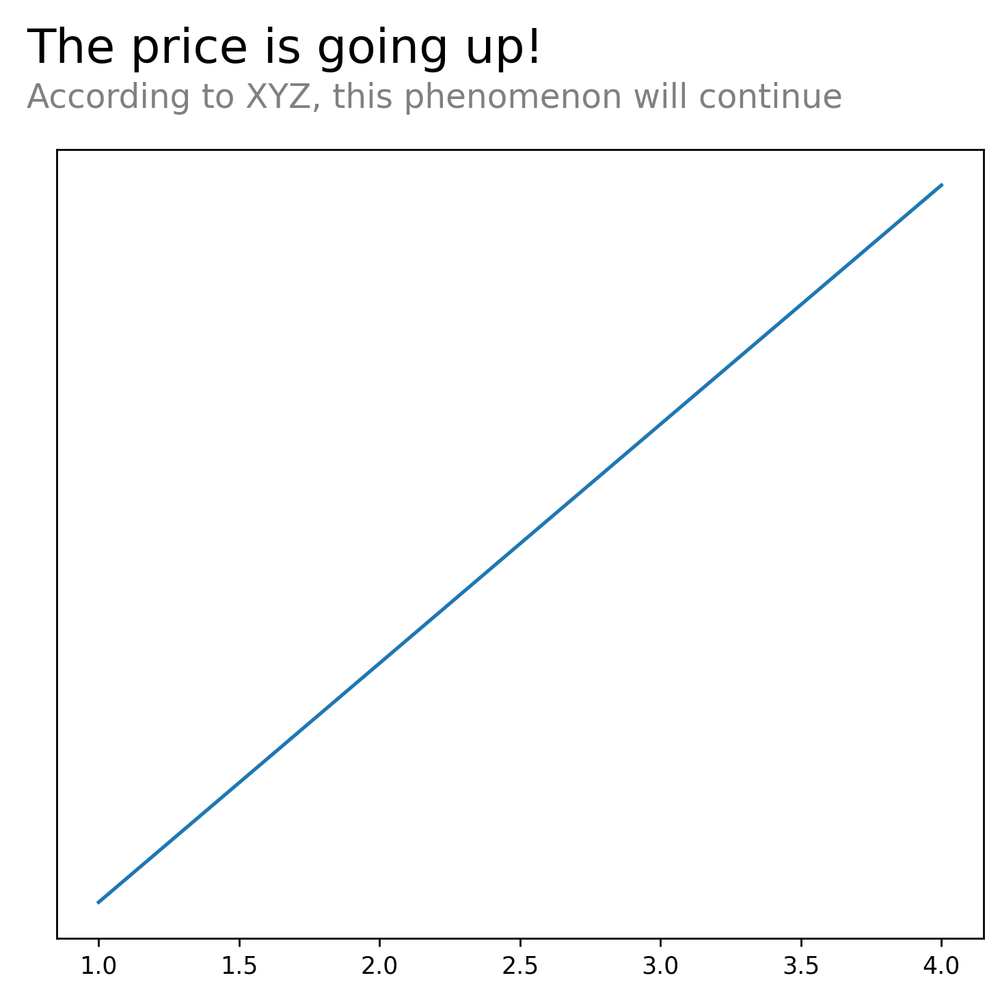
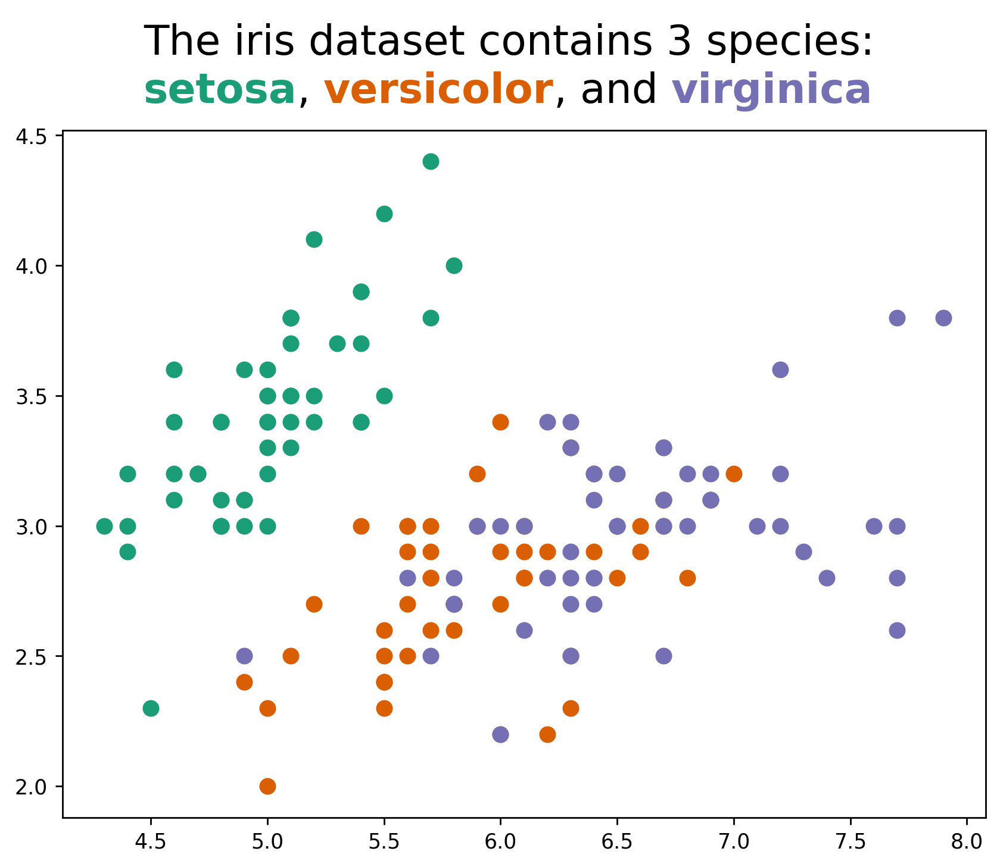

## Titles

In data visualization, titles, or annotations in general, have a **major role** in available information to the reader.

They can be used to:

- **highlight** specific points
- provide **additional** information
- simply **explain** the data in more depth

However, it can be quite technicaly challenging to customize annotations in [matplotlib](/matplotlib).

Let's see how we can create nice titles in a few examples.

## Libraries

Default tools from [matplotlib](/matplotlib) are unfortunately **not enough** to create nice titles, especially when using the `title()`. We will use the [highlight-text package](https://github.com/znstrider/highlight_text) that simplifies the process.

Keep in mind that it would have been possible to use the [flexitext package](/594-introduction-flexitext) that can do approximately the same thing.

And we will also need to load `matplotlib` and `numpy` libraries.

```python
import matplotlib.pyplot as plt
from highlight_text import fig_text
```

## Combine title and subtitle

With [matplotlib](https://python-graph-gallery.com/matplotlib/), the easiest way to combine a title and a subtitle is to use twice the `text()` function with different `y` values (position). However, it can be quite **tricky to align** them properly.

With `highlight_text`, we just have to pass **different properties** to our text to differentiate them to **quickly** create a title and a subtitle.

```python
# create a simple plot
fig, ax = plt.subplots(figsize=(7,6), dpi=250)
ax.plot(
    [1, 2, 3, 4],
    [10, 11, 12, 13]
)

# remove y-axis ticks
ax.set_yticks([])

# add annotation on top
text = '<The price is going up!>\n<According to XYZ, this phenomenon will continue>'
fig_text(
    x=0.1, # position on x-axis
    y=1, # position on y-axis
    ha='left',
    s=text,
    fontsize=12,
    ax=ax,
    highlight_textprops=[
        {"color": "black", "fontsize": 20},
        {"color": "grey", "fontsize": 14}
    ]
)

plt.show()
```

:::output

:::

## Colors

The `highlight_text` package also allows to **color** a specific part of the text. This is a great way to add insight and make your chart more understandable.

```python
# dataset
import pandas as pd
dataset = 'master/static/data/iris.csv'
iris = pd.read_csv('https://raw.githubusercontent.com/holtzy/The-Python-Graph-Gallery/'+dataset)

fig, ax = plt.subplots(figsize=(8, 6), dpi=250)
colors = ["#1B9E77", "#D95F02", "#7570B3"]
for species, color in zip(iris['species'].unique(), colors):
    subset = iris[iris['species'] == species]
    ax.scatter(subset['sepal_length'], subset['sepal_width'], c=color, label=species, s=50)

text = 'The iris dataset contains 3 species:\n<setosa>, <versicolor>, and <virginica>'
fig_text(
    s=text,
    x=.5, y=1,
    fontsize=20,
    color='black',
    highlight_textprops=[{"color": colors[0], 'fontweight': 'bold'},
                         {"color": colors[1], 'fontweight': 'bold'},
                         {"color": colors[2], 'fontweight': 'bold'}],
    ha='center'
)

plt.show()
```

:::output

:::

## Going further

This post explains how to create **nice title** in [matplotlib](https://python-graph-gallery.com/matplotlib/).

You might be interested in [how to add math in annotations](https://python-graph-gallery.com/193-annotate-matplotlib-chart/) or [how to add an image in a plot](https://python-graph-gallery.com/513-add-logo-matplotlib/)
