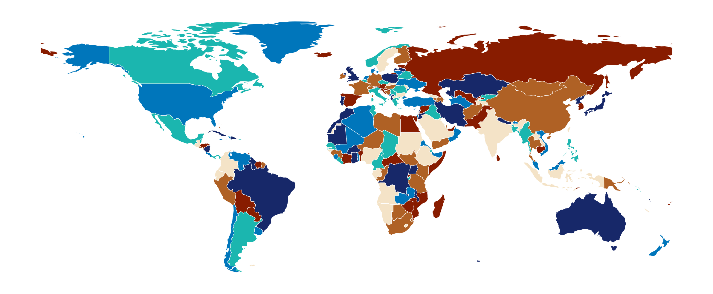
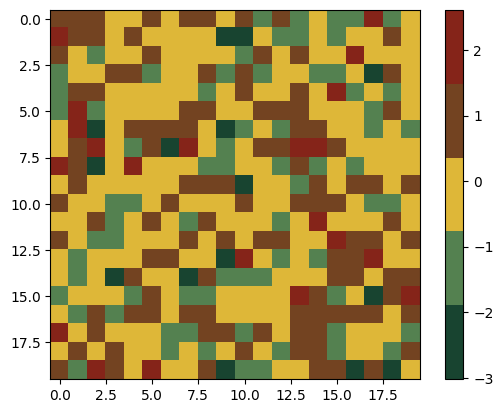
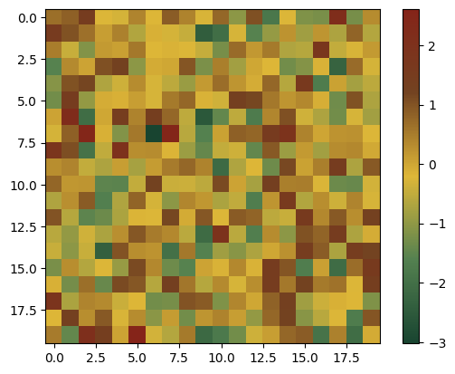
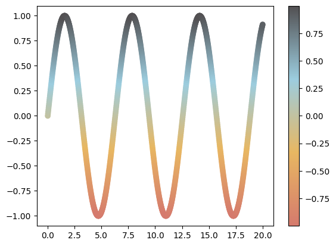

## Pypalettes

[PyPalettes](https://github.com/y-sunflower/pypalettes) is a python library that provides more than **2500 different** palettes to use in your data visualization. It comes with a very simple-to-use API that only requires **1 line of code**.

You can find your dream palette on the [dedicated web app](/color-palette-finder) that **highlights** how palettes look like on different kind of charts.

You can install it by running `pip install pypalettes` in your terminal!

## Quick start

The easiest way to get started is to load the `load_cmap()` function from `pypalettes`.

Here is an example with the [Coconut palette](https://python-graph-gallery.com/color-palette-finder/?palette=coconut).

```python
import geopandas as gpd
import matplotlib.pyplot as plt
from pypalettes import load_cmap, load_palette

# load the dataset
df = gpd.read_file(
    "https://raw.githubusercontent.com/holtzy/The-Python-Graph-Gallery/master/static/data/all_world.geojson"
)
df = df[df["name"] != "Antarctica"]

cmap = load_cmap("Coconut")

# display the world map
fig, ax = plt.subplots(figsize=(10, 10), dpi=300)
ax.set_axis_off()
df.plot(ax=ax, cmap=cmap, edgecolor="white", linewidth=0.3)
plt.show()
```

:::output

:::

## Load and use a colormap

If you want to customise your palettes, the `load_cmap()` function is there to help you and has lots of options. Let's see how to use it in practice.

```python
from pypalettes import load_cmap

cmap = load_cmap("ClaudeMonet")
cmap
```

:::output

:::

We can then use this cmap object for a graph:

```python
import matplotlib.pyplot as plt
import numpy as np

data = np.random.randn(20, 20)

plt.imshow(data, cmap=cmap)
plt.colorbar()
plt.show()
```

:::output

:::

As you can see, the cmap is discrete: it has a **fixed number** of colors, visible via the color bar on the right. What if we want a color gradient instead? Simply add the `cmap_type=‘continuous’` (the default is `‘discrete’`) when you load the cmap:

```python
from pypalettes import load_cmap

cmap = load_cmap("ClaudeMonet", cmap_type="continuous")
cmap
```

:::output

:::

If we recreate the previous graph:

```python
plt.imshow(data, cmap=cmap)
plt.colorbar()
plt.show()
```

:::output

:::

Much better!

Now let's see how far you can go when customizing your palette. The `load_cmap()` function provides a set of arguments for this purpose.

```python
load_cmap("FridaKahlo")
```

:::output

:::

- `reverse`: Whether to reverse the order of the colors or not

```python
load_cmap("FridaKahlo", reverse=True)
```

:::output

:::

- `keep_first_n`: Keep only the first n colors of the palette

```python
load_cmap("FridaKahlo", keep_first_n=3)
```

:::output

:::

- `keep`: Specify which colors to keep in the palette (via a list of booleans)

```python
load_cmap("FridaKahlo", keep=[True, False, False, True, True])
```

:::output

:::

- `repeat`: The number of times the palette must be present in the output. Used to access larger palettes that are repeated.

```python
load_cmap("FridaKahlo", repeat=3)
```

:::output

:::

- `shuffle`: Used to mix the order of colors. If an integer is supplied, it will be used as the seed.

```python
load_cmap("FridaKahlo", shuffle=1)
```

:::output

:::

## Cmap attributes

When you load a cmap, you load a matplotlib object with extended attributes. You can access, for each palette,

- the associated colors using `load_palette()`
- the kind of the palette
- the name of the palette
- the source of the palette

```python
cmap = load_cmap("Acadia")
palette = load_palette("Acadia")

cmap
```

:::output

:::

```python
palette
```

:::output
```text
['#FED789FF', '#023743FF', '#72874EFF', '#476F84FF', '#A4BED5FF', '#453947FF']
```
:::

```python
cmap.name
```

:::output
```text
'Acadia'
```
:::

```python
cmap.source
```

:::output
```text
'The R package: {nationalparkcolors}'
```
:::

```python
cmap.kind
```

:::output
```text
'qualitative'
```
:::

## Make your own

PyPalettes also provides a basic tool for creating and registering color maps in matplotlib: the `add_cmap()` function.

This function does 2 things: it registers your function so that your cmap is now available natively in matplotlib, and it returns the cmap object to you. For example:

```python
from pypalettes import create_cmap

cmap = create_cmap(
    colors=["#D57A6DFF", "#E8B762FF", "#9CCDDFFF", "#525052FF"],
    cmap_type="continuous",
)
```

We can now use `cmap` for our charts:

```python
import matplotlib.pyplot as plt
import numpy as np

x = np.linspace(0, 20, 1000)
y = np.sin(x)

plt.scatter(x, y, c=y, cmap=cmap)
plt.colorbar()
plt.show()
```

:::output

:::

## Bonus & tips

- Palettes can be combined if you provide a list of palette names:

```python
load_cmap(["Joyful", "Juarez", "Kandinsky"])
```

:::output

:::

- If you use `load_cmap()` with no arguments (or with the name `‘random’`), it will load a random one:

```python
load_cmap()
```

:::output

:::

- Can't remember the exact name of your favorite palette? Simply try out what you have in mind and it will suggest similar palettes:

```python
load_cmap("fridaqallo")
```

_`ValueError: Palette with name 'fridaqallo' not found. Did you mean: FridaKahlo, Frida, marill, dracomalfoy, taillow?`_

_`See available palettes at https://python-graph-gallery.com/color-palette-finder/`_

## Going further

### Palette finder

Browse the [color palette finder](/color-palette-finder) to find your dream palette!


<br>

### Related

- the [colors section of the gallery](/python-colors)
- the [github repository](https://github.com/y-sunflower/pypalettes) of `PyPalettes`
