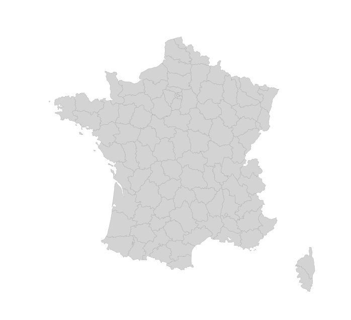

## 🤔 What is a `geoJson` file?

A GeoJSON file is a format used to encode various **geographic data structures** such as points, lines, and polygons, using a `JSON` structure. It allows for easy **storage and exchange of geographic information** systems (GIS) data on the web and between applications.

Let's consider French state boundaries. The original file comes from [here](https://github.com/gregoiredavid/france-geojson/blob/master/departements-version-simplifiee.geojson) but I stored it on the [github repo](https://github.com/holtzy/The-Python-Graph-Gallery/blob/master/static/data/france.geojson) of the python graph gallery for convenience: we will load directly with the code.

## How to load a `geoJson` file into python

You're best friend here is `geopandas`. If this package hasn't been installed on your machine yet, you can do so with `pip install geopandas`. Then, load the package:

```python
import geopandas as gpd

data = gpd.read_file(
    "https://raw.githubusercontent.com/holtzy/The-Python-Graph-Gallery/master/static/data/france.geojson"
)

print(type(data))
```

Here we are 🎉! `data` is a `geo dataframe`. Each row represents an item in the `geojson` file, **i.e. a region of france here**.

Columns describe the feature of each region. The `geometry` column is probably the most important. It provides the **coordinates** of the region boundary.

## Plot the result

Many different options exist to plot a map from a geopandas dataframe. The most common solution is to use a package called `geoplot`. You can install it with `pip install geoplot`. Then import it with:

```python
import geoplot
import geoplot.crs as gcrs
```

Once the library is loaded, the `polyplot()` function can be used to draw a map of the geospatial data frame. The `polyplot()` function is used to plot polygons, i.e any type of geographic area.

```python
geoplot.polyplot(
    data,
    projection=gcrs.AlbersEqualArea(),
    edgecolor='darkgrey',
    facecolor='lightgrey',
    linewidth=.3,
    figsize=(12, 8)
)
```

:::output

:::

Here we are, we've loaded a `geoJson` file, transformed it into a `geopandas dataframe` and drawn a map with `geoplot` from it!

## Going further

This post explains how to create a [map](/map/) from a `geoJSON` file.

You might be interested in:

- building a [choropleth map](/choropleth-map-geopandas-python), where each region has a **color proportionnal to a value**
- creating a [bubble map](/310-basic-map-with-markers), where individual data **points are displayed on top** of a map, with different sizes
