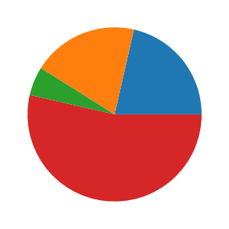
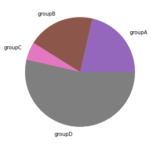
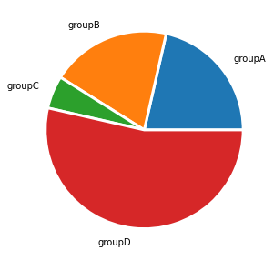
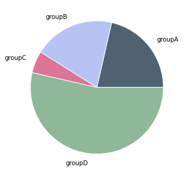

## Most basic pie chart with Matplotlib

The `matplotlib` library allows to easily build a pie chart thanks to its `pie()` function. It expects at the very least some data input. This data must be an array of numbers as in the example below:

```python
# library
import matplotlib.pyplot as plt
plt.rcParams["figure.figsize"] = (20,5)
# create random data
values=[12,11,3,30]
 
# Create a pieplot
plt.pie(values);
plt.show();
```

:::output

:::

## Add labels

The above pie chart is a good start but is definitely not very insightful. The first thing we miss here are labels.

Labels are added thanks to the `labels` parameter that expect an array of strings. You also problably want to play with the `labeldistance` parameter that controls the distance between the circle edge and the label itself. (1= exactly on it, use something bigger to have the label further.)

```python
# library
import matplotlib.pyplot as plt
 
# create random data
names='groupA', 'groupB', 'groupC', 'groupD',
values=[12,11,3,30]
 
# Create a pieplot
plt.pie(size_of_groups)

# Label distance: gives the space between labels and the center of the pie
plt.pie(values, labels=names, labeldistance=1.15);
plt.show();
```

:::output

:::

## Customize wedges

It is pretty common to customize wedges to get some blank spaces around them. This is doable thanks to the `wedgeprops` parameter. This parameter is an object that accept 2 properties: `linewidth` and `edgecolor`

```python
## Same chart as above but with specific wedgeprops option:
plt.pie(values, labels=names, labeldistance=1.15, wedgeprops = { 'linewidth' : 3, 'edgecolor' : 'white' });
```

:::output

:::

## Customize colors

You can change the color palette in use thanks to the `color` parameter that expects an array of color.
See the dedicated section of the gallery for more tips on color with `matplotlib`.

```python
# Create a set of colors
colors = ['#4F6272', '#B7C3F3', '#DD7596', '#8EB897']

# Use it thanks to the color argument
plt.pie(values, labels=names, labeldistance=1.15, wedgeprops = { 'linewidth' : 1, 'edgecolor' : 'white' }, colors=colors);
```

:::output

:::
