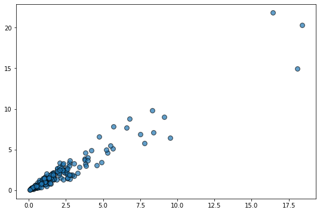
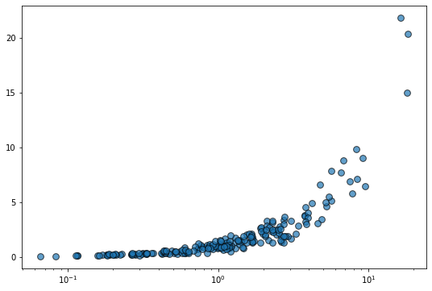
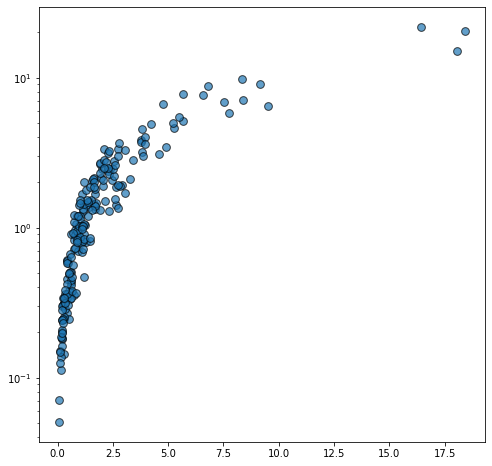
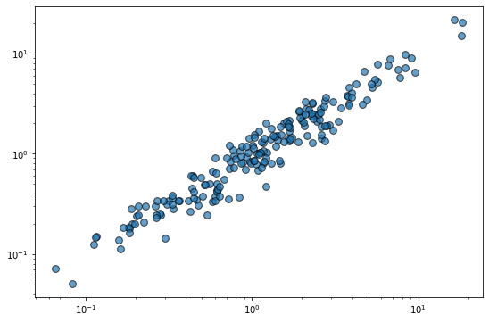

Let's get started by importing Matplotlib and Numpy

```python
import matplotlib.pyplot as plt
import numpy as np
```

Let's get started by creating a reproducible random number generator. This ensures the result is the same no matter how many times we generate the random data.

```python
rng = np.random.default_rng(1234)
```

The next step is to generate some random data where it makes sense to apply a logarithmic transformation to make it easier to see the relationship between the variables. 

In this case, we're going to generate data that violates the homoscedasticity assumption of ordinary linear regression. This is just statistical jargon that means that the variability of the y variable is not constant for all the values of x. In this case, the variability of y increases as the value of x increases.

```python
# Generate data
x = rng.lognormal(size=200)
y = x + rng.normal(scale=5 * (x / np.max(x)), size=200)

# Initialize layout
fig, ax = plt.subplots(figsize = (9, 6))

# Add scatterplot
ax.scatter(x, y, s=60, alpha=0.7, edgecolors="k");
```

:::output

:::

Let's say the horizontal scale is logarithmic now:

```python
fig, ax = plt.subplots(figsize = (9, 6))
ax.scatter(x, y, s=60, alpha=0.7, edgecolors="k")

# Set logarithmic scale on the x variable
ax.set_xscale("log");
```

:::output

:::

And what if the vertical scale is logarithmic?

```python
fig, ax = plt.subplots(figsize = (8,8))
ax.scatter(x, y, s=60, alpha=0.7, edgecolors="k")

# Set logarithmic scale on the y variable
ax.set_yscale("log");
```

:::output

:::

Let's use a logarithmic scale for both axes now:

```python
fig, ax = plt.subplots(figsize = (9, 6))
ax.scatter(x, y, s=60, alpha=0.7, edgecolors="k")

# Set logarithmic scale on the both variables
ax.set_xscale("log")
ax.set_yscale("log");
```

:::output

:::

The relationship between the variables is linear in this log-transformed space and the variability of y looks constant. So cool!
