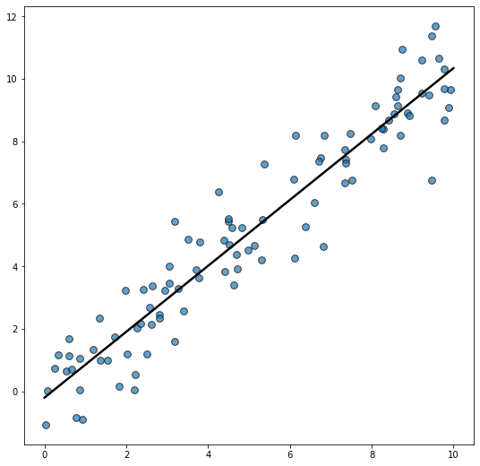

Let's get started by importing Matplotlib and Numpy

```python
import matplotlib.pyplot as plt
import numpy as np
```

Now let's create a reproducible random number generator. This ensures the result is the same no matter how many times we generate the random data.

```python
rng = np.random.default_rng(1234)
```

And finally, let's generate some random data, make the scatterplot, and add the regression line:

```python
# Generate data
x = rng.uniform(0, 10, size=100)
y = x + rng.normal(size=100)

# Initialize layout
fig, ax = plt.subplots(figsize=(9, 9))

# Add scatterplot
ax.scatter(x, y, s=60, alpha=0.7, edgecolors="k")

# Fit linear regression via least squares with numpy.polyfit
# It returns an slope (b) and intercept (a)
# deg=1 means linear fit (i.e. polynomial of degree 1)
b, a = np.polyfit(x, y, deg=1)

# Create sequence of 100 numbers from 0 to 100
xseq = np.linspace(0, 10, num=100)

# Plot regression line
ax.plot(xseq, a + b * xseq, color="k", lw=2.5)
```

:::output

:::

## Going further

This post explains how to add a simple linear regression fit in a [scatter plot](/scatter-plot).

You might be interested by how to [add estimated coefficients on the plot](/556-visualize-linear-regression) and how to [display regression fit with seaborn](/42-custom-linear-regression-fit-seaborn).
