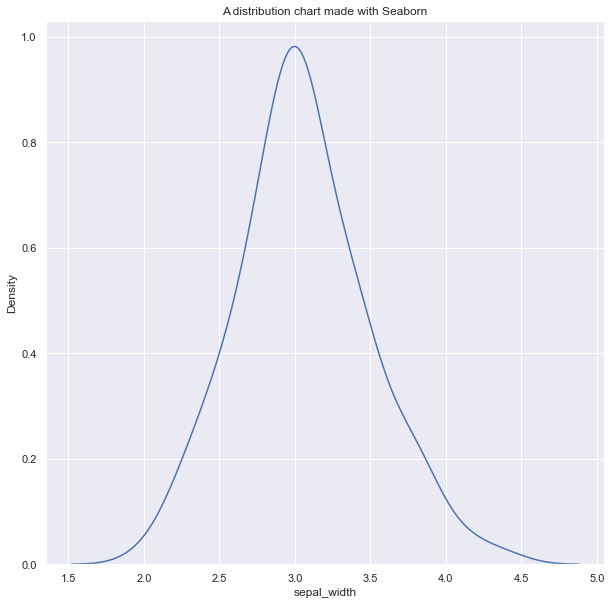

## 📕 Add a title

The following distribution chart is built thanks to the `kdeplot()` function of `seaborn`.

This function returns a `matplotlib` axes instance. Unlike `pyplot` itself, which has a method `plt.title()`, the corresponding argument for an axes is `ax.set_title()`. This is what you need to call to build the title:

```python
# library & dataset
import seaborn as sns
df = sns.load_dataset('iris')

# Figure size
sns.set_theme(rc={'figure.figsize':(10,10)})

# Grey background
sns.set_theme(style="darkgrid")

# Make default density plot
ax = sns.kdeplot(df['sepal_width'])

# Add title
ax.set_title('A distribution chart made with Seaborn');
```

:::output

:::

## 🎨 Title customization

Once you've understood how to add a title to a `seaborn` chart, customization works the same as for `matplotlib`. Visit [this blopost](https://python-graph-gallery.com/190-custom-matplotlib-title) to see many customization examples 🎉.
