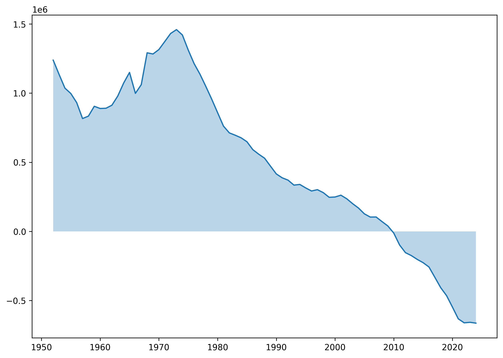
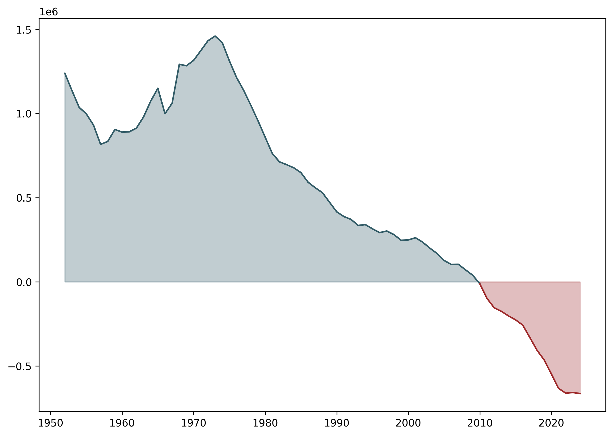
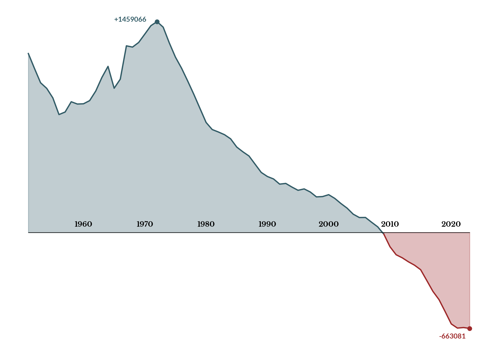
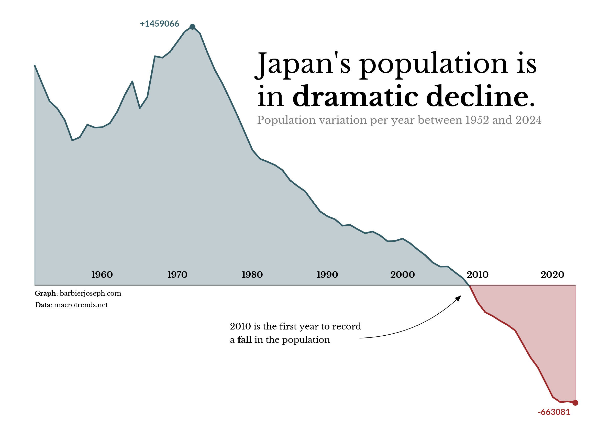

## About

An [area chart](/area-plot) is a kind of line chart where the area between the x-axis and the line if filled in a given color. This chart shows the evolution of Japan's population change between 1952 and 2024.

This chart has been created by [Joseph Barbier](https://barbierjoseph.com). Thanks to him for accepting sharing its work here!

As a teaser, here is the plot we’re gonna try building:


## Libraries

First, we need to load the following libraries:

- [matplotlib](/matplotlib): for creating the plot
- [pandas](/pandas): for data manipulation
- [highlight_text](/advanced-custom-annotations-matplotlib): for annotations
- [pyfonts](/pyfonts) for the fonts
- [drawarrow](/drawarrow) for the arrows

```python
import pandas as pd
import matplotlib.pyplot as plt
from pyfonts import load_google_font
from drawarrow import ax_arrow
from highlight_text import fig_text, ax_text
```

## Dataset

For this reproduction, we're going to retrieve the data directly from the gallery's Github repo. This means we just need to **give the right url as an argument** to pandas' `read_csv()` function to retrieve the data.

```python
url = "https://raw.githubusercontent.com/holtzy/The-Python-Graph-Gallery/master/static/data/japan-population.csv"
df = pd.read_csv(url)
df.head()
```

:::output
::output-html{src="./output-1.html"}
:::

## Simple area chart

An area chart consists of 2 main elements:

- the main line (added via the `plot()` function)
- the filled area (added via the `fill_between()` function, with a lower opacity)

```python
fig, ax = plt.subplots(dpi=300, figsize=(10, 7))

ax.plot(df["date"], df["pop_var"])
ax.fill_between(df["date"], df["pop_var"], alpha=0.3)

plt.show()
```

:::output

:::

## 2 colors for positive and negative values

Since there’s no built-in method to change the color based on a value, so we create **two area charts**:

- First chart: spans from the start date to `year_index` (the year is when the value drops below 0, and we find this info with the `flag` column).
- Second chart: spans from `year_index` to the end date.

Apply different colors to each chart, and done!

```python
fig, ax = plt.subplots(dpi=300, figsize=(10, 7))

year_index = df[df["flag"]].date.values[0]

# before
color = "#335c67"
before_df = df[df["date"] <= year_index]
ax.plot(before_df["date"], before_df["pop_var"], color=color)
ax.fill_between(before_df["date"], before_df["pop_var"], alpha=0.3, color=color)

# after
color = "#9e2a2b"
after_df = df[df["date"] >= year_index]
ax.plot(after_df["date"], after_df["pop_var"], color=color)
ax.fill_between(after_df["date"], after_df["pop_var"], alpha=0.3, color=color)

plt.show()
```

:::output

:::

## Customize axes

Enhance the plot with the following steps:

- Use `ax.set_axis_off()` to remove all axes.
- Load two fonts: one regular, one **bold** thanks to [pyfonts](/pyfonts)
- Highlight the highest and lowest values with `scatter()` and `text()`.
- Use a `for` loop and `text()` to label all dates in the chart's center.
- Add a horizontal black line along the x-axis.

```python
font = load_google_font("Libre Baskerville")
boldfont = load_google_font("Libre Baskerville", weight="bold")
digit_font = load_google_font("Lato", weight="bold")

fig, ax = plt.subplots(dpi=300, figsize=(10, 7))
ax.set_axis_off()

year_index = df[df["flag"]].date.values[0]

# before
color = "#335c67"
year_index = df[df["flag"]].date.values[0]
before_df = df[df["date"] <= year_index]
ax.plot(before_df["date"], before_df["pop_var"], color=color)
ax.fill_between(before_df["date"], before_df["pop_var"], alpha=0.3, color=color)
max_year = df[df["pop_var"] == df["pop_var"].max()].date.values[0]
max_value = df[df["pop_var"] == df["pop_var"].max()].pop_var.values[0]
ax.scatter(x=max_year, y=max_value, color=color, s=20)
ax.text(
    x=max_year - 7,
    y=max_value,
    s=f"+{max_value:.0f}",
    font=digit_font,
    size=8,
    color=color,
)

# after
color = "#9e2a2b"
after_df = df[df["date"] >= year_index]
ax.plot(after_df["date"], after_df["pop_var"], color=color)
ax.fill_between(after_df["date"], after_df["pop_var"], alpha=0.3, color=color)
min_year = df[df["pop_var"] == df["pop_var"].min()].date.values[0]
min_value = df[df["pop_var"] == df["pop_var"].min()].pop_var.values[0]
ax.scatter(x=min_year, y=min_value, color=color, s=20)
ax.text(
    x=min_year - 5,
    y=min_value - 70000,
    s=f"{min_value:.0f}",
    font=digit_font,
    size=8,
    color=color,
)

ax.plot([1952, 2024], [0, 0], color="black", linewidth=0.6)
year_range = range(1960, 2021, 10)
for year in year_range:
    ax.text(x=year + 1, y=40000, s=f"{year}", font=boldfont, size=8, ha="center")

plt.show()
```

:::output

:::

## Final chart with annotations

All the part is done, now we just have to:

- add **title**, **subtitle** and **credit/source** using [highlight_text](/advanced-custom-annotations-matplotlib) and [pyfonts](/pyfonts) for loading the fonts
- add a specific annotation about the year 2010 with an arrow from [drawarrow](/drawarrow)

```python
font = load_google_font("Libre Baskerville")
boldfont = load_google_font("Libre Baskerville", weight="bold")
digit_font = load_google_font("Lato", weight="bold")
arrow_props = dict(color="black", width=0.5, head_width=2, head_length=5, radius=0.2)

fig, ax = plt.subplots(dpi=300, figsize=(10, 7))
ax.set_axis_off()

# before
color = "#335c67"
year_index = df[df["flag"]].date.values[0]
before_df = df[df["date"] <= year_index]
ax.plot(before_df["date"], before_df["pop_var"], color=color)
ax.fill_between(before_df["date"], before_df["pop_var"], alpha=0.3, color=color)
max_year = df[df["pop_var"] == df["pop_var"].max()].date.values[0]
max_value = df[df["pop_var"] == df["pop_var"].max()].pop_var.values[0]
ax.scatter(x=max_year, y=max_value, color=color, s=20)
ax.text(
    x=max_year - 7,
    y=max_value,
    s=f"+{max_value:.0f}",
    font=digit_font,
    size=8,
    color=color,
)

# after
color = "#9e2a2b"
after_df = df[df["date"] >= year_index]
ax.plot(after_df["date"], after_df["pop_var"], color=color)
ax.fill_between(after_df["date"], after_df["pop_var"], alpha=0.3, color=color)
min_year = df[df["pop_var"] == df["pop_var"].min()].date.values[0]
min_value = df[df["pop_var"] == df["pop_var"].min()].pop_var.values[0]
ax.scatter(x=min_year, y=min_value, color=color, s=20)
ax.text(
    x=min_year - 5,
    y=min_value - 70000,
    s=f"{min_value:.0f}",
    font=digit_font,
    size=8,
    color=color,
)

ax.plot([1952, 2024], [0, 0], color="black", linewidth=0.6)
year_range = range(1960, 2021, 10)
for year in year_range:
    ax.text(x=year + 1, y=40000, s=f"{year}", font=boldfont, size=8, ha="center")

s = "Japan's population is\nin <dramatic decline>."
fig_text(
    x=0.45,
    y=0.8,
    s=s,
    font=font,
    highlight_textprops=[{"font": boldfont}],
    fontsize=25,
    ha="left",
    va="top",
)

s = "Population variation per year between 1952 and 2024"
fig_text(x=0.45, y=0.68, s=s, font=font, fontsize=9.8, ha="left", va="top", alpha=0.5)

s = "<Graph>: barbierjoseph.com\n<Data>: macrotrends.net"
ax_text(
    x=1952,
    y=-30000,
    s=s,
    font=font,
    fontsize=6,
    ha="left",
    highlight_textprops=[{"font": boldfont}] * 2,
)

s = "2010 is the first year to record\na <fall> in the population"
ax_text(
    x=1978,
    y=-210000,
    s=s,
    font=font,
    fontsize=8,
    ha="left",
    highlight_textprops=[{"font": boldfont}],
)
ax_arrow(
    tail_position=(1995, -300000), head_position=(2009, -50000), ax=ax, **arrow_props
)

plt.savefig(
    "../../static/graph/web-area-chart-with-different-colors-for-positive-and-negative-values.png",
    dpi=300,
    bbox_inches="tight",
)
plt.show()
```

:::output

:::

## Going further

You might be interested in:

- the [area chart section](/area-plot) of the gallery
- how to create [arrow with an inflexion point](/591-arrows-with-inflexion-point) in a plot
- how to make a [beautiful stacked area chart](/web-stacked-area-with-inflexion-arrows)
