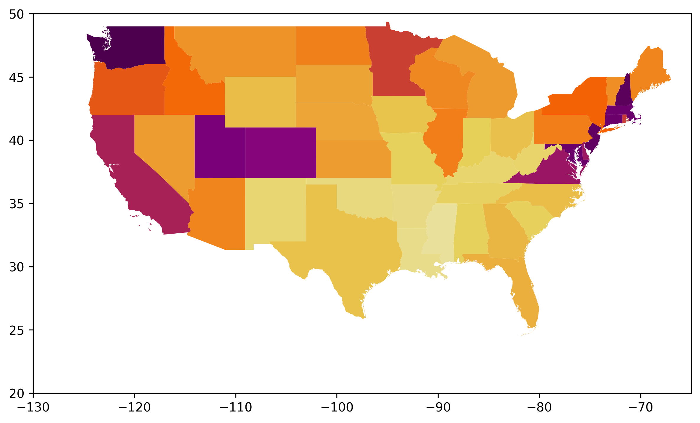
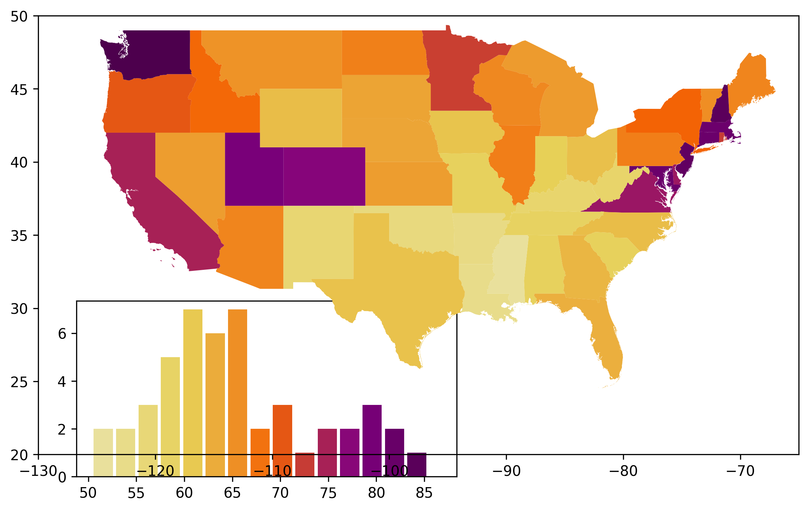
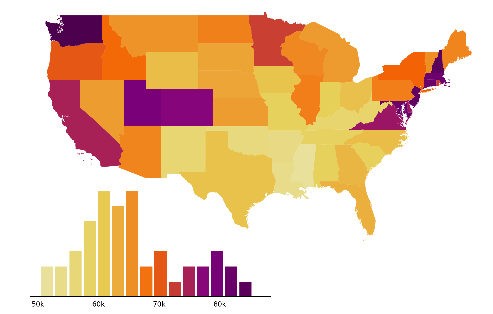
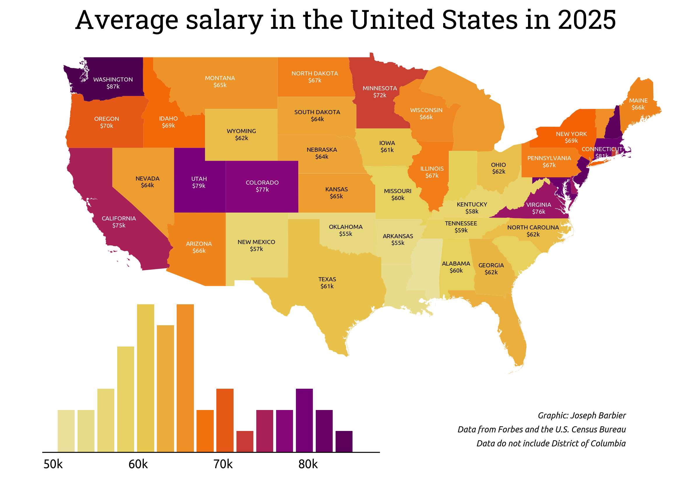

## About

A [choropleth map](/choropleth-map) is a map combined where colors are proportional to values in each region.

This chart has been created by [Joseph Barbier](https://barbierjoseph.com), thanks to him for sharing his work here!

## Libraries

First, we need to load the following libraries:

```python
import matplotlib.pyplot as plt
import geopandas as gpd
import pandas as pd
from pyfonts import load_google_font
from pypalettes import load_cmap
```

## Dataset

Here we need to load 2 datasets:

- one with **map data** (shape of each state)
- one with **data for each state**

And then we merge them:

```python
path = "https://raw.githubusercontent.com/holtzy/The-Python-Graph-Gallery/refs/heads/master/static/data/usa-salary.csv"
path = "../../static/data/usa-salary.csv"
df_salary = pd.read_csv(path)

path = "https://raw.githubusercontent.com/holtzy/The-Python-Graph-Gallery/refs/heads/master/static/data/us.geojson"
path = "../../static/data/us.geojson"
gdf = gpd.read_file(path).merge(df_salary, on="state")

gdf = gdf[gdf["salary"] < 100]  # remove district of columbia
gdf = gdf[gdf["state"] != "Alaska"]
gdf = gdf[gdf["state"] != "Hawaii"]
gdf.head()
```

:::output
::output-html{src="./output-1.html"}
:::

We add a `centroid` column (approximation of the center of the state) that will be used later to add individual state labels:

```python
gdf_projected = gdf.to_crs(epsg=3035)
gdf_projected["centroid"] = gdf_projected.geometry.centroid
gdf["centroid"] = gdf_projected["centroid"].to_crs(gdf.crs)
gdf.head()
```

:::output
::output-html{src="./output-2.html"}
:::

## Basic choropleth map

The key steps here are:

- create a colormap (`cmap`) with the color range we want
- create a matplotlib Figure with `fig, ax = plt.subplots()`
- plot the choropleth map with `gdf.plot()`

```python
cmap = load_cmap("enara", cmap_type="continuous", reverse=True)
edgecolor = "white"
linewidth = 0

fig, ax = plt.subplots(figsize=(8, 8), dpi=300)

ax.set_xlim(-130, -65)
ax.set_ylim(20, 50)

gdf.plot(ax=ax, column="salary", cmap=cmap, edgecolor=edgecolor, linewidth=linewidth)

fig.tight_layout()
```

:::output

:::

## Add barplot

In order to add the barplot, we use the `ax.inset_axes()` function to create a subplot (smaller) that will contain our barplot.

If you're not familiar with complex layouts in Matplotlib, please check this [dedicated lesson](https://www.matplotlib-journey.com/module4/axes-at-any-position) where we explain the concept in depth!

Then we customize it a bit so that it uses the right color scale and looks nice.

```python
cmap = load_cmap("enara", cmap_type="continuous", reverse=True)
edgecolor = "white"
linewidth = 0

fig, ax = plt.subplots(figsize=(8, 8), dpi=300)

gdf.plot(ax=ax, column="salary", cmap=cmap, edgecolor=edgecolor, linewidth=linewidth)

ax.set_xlim(-130, -65)
ax.set_ylim(20, 50)

bar_ax = ax.inset_axes(bounds=[0.05, -0.05, 0.5, 0.4], zorder=-1)
n, bins, _ = bar_ax.hist(gdf["salary"], bins=15, alpha=0)
colors = [cmap((val - min(bins)) / (max(bins) - min(bins))) for val in bins]
bar_ax.bar(
    bins[:-1], n, color=colors, width=2, edgecolor=edgecolor, linewidth=linewidth
)

fig.tight_layout()
```

:::output

:::

## Clean the Axes of map and barplot

Here we remove all spines (border of each plot) and clean up the labels in the histogram.

```python
cmap = load_cmap("enara", cmap_type="continuous", reverse=True)
edgecolor = "white"
linewidth = 0

fig, ax = plt.subplots(figsize=(8, 8), dpi=300)

gdf.plot(ax=ax, column="salary", cmap=cmap, edgecolor=edgecolor, linewidth=linewidth)

ax.set_xlim(-130, -65)
ax.set_ylim(20, 50)
ax.axis("off")

bar_ax = ax.inset_axes(bounds=[0.05, -0.05, 0.5, 0.4], zorder=-1)
n, bins, _ = bar_ax.hist(gdf["salary"], bins=15, alpha=0)
colors = [cmap((val - min(bins)) / (max(bins) - min(bins))) for val in bins]
bar_ax.bar(
    bins[:-1], n, color=colors, width=2, edgecolor=edgecolor, linewidth=linewidth
)
bar_ax.spines[["top", "left", "right"]].set_visible(False)
bar_ax.set_yticks([])
x_ticks = list(range(50, 90, 10))
x_tick_labels = [f"{val}k" for val in x_ticks]
bar_ax.set_xticks(x_ticks, labels=x_tick_labels, size=8)
bar_ax.tick_params(axis="x", length=0, pad=5)

fig.tight_layout()
```

:::output

:::

## Add individual state labels

The easiest way to find the center of each country is to use the `centroid` attribute of the `geometry` column in the `geo dataframe`. These coordinates can then be used to add annotations to the map.

Since the default font isn't very attractive, we load a **font** for the **annotations**. We can then use the `load_google_font()` function from [pyfonts](/pyfonts) to load the fonts from Google font.

Just before adding the annotations, we define an **adjustment dictionary** to help us improve the approximate position of the annotations. This is necessary because centroids aren't always ideally positioned for annotations.

```python
font2 = load_google_font("Ubuntu")
cmap = load_cmap("enara", cmap_type="continuous", reverse=True)
edgecolor = "white"
linewidth = 0
text_color = "white"

fig, ax = plt.subplots(figsize=(8, 8), dpi=300)

gdf.plot(ax=ax, column="salary", cmap=cmap, edgecolor=edgecolor, linewidth=linewidth)

ax.set_xlim(-130, -65)
ax.set_ylim(20, 50)
ax.axis("off")

bar_ax = ax.inset_axes(bounds=[0.05, -0.05, 0.5, 0.4], zorder=-1)
n, bins, _ = bar_ax.hist(gdf["salary"], bins=15, alpha=0)
colors = [cmap((val - min(bins)) / (max(bins) - min(bins))) for val in bins]
bar_ax.bar(
    bins[:-1], n, color=colors, width=2, edgecolor=edgecolor, linewidth=linewidth
)
bar_ax.spines[["top", "left", "right"]].set_visible(False)
bar_ax.set_yticks([])
x_ticks = list(range(50, 90, 10))
x_tick_labels = [f"{val}k" for val in x_ticks]
bar_ax.set_xticks(x_ticks, labels=x_tick_labels, size=8, font=font2)
bar_ax.tick_params(axis="x", length=0, pad=5)

exclude = {
    "Indiana",
    "Michigan",
    "Mississippi",
    "Florida",
    "New Jersey",
    "West Virginia",
    "South Carolina",
    "Louisiana",
    "Massachusetts",
    "Vermont",
    "Connedgecolorticut",
    "Maryland",
    "Delaware",
    "Rhode Island",
    "New Hampshire",
}
states_to_annotate = [state for state in gdf.state.to_list() if state not in exclude]

adjustments = {
    "California": (0, -1),
    "Kentucky": (0, -0.2),
    "Washington": (0.5, -0.4),
    "Virginia": (0, -0.2),
    "Idaho": (0, -0.4),
    "New York": (0, -0.2),
}

for state in states_to_annotate:
    centroid = gdf.loc[gdf["state"] == state, "centroid"].values[0]
    x_val, y_val = centroid.coords[0]
    try:
        x_val += adjustments[state][0]
        y_val += adjustments[state][1]
    except KeyError:
        pass
    value = gdf.loc[gdf["state"] == state, "salary"].values[0]
    if value <= 65:
        color_text = "black"
    else:
        color_text = text_color
    ax.text(
        x=x_val,
        y=y_val,
        s=f"{state.upper()}\n${value:.0f}k",
        fontsize=5,
        font=font2,
        color=color_text,
        ha="center",
        va="center",
    )

fig.tight_layout()
```

:::output

:::

## Add last annotations

The title, credit and source annotations are added via the `fig.text()` function at the end:

```python
font1 = load_google_font("Ubuntu", italic=True)
font2 = load_google_font("Ubuntu")
cmap = load_cmap("enara", cmap_type="continuous", reverse=True)
edgecolor = "white"
linewidth = 0
text_color = "white"

fig, ax = plt.subplots(figsize=(8, 8), dpi=300)

gdf.plot(ax=ax, column="salary", cmap=cmap, edgecolor=edgecolor, linewidth=linewidth)

ax.set_xlim(-130, -65)
ax.set_ylim(20, 50)
ax.axis("off")

bar_ax = ax.inset_axes(bounds=[0.05, -0.05, 0.5, 0.4], zorder=-1)
n, bins, _ = bar_ax.hist(gdf["salary"], bins=15, alpha=0)
colors = [cmap((val - min(bins)) / (max(bins) - min(bins))) for val in bins]
bar_ax.bar(
    bins[:-1], n, color=colors, width=2, edgecolor=edgecolor, linewidth=linewidth
)
bar_ax.spines[["top", "left", "right"]].set_visible(False)
bar_ax.set_yticks([])
x_ticks = list(range(50, 90, 10))
x_tick_labels = [f"{val}k" for val in x_ticks]
bar_ax.set_xticks(x_ticks, labels=x_tick_labels, size=8, font=font2)
bar_ax.tick_params(axis="x", length=0, pad=5)

exclude = {
    "Indiana",
    "Michigan",
    "Mississippi",
    "Florida",
    "New Jersey",
    "West Virginia",
    "South Carolina",
    "Louisiana",
    "Massachusetts",
    "Vermont",
    "Connedgecolorticut",
    "Maryland",
    "Delaware",
    "Rhode Island",
    "New Hampshire",
}
states_to_annotate = [state for state in gdf.state.to_list() if state not in exclude]

adjustments = {
    "California": (0, -1),
    "Kentucky": (0, -0.2),
    "Washington": (0.5, -0.4),
    "Virginia": (0, -0.2),
    "Idaho": (0, -0.4),
    "New York": (0, -0.2),
}

for state in states_to_annotate:
    centroid = gdf.loc[gdf["state"] == state, "centroid"].values[0]
    x_val, y_val = centroid.coords[0]
    try:
        x_val += adjustments[state][0]
        y_val += adjustments[state][1]
    except KeyError:
        pass
    value = gdf.loc[gdf["state"] == state, "salary"].values[0]
    if value <= 65:
        color_text = "black"
    else:
        color_text = text_color
    ax.text(
        x=x_val,
        y=y_val,
        s=f"{state.upper()}\n${value:.0f}k",
        fontsize=5,
        font=font2,
        color=color_text,
        ha="center",
        va="center",
    )

fig.text(
    x=0.5,
    y=0.8,
    s="Average salary in the United States in 2025",
    ha="center",
    size=22,
    font=load_google_font("Roboto Slab"),
)

credit_params = dict(x=0.9, ha="right", size=7, font=font1, va="bottom")
fig.text(y=0.24, s="Graphic: Joseph Barbier", **credit_params)
fig.text(y=0.22, s="Data from Forbes and the U.S. Census Bureau", **credit_params)
fig.text(y=0.2, s="Data do not include District of Columbia", **credit_params)

fig.tight_layout()

fig.savefig(
    "../../static/graph/web-choropleth-map-with-histogram.png",
    dpi=300,
    bbox_inches="tight",
)
```

:::output

:::

## Going further

You might be interested in:

- the [choropleth map section](/choropleth-map) of the gallery
- this other [choropleth + barplot example](/web-combine-choropleth-map-with-barplot)
- how to create an [interactive choropleth map](/choropleth-map-plotly-python)
- learn matplotlib easily with [Matplotlib Journey](https://www.matplotlib-journey.com)
