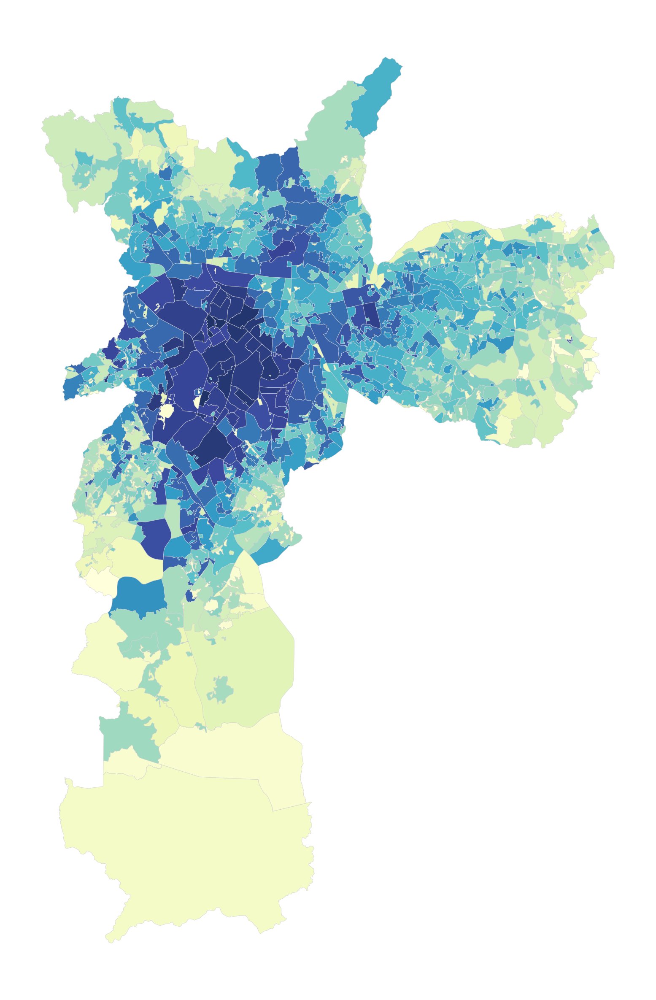
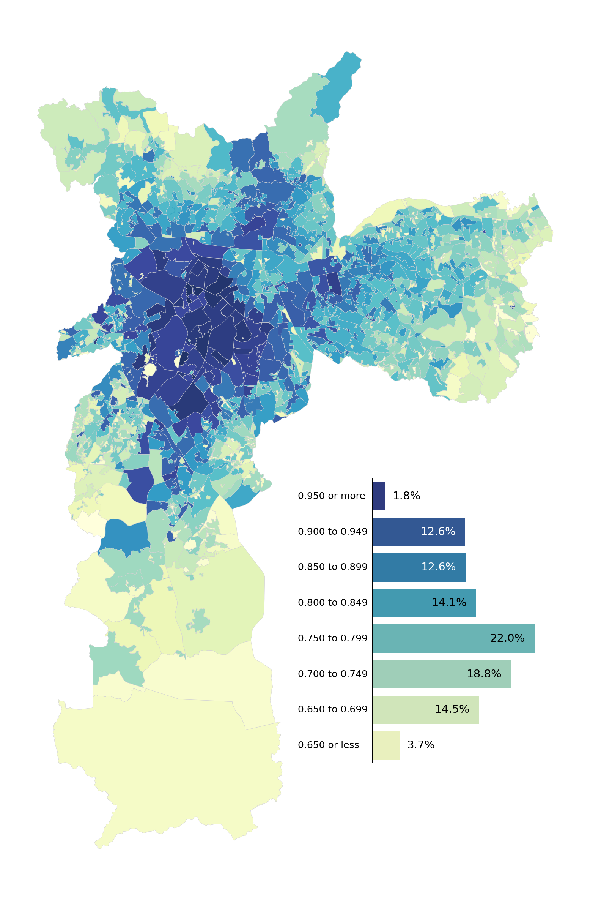
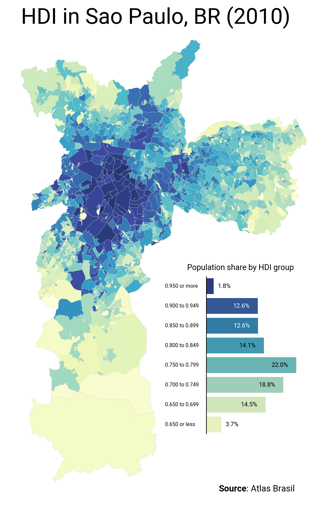

## About

This plot is a [choropleth map](/choropleth-map) combined with a [barplot](/barplot) for the legend.

It has been originally designed by [Vinicius Oike Reginatto](https://restateinsight.com/) in R. Here is a reproduction in Python by [Joseph Barbier](https://www.barbierjoseph.com).

As a teaser, here is the plot we’re gonna try building:


## Libraries

For creating this chart, we will need a whole bunch of libraries!

- [matplotlib](/matplotlib): to customize the appearance of the chart
- [geopandas](/597-introduction-to-geopandas): to handle make the map
- [pandas](/pandas): to handle the data
- [seaborn](/seaborn): for the barplot
- [pypalettes](/introduction-to-pypalettes): for the colors
- [highlight_text](/advanced-custom-annotations-matplotlib): for the annotations
- [pyfonts](/pyfonts): for customizing the font

```python
import geopandas as gpd
import matplotlib.pyplot as plt
import seaborn as sns
import pandas as pd
from pypalettes import load_cmap
from highlight_text import fig_text, ax_text
from pyfonts import load_google_font
```

## Dataset

We need two datasets:

- one for the map with the **polygons** and the measure of interest (in this case the HDI)
- one for the bar chart, which we will deduce from the first by doing a **few calculations**.

```python
path = "https://raw.githubusercontent.com/holtzy/The-Python-Graph-Gallery/master/static/data/saopaulo.geojson"
path = "../../static/data/saopaulo.geojson"
df = gpd.read_file(path)
df.head()
```

:::output
::output-html{src="./output-1.html"}
:::

Now we create the dataset for the barplot:

```python
atlas = df[["HDI", "pop"]].copy()

bins = [0.0, 0.65, 0.699, 0.749, 0.799, 0.849, 0.899, 0.949, 1.0]
labels = [
    "0.650 or less",
    "0.650 to 0.699",
    "0.700 to 0.749",
    "0.750 to 0.799",
    "0.800 to 0.849",
    "0.850 to 0.899",
    "0.900 to 0.949",
    "0.950 or more",
]

atlas["group_hdi"] = pd.cut(atlas["HDI"], bins=bins, include_lowest=True, labels=labels)

pop_hdi = atlas.groupby("group_hdi", observed=True)["pop"].sum().reset_index()
pop_hdi["share"] = (pop_hdi["pop"] / pop_hdi["pop"].sum()) * 100

pop_hdi["y_text"] = pop_hdi["share"] / 2
pop_hdi["label"] = pop_hdi["share"].round(1).astype(str) + "%"

pop_hdi
```

:::output
::output-html{src="./output-2.html"}
:::

## Choropleth map

Creating the choropleth map is the easiest part:

- load the `YlGnBu` colormap and specify that we want a **continuous** colormap
- create a matplotlib figure with `plt.subplots()`.
- remove the axis
- use the `plot()` method on the `df` geodataframe and specify the **column to represent for the colors** (here it's HDI)

```python
palette_name = "YlGnBu"
cmap = load_cmap(palette_name, cmap_type="continuous")

fig, ax = plt.subplots(figsize=(10, 10), dpi=300)
ax.axis("off")
df.plot(ax=ax, column="HDI", cmap=cmap, edgecolor="lightgrey", linewidth=0.2, alpha=0.9)
plt.show()
```

:::output

:::

## Barplot

Adding the bar chart may seem a little tricky, but it's not.

The main thing is to add a mini graph inside the choropleth. To do this, we create it with :

`subax = ax.inset_axes(bounds=(0.58, 0.22, 0.15, 0.25), transform=fig.transFigure)`

- `bounds` designates the location of this minichart
- `transform` specifies that the coordinates of `bounds` are relative to the figure. You can read more about this [in this article](/589-how-to-change-coordinate-system)

Once we've done that, we use the `barplot()` function from [seaborn](/seaborn) and use a `for` loop to add labels with specific positions/colours to the barplot.

```python
palette_name = "YlGnBu"
cmap = load_cmap(palette_name, cmap_type="continuous")

fig, ax = plt.subplots(figsize=(10, 10), dpi=300)
ax.axis("off")

# choropleth
df.plot(ax=ax, column="HDI", cmap=cmap, edgecolor="lightgrey", linewidth=0.2, alpha=0.9)

# barplot
mini_ax = ax.inset_axes(bounds=(0.58, 0.22, 0.15, 0.25), transform=fig.transFigure)
mini_ax.axis("off")
sns.barplot(
    data=pop_hdi,
    x="share",
    y="group_hdi",
    palette=palette_name,
    ax=mini_ax,
    hue="group_hdi",
    legend=False,
)
mini_ax.axvline(x=0, color="black")
mini_ax.invert_yaxis()

for index, row in pop_hdi.iterrows():
    x_pos = row["share"] - 6 if row["share"] > 4 else row["share"] + 1
    y_pos = index
    color = "white" if index in [5, 6] else "black"
    mini_ax.text(x_pos, y_pos, row["label"], color=color, size=7, va="center")
    mini_ax.text(-10, y_pos, row["group_hdi"], color="black", size=6, va="center")
plt.show()
```

:::output

:::

## Annotations

The only thing missing here is some good annotations with a nice font.

For this we'll use the Roboto font and load it with [pyfonts](/pyfonts). Then we'll basically use the `fig.text()` function to add the text we want.

```python
font = load_google_font("Roboto")
boldfont = load_google_font("Roboto", weight="bold")

fig, ax = plt.subplots(figsize=(10, 10), dpi=300)
ax.axis("off")

df.plot(ax=ax, column="HDI", cmap=cmap, edgecolor="lightgrey", linewidth=0.2, alpha=0.9)

subax = ax.inset_axes(bounds=(0.58, 0.22, 0.15, 0.25), transform=fig.transFigure)
subax.set_axis_off()
sns.barplot(
    data=pop_hdi,
    x="share",
    y="group_hdi",
    palette=palette_name,
    ax=subax,
    hue="group_hdi",
    legend=False,
)
subax.axvline(x=0, color="black")
subax.invert_yaxis()

for index, row in pop_hdi.iterrows():
    x_pos = row["share"] - 6 if row["share"] > 4 else row["share"] + 1
    y_pos = index
    color = "white" if index in [5, 6] else "black"
    subax.text(x_pos, y_pos, row["label"], color=color, size=7, va="center", font=font)
    subax.text(
        -10, y_pos, row["group_hdi"], color="black", size=6, va="center", font=font
    )

fig.text(
    x=0.5, y=0.87, s="HDI in Sao Paulo, BR (2010)", ha="center", size=25, font=font
)
fig.text(x=0.55, y=0.48, s="Population share by HDI group", size=9, font=font)
fig_text(
    x=0.6,
    y=0.14,
    s="<Source>: Atlas Brasil",
    size=10,
    font=font,
    highlight_textprops=[{"font": boldfont}],
)

plt.savefig(
    "../../static/graph/web-combine-choropleth-map-with-barplot.png",
    bbox_inches="tight",
    dpi=300,
)
plt.show()
```

:::output

:::

## Going further

You might be interested in:

- [customizing the legend of a choropleth map](/web-map-with-custom-legend)
- [create beautiful bubble maps](/web-bubble-map-with-arrows)
- [how to make an interactive choropleth map](/292-choropleth-map-with-folium)
