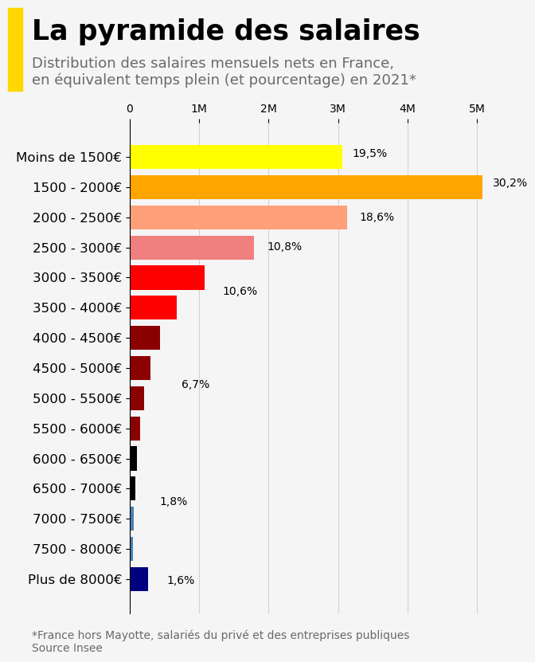

## About

This plot is a [histogram](https://python-graph-gallery.com/histogram/). This post is a translation to Python by [Joseph B.](https://www.barbierjoseph.com). 

Thanks to him for accepting sharing his work here!

As a teaser, here is the plot we’re gonna try building:


## Libraries

For creating this chart, we will need a whole bunch of libraries!

```python
import matplotlib.pyplot as plt # plotting the chart
import matplotlib.patches as patches # add yellow rectangle
import pandas as pd # data manipulation
from matplotlib.patches import Rectangle
```

## Dataset

The data can be accessed using the **url below**.

```python
url = 'https://raw.githubusercontent.com/holtzy/The-Python-Graph-Gallery/master/static/data/insee_salaries.csv'
df = pd.read_csv(url)
```

## Creating the chart

Here's the following things we do in order to customize our [histogram](https://python-graph-gallery.com/histogram/):

- We initialize a **cartesian coordinate layout** for the plot and set the **background color** of both the plot and figure to `"whitesmoke"`
- Defines a **list of colors** to be used for each bar in the [histogram](https://python-graph-gallery.com/histogram/)
- Creates the horizontal [histogram](https://python-graph-gallery.com/histogram/) using the `ax.barh()` method, where `df['range']` represents the horizontal positions of the bars, and `df['people']` represents the heights of the bars. The specified colors are used for the bars
- Adds vertical **grid lines** to the chart with specified linestyle, opacity, and axis
- Sets the **title**, **subtitle**, and details/credit text for the chart using the `fig.text()` function. It also specifies the font size, color, and alignment for these text elements.
- Removes the `spines` (border lines) from the chart's top, right, and bottom edges to give it a **clean appearance**
- Changes the position and **labels** of the y-axis ticks and moves the x-axis ticks **to the top of the chart**
- Adds a **yellow rectangle** to the figure using Matplotlib's `patches.Rectangle()` to highlight a specific area
- Adds **percentage labels** at various positions on the chart using the `ax.text()` function

Finally, it displays the chart using `plt.show()`.

```python
# Initialize layout in polar coordinates
fig, ax = plt.subplots(figsize=(6, 8))

# Add grey background in the ax and fig
ax.set_facecolor('whitesmoke')
fig.set_facecolor('whitesmoke')

# Define colors to use for each bar
colors = ['navy', 'steelblue', 'steelblue', 'black', 'black', 'darkred',
          'darkred', 'darkred', 'darkred', 'red', 'red', 'lightcoral', 'lightsalmon',
          'orange', 'yellow', 'lightyellow']

# Create the plot
ax.barh(df['range'], df['people'],
        color=colors, # colors that we want
        zorder=2, # specify that the bars is drawn after the grid
       )

# Add a vertical grey line at the relative position
ax.grid(linestyle='-', # type of lines
        alpha=0.5, # opacity
        axis='x', # specify that we only want vertical lines
       )

# Title of our graph 
title = 'La pyramide des salaires'
fig.text(-0.08, 1.01, # relative postion
         title, 
         fontsize=25, # High font size for style
         fontweight = 'bold',
         ha='left', # align to the left
         family='dejavu sans'
        )

# Subtitle of our graph
subtitle = 'Distribution des salaires mensuels nets en France,\nen équivalent temps plein (et pourcentage) en 2021*'
fig.text(-0.08, 0.94, # relative postion
         subtitle, 
         fontsize=13, # High font size for style
         color='dimgrey',
         ha='left', # align to the left
         family='dejavu sans'
        )

# Details and Credit
text = '*France hors Mayotte, salariés du privé et des entreprises publiques\nSource Insee'
fig.text(-0.08, 0.05, # relative postion
         text, 
         fontsize=10, # High font size for style
         color='dimgrey',
         ha='left', # align to the left
         family='dejavu sans'
        )

# Remove the spines (border lines) from the chart
ax.spines['top'].set_visible(False)
ax.spines['right'].set_visible(False)
ax.spines['bottom'].set_visible(False)

# Change axis position and labels
ax.tick_params(axis='y', labelsize=12)
ax.set_xticklabels(['0', '1M', '2M', '3M', '4M', '5M', '6M'])
ax.xaxis.tick_top()

# Add yellow rectangle
rectangle_color = 'gold'
rect = patches.Rectangle((-0.13, 0.93), 0.03, 0.13,
                         linewidth=1, edgecolor=rectangle_color,
                         facecolor=rectangle_color, transform=fig.transFigure)
fig.patches.append(rect)

# Add percents
ax.text(0.6,0.93, # relative position
        '19,5%', # label
        transform=ax.transAxes,
        size=10, # text size
       )
ax.text(0.98,0.87, # relative position
        '30,2%', # label
        transform=ax.transAxes,
        size=10, # text size
       )
ax.text(0.62,0.8, # relative position
        '18,6%', # label
        transform=ax.transAxes,
        size=10, # text size
       )
ax.text(0.37,0.74, # relative position
        '10,8%', # label
        transform=ax.transAxes,
        size=10, # text size
       )
ax.text(0.25,0.65, # relative position
        '10,6%', # label
        transform=ax.transAxes,
        size=10, # text size
       )
ax.text(0.14,0.46, # relative position
        '6,7%', # label
        transform=ax.transAxes,
        size=10, # text size
       )
ax.text(0.08,0.22, # relative position
        '1,8%', # label
        transform=ax.transAxes,
        size=10, # text size
       )
ax.text(0.1,0.06, # relative position
        '1,6%', # label
        transform=ax.transAxes,
        size=10, # text size
       )

# Display the final chart
plt.show()
```

:::output

:::

## Going further

This article explains how to reproduce a [histogram](https://python-graph-gallery.com/histogram/) with nice customization features and annotations.

For more examples of **advanced customization**, check out this [other nice chart with annotations](https://python-graph-gallery.com/web-stacked-line-chart-with-labels/). Also, you might be interested in [adding an image](https://python-graph-gallery.com/513-add-logo-matplotlib/) to your chart.
