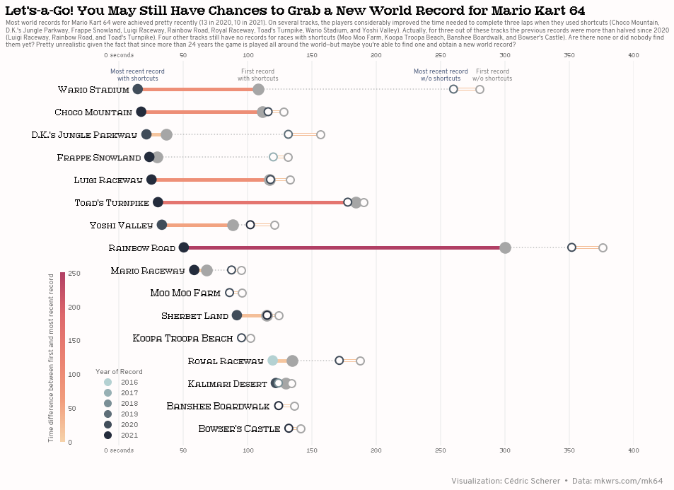

## About

This page showcases the work of [Cedric Scherer](https://www.cedricscherer.com), 
built for the [TidyTuesday](https://github.com/rfordatascience/tidytuesday) 
initiative. You can find the original code on his github repository 
[here](https://github.com/z3tt/TidyTuesday/blob/master/R/2021_22_MarioKart.Rmd), written in [R](https://www.r-graph-gallery.com).

Thanks to him for accepting sharing his work here! Thanks also to [Tomás Capretto](https://tomicapretto.github.io/) who translated this work from R to Python! 🙏🙏

As a teaser, here is the plot we’re gonna try building:


## Load libraries

As always, several libraries are needed in order to build the chart. `numpy`, `pandas` and `matplotlib` are pretty usual, but we also need some lesser known libraries like `palettable` to get some nice colors.

```python
import numpy as np
import pandas as pd
import matplotlib.colors as mc
import matplotlib.pyplot as plt

from matplotlib.cm import ScalarMappable
from matplotlib.lines import Line2D
from mpl_toolkits.axes_grid1.inset_locator import inset_axes
from palettable import cartocolors
```

## Load the dataset

Today we are going to visualize world records for the Mario Kart 64 game. The game consists of 16 individual tracks and world records can be achieved for the fastest *single lap* or the fastest completed race (**three laps**). Also, through the years, players discovered **shortcuts** in many of the tracks.  Fortunately, shortcut and non-shortcut world records are listed separately.

Our chart consists of a double-dumbbell plot where we visualize world record times on Mario Kart 64 with and without shortcuts. The original source of the data is [https://mkwrs.com/](https://mkwrs.com/), which holds time trial world records for all of the Mario Kart games, but we are using the version released for the [TidyTuesday](https://github.com/rfordatascience/tidytuesday) initiative on the week of 2021-05-25. You can find the original announcement and more information about the data [here](https://github.com/rfordatascience/tidytuesday/tree/master/data/2021/2021-05-25).

```python
df_records = pd.read_csv('https://raw.githubusercontent.com/rfordatascience/tidytuesday/master/data/2021/2021-05-25/records.csv')
df_records.head(3)
```

:::output
::output-html{src="./output-1.html"}
:::

<br>
<br>
<br>
<br>

From all the columns in the data, we will only use `track`, `type`, `shortcut`, `date`, and `time`. 
- `track` indicates the name of the track
- `type` tells us whether the record is for single lap or a complete race
- `shortcut` is a yes/no variable that identifies records where a shortcut was used
- `date` represents the date where the record was achieved
- `time` indicates how many seconds it took to complete the track

## Prepare the dataset

Today's visualization is based on records for complete races only. Our first step is to create a `pandas.DataFrame` called `df_rank` that keeps current world records for every track.
<!--  Do you prefer this approach instead?
df_rank = df_records.query("type == 'Three Lap'")
df_rank = (
    df_rank.loc[df_rank.groupby("track")["time"].idxmin()]
     .sort_values("time", ascending=False)
     .assign(track = lambda df: pd.Categorical(df['track'], ordered=True, categories=df["track"]))
) 
-->

```python
# Keep records where type is Three Lap
df_rank = df_records.query("type == 'Three Lap'")

# Keep records with the minimum time for each track
df_rank = df_rank.loc[df_rank.groupby("track")["time"].idxmin()]

# Sort by descending time
df_rank = df_rank.sort_values("time", ascending=False)

# Make "track" ordered categorical with order given by descending times
# This categorical type will be used to sort the tracks in the plot.
df_rank["track"] = pd.Categorical(df_rank["track"], ordered=True,  categories=df_rank["track"])
```

Then we have `df_records_three` which holds all the records, no matter they were beaten or not. It is used to derive other data frames that used in our chart.

```python
# We call '.reset_index()' to avoid SettingWithCopyWarning
df_records_three = df_records.query("type == 'Three Lap'").reset_index() 
df_records_three["year"] = pd.DatetimeIndex(df_records_three["date"]).year
```

`df_connect` is the first data frame we derive. This one is used to add a dotted line that connects record times with and without shortcuts and will serve as a reference for their difference.

```python
# First of all, for each track and shortcut, obtain the minimum and maximum
# value of time. These represent the most recent and first records, respectively.
df_connect = df_records_three.groupby(["track", "shortcut"]).agg(
    no = ("time", min),
    yes = ("time", max)
).reset_index()

# Next, put it into long format.
# Each row indicates the track, whether shortcuts were used, 
# if it's the current record, and the time achieved.
df_connect = pd.melt(
    df_connect,
    id_vars=["track", "shortcut"],
    value_vars=["no", "yes"],
    var_name="record",
    value_name="time"
)

# The dotted line goes from the first record without shortcut (the slowest)
# to the most recent record with shortcut (the fastest)
df_connect = df_connect.query(
    "(shortcut == 'No' and record == 'no') or (shortcut == 'Yes' and record == 'yes')"
)

# Finally it is put in wide format, where there's only one row per track.
df_connect = df_connect.pivot_table(index="track", columns="record", values="time").reset_index()
```

We also have `df_longdist` and `df_shortcut`. Note each data frame consists of five columns: `track`, `year`, `max`, `min`, and `diff`. `year` refers to the year where the current record was achieved, `max` is the completetion time for the first record and `min` is the time for the current record. `diff` is simply the difference between `max` and `min`, i.e. a measurement of how much the first record was improved. `df_shortcut` and `df_longdist` refer to records with and without shortcuts, respectively.

```python
# Long dist refers to records without shortcut
df_longdist = df_records_three.query("shortcut == 'No'")

# Only keep observations referring to either the first or the most recent record, by track.
grouped = df_longdist.groupby("track")
df_longdist = df_longdist.loc[pd.concat([grouped["time"].idxmax(), grouped["time"].idxmin()])]

# Create a 'group' variable that indicates whether the record
# refers to the first record, the one with maximum time,
# or to the most recent record, the one with minimum time.
df_longdist.loc[grouped["time"].idxmax(), "group"] = "max"
df_longdist.loc[grouped["time"].idxmin(), "group"] = "min"

# 'year' records the year of the most recent record
df_longdist["year"] = df_longdist.groupby("track")['year'].transform(max)

# Put the data in wide format, i.e., one observation per track.
df_longdist = df_longdist.pivot_table(index=["track", "year"], columns="group", values="time").reset_index()
df_longdist["diff"] = df_longdist["max"] - df_longdist["min"]
```

```python
# Same process than above, but using records where shortcut is "Yes"
df_shortcut = df_records_three.query("shortcut == 'Yes'")
grouped = df_shortcut.groupby("track")
df_shortcut = df_shortcut.loc[pd.concat([grouped["time"].idxmax(), grouped["time"].idxmin()])]
df_shortcut.loc[grouped["time"].idxmax(), "group"] = "max"
df_shortcut.loc[grouped["time"].idxmin(), "group"] = "min"

df_shortcut["year"] = df_shortcut.groupby("track")['year'].transform(max)
df_shortcut = df_shortcut.pivot_table(index=["track", "year"], columns="group", values="time").reset_index()
df_shortcut["diff"] = df_shortcut["max"] - df_shortcut["min"]
```

All the datasets are sorted according to the order of `"track"` in `df_rank`. To do so, we first set the type of the `"track"` variable equal to the categorical type in `df_rank`, and then sort according to its levels.

```python
tracks_sorted = df_rank["track"].dtype.categories.tolist()
```

```python
# Sort df_connect
df_connect["track"] = df_connect["track"].astype("category")
df_connect["track"].cat.set_categories(tracks_sorted, inplace=True)
df_connect = df_connect.sort_values("track")

# Sort df_longdist
df_longdist["track"] = df_longdist["track"].astype("category")
df_longdist["track"].cat.set_categories(tracks_sorted, inplace=True)
df_longdist = df_longdist.sort_values("track")

# Sort df_shortcut
df_shortcut["track"] = df_shortcut["track"].astype("category")
df_shortcut["track"].cat.set_categories(tracks_sorted, inplace=True)
df_shortcut = df_shortcut.sort_values("track")
```

## Start building the chart

This highly customized plot demands a lot of code. It is a good practice to define the colors at the very beginning so we can refer to them by name.

```python
GREY94 = "#f0f0f0"
GREY75 = "#bfbfbf"
GREY65 = "#a6a6a6"
GREY55 = "#8c8c8c"
GREY50 = "#7f7f7f"
GREY40 = "#666666"
LIGHT_BLUE = "#b4d1d2"
DARK_BLUE = "#242c3c"
BLUE = "#4a5a7b"
WHITE = "#FFFCFC" # technically not pure white
```

Today we make use of the `palettable` library to make use of the `RedOr` palette, which is the one used in the original plot. We will also make use of the `matplotlib.colors.Normalize` class to normalize values into the (0, 1) interval before we pass it to our `colormap` function and `matplotlib.colors.LinearSegmentedColormap` to create a custom colormap for blue colors.

```python
# We have two colormaps, one for orange and other for blue
colormap_orange = cartocolors.sequential.RedOr_5.mpl_colormap

# And we also create a new colormap using 
colormap_blue = mc.LinearSegmentedColormap.from_list("blue", [LIGHT_BLUE, DARK_BLUE], N=256)
```

`colormap_orange and` and `colormap_blue` are functions now.

```python
fig, ax = plt.subplots(figsize = (15, 10))

# Add segments ---------------------------------------------------
# Dotted line connection shortcut yes/no
ax.hlines(y="track", xmin="yes", xmax="no", color=GREY75, ls=":", data=df_connect)

# Segment when shortcut==yes
# First time we use the colormap and the normalization
norm_diff = mc.Normalize(vmin=0, vmax=250)
color = colormap_orange(norm_diff(df_shortcut["diff"].values))
ax.hlines(y="track", xmin="min", xmax="max", color=color, lw=5, data=df_shortcut)

# Segment when shortcut==no. Note we are overlapping lineranges
# We use the same normalization scale.
color = colormap_orange(norm_diff(df_longdist["diff"].values))
ax.hlines(y="track", xmin="min", xmax="max", color=color, lw=4, data=df_longdist)
ax.hlines(y="track", xmin="min", xmax="max", color=WHITE, lw=2, data=df_longdist)


# Add dots -------------------------------------------------------
## Dots when shortcut==yes – first record
# zorder is added to ensure dots are on top
ax.scatter(x="max", y="track", s=200, color=GREY65, edgecolors=GREY65, lw=2.5, zorder=2, data=df_shortcut)

## Dots when shortcut==yes – latest record
# This time we normalize using the range of years in the data, and use blue colormap
norm_year = mc.Normalize(df_shortcut["year"].min(), df_shortcut["year"].max())
color = colormap_blue(norm_year(df_shortcut["year"].values))
ax.scatter(x="min", y="track", s=160, color=color, edgecolors=color, lw=2, zorder=2, data=df_shortcut)

## Dots shortcut==no – first record
color = colormap_blue(norm_year(df_longdist["year"].values))
ax.scatter(x="min", y="track", s=120, color=WHITE, edgecolors=color, lw=2, zorder=2, data=df_longdist)

## Dots shortcut==no – latest record
ax.scatter(x="max", y="track", s=120, color=WHITE, edgecolors=GREY65, lw=2, zorder=2, data=df_longdist)


# Add labels on the left side of the lollipops -------------------
# Annotations for tracks in df_shortcut
for row in range(df_shortcut.shape[0]):
     ax.text(
        df_shortcut["min"][row] - 7, 
        df_shortcut["track"][row], 
        df_shortcut["track"][row], 
        ha="right", 
        va="center",
        size=16, 
        color="black",
        fontname="Atlantis"
    )

# Annotations for df_longdist, not in df_shortcut
for row in range(df_longdist.shape[0]):
    if df_longdist["track"][row] not in df_shortcut["track"].values:
        ax.text(
            df_longdist["min"][row] - 7, 
            df_longdist["track"][row], 
            df_longdist["track"][row], 
            ha="right", 
            va="center",
            size=17,
            color="black",
            fontname="Atlantis",
        )

# Add labels on top of the first row of lollipops ----------------
# These labels are used to give information about the meaning of
# the different dots without having to use a legend.

# Label dots when shortcut==yes
df_shortcut_wario = df_shortcut.query("track == 'Wario Stadium'")
ax.text(
    df_shortcut_wario["min"], 
    df_shortcut_wario["track"], 
    "Most recent record\nwith shortcuts\n", 
    color=BLUE,
    ma="center",
    va="bottom",
    ha="center",
    size=9,
    fontname="Overpass"
)
ax.text(
    df_shortcut_wario["max"], 
    df_shortcut_wario["track"], 
    "First record\nwith shortcuts\n", 
    color=GREY50,
    ma="center",
    va="bottom",
    ha="center",
    size=9,
    fontname="Overpass"
)

# Label dots when shortcut==no
df_longdist_wario = df_longdist.query("track == 'Wario Stadium'")

ax.text(
    df_longdist_wario["min"] - 10, 
    df_longdist_wario["track"], 
    "Most recent record\nw/o shortcuts\n", 
    color=BLUE,
    ma="center",
    va="bottom",
    ha="center",
    size=9,
    fontname="Overpass"
)
ax.text(
    df_longdist_wario["max"] + 10, 
    df_longdist_wario["track"], 
    "First record\nw/o shortcuts\n", 
    color=GREY50,
    ma="center",
    va="bottom",
    ha="center",
    size=9,
    fontname="Overpass"
)

# Customize the layout -------------------------------------------

# Hide spines
ax.spines["left"].set_visible(False)
ax.spines["right"].set_visible(False)
ax.spines["top"].set_visible(False)
ax.spines["bottom"].set_visible(False)

# Hide y labels
ax.yaxis.set_visible(False)

# Customize x ticks
# * Remove x axis ticks 
# * Put labels on both bottom and and top
# * Customize the tick labels. Only the first has the "seconds" appended.
ax.tick_params(axis="x", bottom=True, top=True, labelbottom=True, labeltop=True, length=0)
xticks = np.linspace(0, 400, num=9, dtype=int).tolist()
ax.set_xlim(-60, 400)
ax.set_xticks(xticks)
ax.set_xticklabels(["0 seconds"] + xticks[1:], fontname="Hydrophilia Iced", color=GREY40, size=9)

# Set background color for the subplot.
ax.set_facecolor(WHITE)


# Add thin vertical lines to serve as guide
# 'zorder=0' is imoprtant to they stay behind other elements in the plot.
for xtick in xticks:
    ax.axvline(xtick, color=GREY94, zorder=0)

# Add vertical space to the vertical limit in the plot
x0, x1, y0, y1 = plt.axis()
plt.axis((x0, x1, y0, y1 + 0.5));


# Add custom legends ---------------------------------------------

# Legend for time difference. 

# Recall the 'norm_diff()' created above.
# Create an inset axes with a given width and height.
cbaxes = inset_axes(
    ax, width="0.8%", height="44%", loc=3,
    bbox_to_anchor=(0.025, 0., 1, 1), 
    bbox_transform=ax.transAxes
) 

cb = fig.colorbar(
    ScalarMappable(norm=norm_diff, cmap=colormap_orange), cax=cbaxes, 
    ticks=[0, 50, 100, 150, 200, 250]
)

# Remove the outline of the colorbar
cb.outline.set_visible(False)

# Set label, playing with labelpad to put it in the right place
cb.set_label(
    "Time difference between first and most recent record", 
    labelpad=-45,
    color=GREY40, 
    size=10, 
    fontname="Overpass"
)

# Remove ticks in the colorbar with 'size=0'
cb.ax.yaxis.set_tick_params(
    color=GREY40,
    size=0
)

# Add ticklabels at given positions, with custom font and color
cb.ax.yaxis.set_ticklabels(
    [0, 50, 100, 150, 200, 250], 
    fontname="Hydrophilia Iced", 
    color=GREY40, 
    size=10
)

# Legend for year

# We create a custom function to put the Line2D elements into a list
# that then goes into the 'handle' argument of the 'ax.legend()'
years = [2016, 2017, 2018, 2019, 2020, 2021]
def legend_dot(year):
    line = Line2D(
        [0], 
        [0], 
        marker="o",
        markersize=10,
        linestyle="none",
        color=colormap_blue(norm_year(year)), 
        label=f"{year}"
    )
    return line

# Store the legend in a name because we use it to modify its elements
years_legend = ax.legend(
    title="Year of Record",
    handles=[legend_dot(year) for year in years], 
    loc=3, # lower left
    bbox_to_anchor=(0.08, 0, 1, 1),
    frameon=False
)

# Set font family, color and size to the elements in the legend
for text in years_legend.get_texts():
    text.set_fontfamily("Hydrophilia Iced")
    text.set_color(GREY40)
    text.set_fontsize(10)

# Same modifications, but applied to the title.
legend_title = years_legend.get_title()
legend_title.set_fontname("Overpass")
legend_title.set_color(GREY40)
legend_title.set_fontsize(10)

# The suptitle acts as the main title.
# Play with 'x' and 'y' to get them in the place you want.
plt.suptitle(
    "Let's-a-Go!  You  May  Still  Have  Chances  to  Grab  a  New  World  Record  for  Mario  Kart  64",
    fontsize=13,
    fontname="Atlantis Headline",
    weight="bold",
    x = 0.457,
    y = 0.99
    
)

subtitle = [
    "Most world records for Mario Kart 64 were achieved pretty recently (13 in 2020, 10 in 2021). On several tracks, the players considerably improved the time needed to complete three laps when they used shortcuts (Choco Mountain,",
    "D.K.'s Jungle Parkway, Frappe Snowland, Luigi Raceway, Rainbow Road, Royal Raceway, Toad's Turnpike, Wario Stadium, and Yoshi Valley). Actually, for three out of these tracks the previous records were more than halved since 2020", 
    "(Luigi Raceway, Rainbow Road, and Toad's Turnpike). Four other tracks still have no records for races with shortcuts (Moo Moo Farm, Koopa Troopa Beach, Banshee Boardwalk, and Bowser's Castle). Are there none or did nobody find", 
    "them yet? Pretty unrealistic given the fact that since more than 24 years the game is played all around the world—but maybe you're able to find one and obtain a new world record?"
]
# And the axis title acts as a subtitle.
ax.set_title(
    "\n".join(subtitle),
    loc="center",
    ha="center",
    ma="left",
    color=GREY40,
    fontname="Overpass",
    fontsize=9,
    pad=20
)

# Add legend
fig.text(
    0.8, .05, "Visualization: Cédric Scherer  •  Data: mkwrs.com/mk64", 
    fontname="Overpass", 
    fontsize=12, 
    color=GREY55, 
    ha="center"
)

# Set figure's background color, to match subplot background color.
fig.patch.set_facecolor(WHITE)

# Finally, save the plot!
plt.savefig(
    "mario-kart-64-world-records.png", 
    facecolor=WHITE, 
    dpi=300,
    bbox_inches="tight",
    pad_inches=0.3
)
```

:::output

:::

## Conclusion

That was a lot of work! And many more lines of code than using R. But here we are, a pretty good looking lollipop chart showcasing the possibilities offered by Matplotlib, which are basically infinite!
