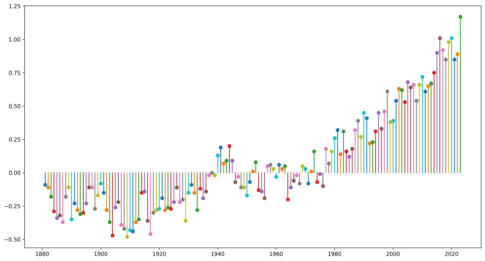
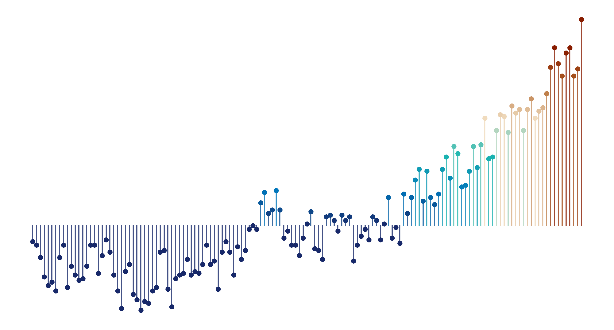
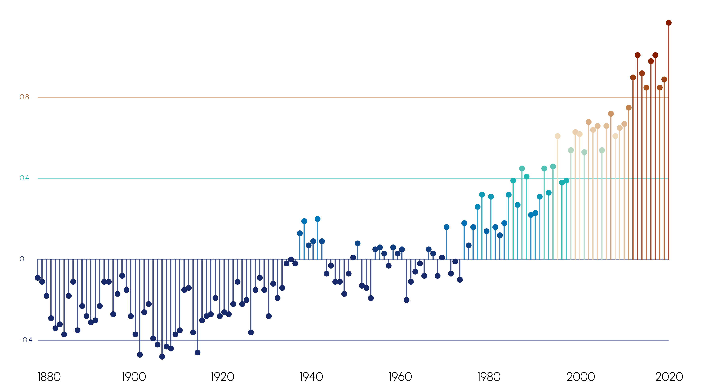
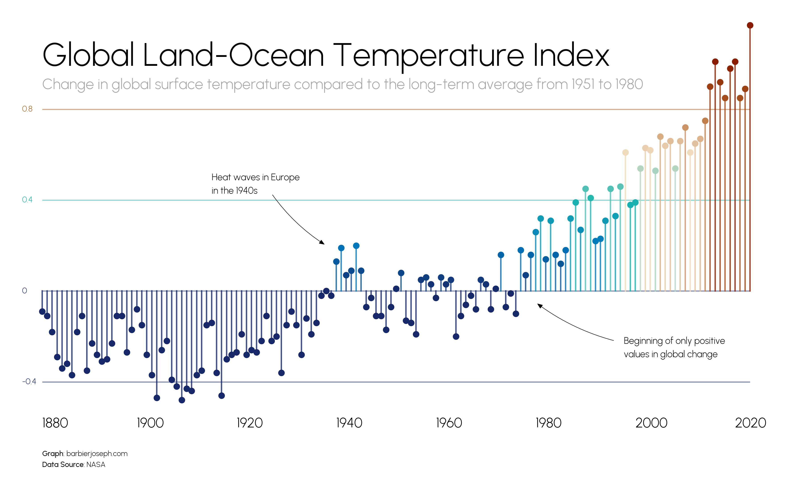

## About

This plot is a [lollipop plot](/lollipop-plot). It shows the evolution of temperature variation compared to the average between 1951 and 1980.

The chart was made by [Joseph Barbier](https://www.barbierjoseph.com/). Thanks to him for accepting sharing his work here!

Let's see what the final picture will look like:


## Libraries

First, you need to install the following librairies:

- [matplotlib](/matplotlib) is used for creating the chart and add customization features
- [pandas](/pandas) for loading the dataset
- [pypalettes](/color-palette-finder) is used to get a nice color palette
- [pyfonts](/pyfonts) is used to load the font
- [drawarrow](/drawarrow) is used to make the arrow
- [highlight_text](/advanced-custom-annotations-matplotlib): to add beautiful annotations to the chart

And that's it!

```python
import pandas as pd
import matplotlib.pyplot as plt
from pypalettes import load_cmap
from pyfonts import load_google_font
from highlight_text import ax_text
from drawarrow import ax_arrow
```

## Dataset

For this reproduction, we're going to retrieve the data directly from the [gallery's Github repo](https://github.com/holtzy/The-Python-Graph-Gallery). This means we just need to **give the right url as an argument** to pandas' `read_csv()` function to retrieve the data.

```python
path = "https://raw.githubusercontent.com/holtzy/The-Python-Graph-Gallery/master/static/data/temperature-variation.csv"
df = pd.read_csv(path)
df.head()
```

:::output
::output-html{src="./output-1.html"}
:::

## Basic lollipop

Although the `stem()` function in Matplotlib is **designed for lollipop plots**, we'll use `plot()` and `scatter()` instead to manually add the lines and points. This approach simplifies customizing the color of each lollipop in the next step.

We add each point and each line using a `for` loop, which **iterates on each row** of our dataframe.

```python
fig, ax = plt.subplots(figsize=(15, 8), dpi=300)

for i, row in df.iterrows():
    year = row["Year"]
    change = row["Change"]
    ax.scatter(x=year, y=change)
    ax.plot([year, year], [0, change])

plt.show()
```

:::output

:::

## Removes axis and custom color

In this step, we'll load a color map using `load_cmap()` from [pypalettes](/color-palette-finder), selecting the [Coconut](https://python-graph-gallery.com/color-palette-finder/?palette=coconut) palette for its gradient from blue ("cold") to red ("hot").

Then, within the `for` loop, we'll retrieve the appropriate **color based on the value** (temperature change in this case) and apply it to both `scatter()` and `plot()`.

And finally we remove all elements of the axis with `ax.set_axis_off()` since it's not very good looking and want to create our own.

```python
cmap = load_cmap("Coconut", cmap_type="continuous", reverse=True)
fig, ax = plt.subplots(figsize=(15, 8), dpi=300)
ax.set_axis_off()

for i, row in df.iterrows():
    year = row["Year"]
    change = row["Change"]
    color = cmap(change)
    ax.scatter(x=year, y=change, color=color)
    ax.plot([year, year], [0, change], color=color, alpha=0.8)

plt.show()
```

:::output

:::

## Create custom axis

To draw custom axes for this chart:

- **X-Axis Labels**:

  - For each year divisible by 20 (`if year % 20 == 0`):
    - `ax.text(x=year, y=-0.6, s=f'{year:.0f}', ...)` adds the year as a label below the x-axis.
  - Adds an extra label for 1880 manually since it's not in the original data.

- **Horizontal Lines (Custom Y-Axis)**:

  - `ax.hlines(y=h_lines, xmin=1881, xmax=2023, ...)` draws horizontal lines at specified `h_lines` values.
  - `xmin` and `xmax` define the line's start and end on the x-axis.

- **Y-Axis Labels**:
  - For each value in `h_lines`, `ax.text(x=1877, y=value, s=f'{value}', ...)` adds the value as a label beside the y-axis.

```python
cmap = load_cmap("Coconut", cmap_type="continuous", reverse=True)
font = load_google_font("Urbanist", weight="light")
bold_font = load_google_font("Urbanist", weight="medium")

fig, ax = plt.subplots(figsize=(15, 8), dpi=300)
ax.set_axis_off()

for i, row in df.iterrows():
    year = row["Year"]
    change = row["Change"]
    color = cmap(change)
    ax.scatter(x=year, y=change, color=color)
    ax.plot([year, year], [0, change], color=color, alpha=0.8)

    if year % 20 == 0:
        ax.text(x=year, y=-0.6, s=f"{year:.0f}", font=font, size=15, ha="left")
ax.text(x=1881, y=-0.6, s=f"{1880}", font=font, size=15, ha="left")

h_lines = [-0.4, 0, 0.4, 0.8]
ax.hlines(
    y=h_lines,
    xmin=1881,
    xmax=2023,
    colors=[cmap(val) for val in h_lines],
    linewidth=1.2,
    zorder=-1,
    alpha=0.5,
)
for value in h_lines:
    ax.text(
        x=1877, y=value, s=f"{value}", font=font, color=cmap(value), size=9, va="center"
    )

plt.show()
```

:::output

:::

## Final chart with annotations

Once we have the core of the chart, we just need to **add some annotations**:

- the fonts are loaded thanks to [pyfonts](/pyfonts)
- the arrows are added thanks to [drawarrow](/drawarrow)
- the text in the annotations is formatted thanks to [highlight_text](/advanced-custom-annotations-matplotlib)

```python
cmap = load_cmap("Coconut", cmap_type="continuous", reverse=True)
font = load_google_font("Urbanist", weight="light")
bold_font = load_google_font("Urbanist", weight="medium")
arrow_props = dict(color="black", width=0.5, head_width=2, head_length=5, radius=0.1)

fig, ax = plt.subplots(figsize=(15, 8), dpi=300)
ax.set_axis_off()

for i, row in df.iterrows():
    year = row["Year"]
    change = row["Change"]
    color = cmap(change)
    ax.scatter(x=year, y=change, color=color)
    ax.plot([year, year], [0, change], color=color, alpha=0.8)

    if year % 20 == 0:
        ax.text(x=year, y=-0.6, s=f"{year:.0f}", font=font, size=15, ha="left")
ax.text(x=1881, y=-0.6, s=f"{1880}", font=font, size=15, ha="left")

h_lines = [-0.4, 0, 0.4, 0.8]
ax.hlines(
    y=h_lines,
    xmin=1881,
    xmax=2023,
    colors=[cmap(val) for val in h_lines],
    linewidth=1.2,
    zorder=-1,
    alpha=0.5,
)
for value in h_lines:
    ax.text(
        x=1877, y=value, s=f"{value}", font=font, color=cmap(value), size=9, va="center"
    )

s = "Global Land-Ocean Temperature Index"
ax_text(x=1881, y=1.1, s=s, font=font, size=35, ha="left")

s = "Change in global surface temperature compared to the long-term average from 1951 to 1980"
ax_text(x=1881, y=0.94, s=s, font=font, size=16, ha="left", color="grey", alpha=0.7)

s = "<Graph>: barbierjoseph.com\n<Data Source>: NASA"
ax_text(
    x=1881,
    y=-0.7,
    s=s,
    font=font,
    size=8,
    ha="left",
    highlight_textprops=[{"font": bold_font}] * 2,
)

s = "Heat waves in Europe\nin the 1940s"
ax_text(x=1915, y=0.52, s=s, font=font, size=10, ha="left")
ax_arrow(tail_position=(1927, 0.43), head_position=(1938, 0.2), **arrow_props)

s = "Beginning of only positive\nvalues in global change"
ax_text(x=2018, y=-0.2, s=s, font=font, size=10, ha="right")
ax_arrow(
    tail_position=(1996, -0.22), head_position=(1980, -0.05), invert=True, **arrow_props
)

plt.savefig(
    "../../static/graph/web-lollipop-with-colormap-and-arrow.png",
    dpi=300,
    bbox_inches="tight",
)
plt.show()
```

:::output

:::

## Going further

You might be interested in:

- how to create a [dumbell chart](/web-lollipop-plot-with-python-mario-kart-64-world-records)
- how to use a [lollipop for a time series](/web-lollipop-plot-with-python-the-office)
- this tuto about [circular lollipop](/web-circular-lollipop-plot-with-matplotlib)
