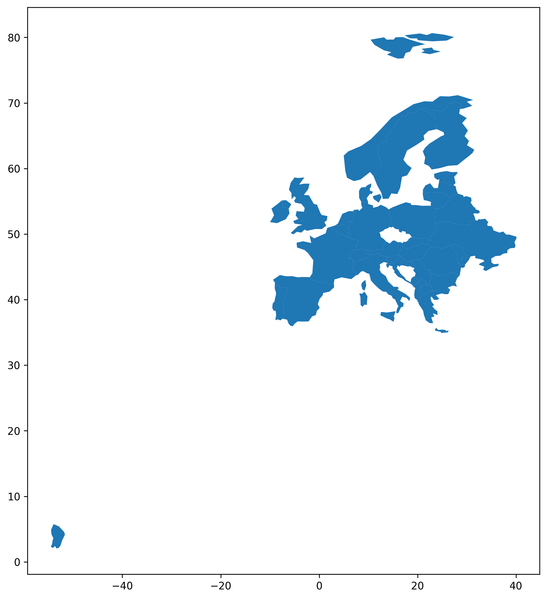
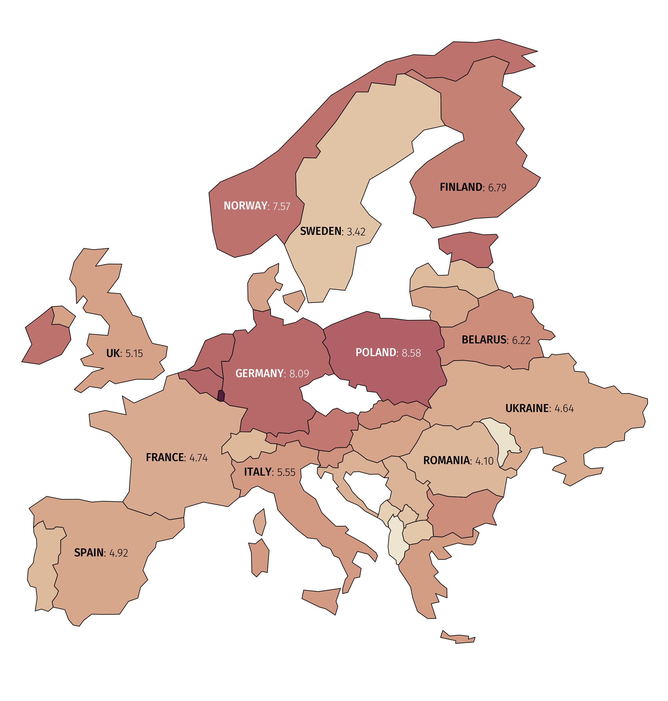
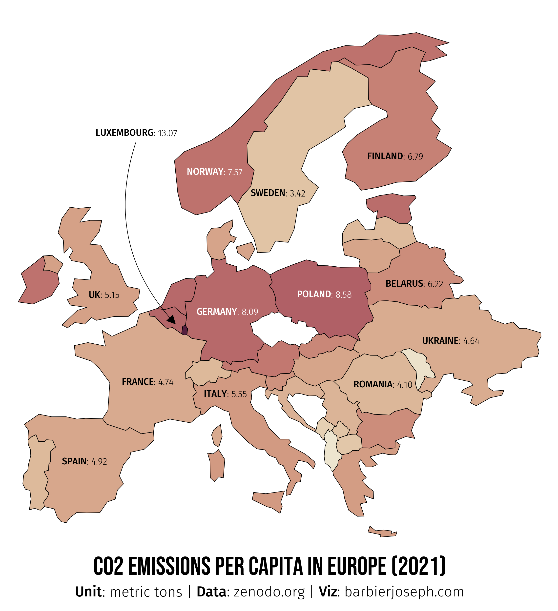
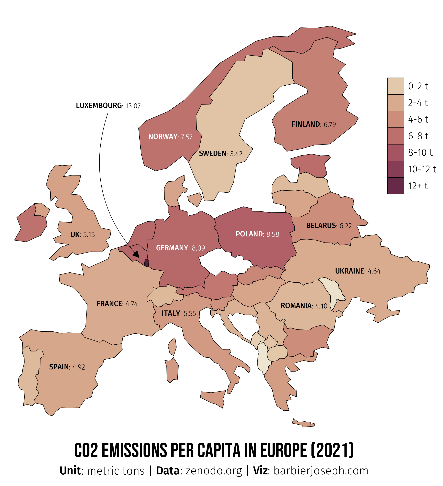

## About

This plot is a [choropleth map](/choropleth-map). It show the CO2 emissions per capita in 2021 for each country.

The chart was made by [Joseph Barbier](https://www.barbierjoseph.com/). Thanks to him for accepting sharing his work here!

Let's see what the final picture will look like:


## Libraries

First, you need to install the following librairies:

- [matplotlib](/matplotlib) is used for creating the chart and add customization features
- [pandas](/pandas) and `geopandas` are used to put the data into a dataframe and manipulate geographical data
- [drawarrow](/drawarrow) for the arrows
- [pyfonts](/pyfonts) for the fonts
- `geopandas`: for the geographical data
- `highlight_text`: to add beautiful annotations to the chart

And that's it!

```python
import pandas as pd
import geopandas as gpd
import matplotlib.pyplot as plt
from pypalettes import load_cmap
from drawarrow import fig_arrow
from pyfonts import load_google_font

from highlight_text import fig_text, ax_text
```

## Dataset

**Creating a [choropleth map](/choropleth-map)** necessitates a **dataset with geographical information**. For this example, we need to **load the world map** from the [Gallery's repo](https://github.com/holtzy/The-Python-Graph-Gallery).

Next, we should **load the dataset containing the values** we want to represent on the map, such as **CO2 per capita by country**. This dataset is also accessible in the [Gallery's repo](https://github.com/holtzy/The-Python-Graph-Gallery).

```python
url = "https://raw.githubusercontent.com/holtzy/the-python-graph-gallery/master/static/data/europe.geojson"
world = gpd.read_file(url)
world.head()
```

:::output
::output-html{src="./output-1.html"}
:::

<br>

Now we merge this dataset with the world map with a `merge` function. This function will match the country names in the two datasets and add the CO2 values to the world map dataframe.

```python
url = "https://raw.githubusercontent.com/holtzy/the-python-graph-gallery/master/static/data/co2PerCapita.csv"
df = pd.read_csv(url)

# merge data
data = world.merge(df, how="left", left_on="name", right_on="Country")

# filter to keep only specific countries
data = data[data["continent"] == "Europe"]
data = data[~data["name"].isin(["Russia", "Iceland"])]
data = data[data["Year"] == 2021]
data = data[["name", "Total", "geometry"]]
data = data.dropna()
data.head()
```

:::output
::output-html{src="./output-2.html"}
:::

## Background map

Thanks to the `geopandas` library, we can easily add a **background map** to our plot by simply calling the `plot()` function on our **geo dataframe**.

With just a few lines of code, we can create a **synthetic map** that displays a **European map**.

```python
# initialize the figure
fig, ax = plt.subplots(figsize=(10, 10), dpi=300)

# create the plot
data.plot(ax=ax)
plt.show()
```

:::output

:::

## Custom axis

The next step is to **adjust the plot's ranges** (latitude and longitude) using the `set_xlim()` and `set_ylim()` functions on the axis object.

We also **remove the spines** around the map since they are not particularly useful in this context.

```python
# initialize the figure
fig, ax = plt.subplots(figsize=(10, 10), dpi=300)

# create the plot
data.plot(ax=ax)

# custom axis
ax.set_xlim(-11, 41)
ax.set_ylim(32, 73)
ax.set_axis_off()

plt.show()
```

:::output

:::

## Choropleth map

A [choropleth map](/choropleth-map) is distinct from a background map because it employs **color gradients** to depict data, with each country shaded according to its data value.

We initiate by loading a colormap via the `load_cmap()` function from the [pypalettes library](/color-palette-finder), subsequently integrating this colormap into the plot by including `cmap=cmap` in the `plot()` function.

To enhance readability, we also define the `edgecolor` and `linewidth` of the countries.

```python
# load colormap
cmap = load_cmap("BrwnYl", cmap_type="continuous")

# initialize the figure
fig, ax = plt.subplots(figsize=(10, 10), dpi=300)

# create the plot
data.plot(ax=ax, column="Total", cmap=cmap, edgecolor="black", linewidth=0.5)

# custom axis
ax.set_xlim(-11, 41)
ax.set_ylim(32, 73)
ax.set_axis_off()

plt.show()
```

:::output

:::

## Centroids and annotations

The easiest way to find the center of each country is to use the `centroid` attribute of the `geometry` column in the `geo dataframe`. These coordinates can then be used to add annotations to the map.

Since the default font isn't very attractive, we load **two other fonts**: one for the **title** and one for the **annotations**. We can then use the `ax_text()` function from the [`highlight_text` library](/advanced-custom-annotations-matplotlib) to add annotations to the map, and [pyfonts](/pyfonts) to load the fonts from Github.

Just before adding the annotations, we define an **adjustment dictionary** to help us improve the approximate position of the annotations. This is necessary because centroids aren't always ideally positioned for annotations, especially in countries with outlying islands.

```python
adjustments = {
    "France": (10, 3),
    "Italy": (-2.4, 2.5),
    "Finland": (0, -2),
    "Belarus": (0, -0.4),
    "Ireland": (0, -1),
    "Germany": (-0.2, 0),
    "Poland": (0, 0.2),
    "Sweden": (-1.2, -2.8),
    "United Kingdom": (1, -1.5),
    "Norway": (-4, -5.5),
}

# Example
print(adjustments["France"])
```

:::output
```text
(10, 3)
```
:::

```python
# load colormap and other colors
cmap = load_cmap("BrwnYl", cmap_type="continuous")
background_color = "white"
text_color = "black"

# load the fonts
font = load_google_font("Bebas Neue")
other_font = load_google_font("Fira Sans", weight="light")
other_bold_font = load_google_font("Fira Sans", weight="medium")

# initialize the figure
fig, ax = plt.subplots(figsize=(10, 10), dpi=300)
fig.set_facecolor(background_color)
ax.set_facecolor(background_color)

# create the plot
data.plot(ax=ax, column="Total", cmap=cmap, edgecolor="black", linewidth=0.5)

# custom axis
ax.set_xlim(-11, 41)
ax.set_ylim(32, 73)
ax.set_axis_off()

# compute the centroid of each country
data_projected = data.to_crs(epsg=3035)
data_projected["centroid"] = data_projected.geometry.centroid
data["centroid"] = data_projected["centroid"].to_crs(data.crs)

# define which countries to annotate
countries_to_annotate = [
    "France",
    "Italy",
    "Romania",
    "Poland",
    "Finland",
    "Ukraine",
    "Spain",
    "Germany",
    "Sweden",
    "United Kingdom",
    "Belarus",
    "Norway",
]

# annotate each country
for country in countries_to_annotate:
    centroid = data.loc[data["name"] == country, "centroid"].values[0]
    x, y = centroid.coords[0]
    try:
        x += adjustments[country][0]
        y += adjustments[country][1]
    except KeyError:
        pass
    rate = data.loc[data["name"] == country, "Total"].values[0]
    if country == "United Kingdom":
        country = "UK"
    if rate > 7:
        color_text = "white"
    else:
        color_text = text_color  # 'black'
    ax_text(
        x=x,
        y=y,
        s=f"<{country.upper()}>: {rate:.2f}",
        fontsize=9,
        font=other_font,
        color=color_text,
        ha="center",
        va="center",
        ax=ax,
        highlight_textprops=[{"font": other_bold_font}],
    )

plt.show()
```

:::output

:::

## Add title and Luxembourg

Since **Luxembourg** is a **small country**, we **annotate it outside** of the **map** and use an **arrow** to explicitly show its **position**. We use the `ax_text()` function from the `highlight_text` **library** to add the **annotation**.

The **arrow** is added using the [drawarrow](/drawarrow) library and its `fig_arrow` function.

To ensure the title is perfectly aligned with the source below, simply specify **`ha='center'`** in the **`ax_text()`** function. This guarantees that, regardless of the title's size, it will always be centered.

In other words, by using the same **`x`** value for both the title and the source, and setting **`ha='center'`**, the title will always be centered with the source.

```python
adjustments = {
    "France": (10, 3),
    "Italy": (-2.4, 2.5),
    "Finland": (0, -2),
    "Belarus": (0, -0.4),
    "Ireland": (0, -1),
    "Germany": (-0.2, 0),
    "Poland": (0, 0.2),
    "Sweden": (-1.2, -2.8),
    "United Kingdom": (1, -1.5),
    "Norway": (-4, -5.5),
}

# load colormap and other colors
cmap = load_cmap("BrwnYl", cmap_type="continuous")
background_color = "white"
text_color = "black"

# load the fonts
font = load_google_font("Bebas Neue")
other_font = load_google_font("Fira Sans", weight="light")
other_bold_font = load_google_font("Fira Sans", weight="medium")

# arrow properties
arrow_props = dict(width=0.5, head_width=4, head_length=8, color="black")

# initialize the figure
fig, ax = plt.subplots(figsize=(10, 10), dpi=300)
fig.set_facecolor(background_color)
ax.set_facecolor(background_color)

# create the plot
data.plot(ax=ax, column="Total", cmap=cmap, edgecolor="black", linewidth=0.5)

# custom axis
ax.set_xlim(-11, 41)
ax.set_ylim(32, 73)
ax.set_axis_off()

# compute the centroid of each country
data_projected = data.to_crs(epsg=3035)
data_projected["centroid"] = data_projected.geometry.centroid
data["centroid"] = data_projected["centroid"].to_crs(data.crs)

# define which countries to annotate
countries_to_annotate = [
    "France",
    "Italy",
    "Romania",
    "Poland",
    "Finland",
    "Ukraine",
    "Spain",
    "Germany",
    "Sweden",
    "United Kingdom",
    "Belarus",
    "Norway",
]

# annotate each country
for country in countries_to_annotate:
    centroid = data.loc[data["name"] == country, "centroid"].values[0]
    x, y = centroid.coords[0]
    try:
        x += adjustments[country][0]
        y += adjustments[country][1]
    except KeyError:
        pass
    rate = data.loc[data["name"] == country, "Total"].values[0]
    if country == "United Kingdom":
        country = "UK"
    if rate > 7:
        color_text = "white"
    else:
        color_text = text_color  # 'black'
    ax_text(
        x=x,
        y=y,
        s=f"<{country.upper()}>: {rate:.2f}",
        fontsize=9,
        font=other_font,
        color=color_text,
        ha="center",
        va="center",
        ax=ax,
        highlight_textprops=[{"font": other_bold_font}],
    )

# title
fig_text(
    s="CO2 emissions per capita in Europe (2021)",
    x=0.5,
    y=0.14,
    color=text_color,
    fontsize=25,
    font=font,
    ha="center",
    va="top",
    ax=ax,
)

# subtitle
fig_text(
    s="<Unit>: metric tons | <Data>: zenodo.org | <Viz>: barbierjoseph.com",
    x=0.5,
    y=0.1,
    color=text_color,
    fontsize=14,
    font=other_font,
    ha="center",
    va="top",
    ax=ax,
    highlight_textprops=[
        {"font": other_bold_font},
        {"font": other_bold_font},
        {"font": other_bold_font},
    ],
)

# arrows for the Luxembourg
luxembourg_values = data.loc[data["name"] == "Luxembourg", "Total"].values[0]
fig_arrow(
    tail_position=(0.32, 0.7), head_position=(0.375, 0.45), radius=0.3, **arrow_props
)
fig_text(
    s=f"<LUXEMBOURG>: {luxembourg_values:.2f}",
    x=0.32,
    y=0.71,
    highlight_textprops=[{"font": other_bold_font}],
    color=text_color,
    fontsize=9,
    font=other_font,
    ha="center",
    va="center",
    fig=fig,
)

plt.show()
```

:::output

:::

## Final Chart with Legend

Creating the legend for this chart involves some straightforward steps:

- **Define** `value_ranges` as a list storing the legend values: `[1, 3, 5, 7, 9, 11, 13, 15]`.
- **Define** `labels` as a list storing the legend labels: `['0-2 t', '2-4 t', '4-6 t', '6-8 t', '8-10 t', '10-12 t', '12+ t']`.

_Note that `value_ranges` contains one more element than the `labels` list due to the method used for color calculation._

```python
# load the colormap
cmap = load_cmap("BrwnYl", cmap_type="continuous")
background_color = "white"
text_color = "black"

value_ranges = [1, 3, 5, 7, 9, 11, 13, 15]
labels = ["0-2 t", "2-4 t", "4-6 t", "6-8 t", "8-10 t", "10-12 t", "12+ t"]

# load the font
font = load_google_font("Bebas Neue")
other_font = load_google_font("Fira Sans", weight="light")
other_bold_font = load_google_font("Fira Sans", weight="medium")

# arrow properties
arrow_props = dict(width=0.5, head_width=4, head_length=8, color="black")

# initialize the figure
fig, ax = plt.subplots(figsize=(10, 10), dpi=300)
fig.set_facecolor(background_color)

# create the plot
data.plot(ax=ax, column="Total", cmap=cmap, edgecolor="black", linewidth=0.5)

# custom axis
ax.set_xlim(-11, 41)
ax.set_ylim(32, 73)
ax.set_axis_off()

# define range and values for the legend
value_ranges = [1, 3, 5, 7, 9, 11, 13, 15]
labels = ["0-2 t", "2-4 t", "4-6 t", "6-8 t", "8-10 t", "10-12 t", "12+ t"]

# parameters of the legend
rectangle_width = 2
rectangle_height = 1.5
legend_x = 35
legend_y_start = 65
legend_y_step = 1.5

# create the legend
for i in range(len(labels)):
    value = (
        (value_ranges[i] + value_ranges[i + 1]) / 2 / value_ranges[-1]
    )  # Normalize the value to [0, 1]
    color = cmap(value)
    ax.add_patch(
        plt.Rectangle(
            (legend_x, legend_y_start - i * legend_y_step),
            rectangle_width,
            rectangle_height,
            color=color,
            ec="black",
            lw=0.6,
        )
    )
    ax.text(
        legend_x + 2.5,
        legend_y_start - i * legend_y_step + 0.7,
        labels[i],
        fontsize=12,
        fontproperties=other_font,
        color=text_color,
        va="center",
    )

# compute centroids and display the total
adjustments = {
    "France": (10, 3),
    "Italy": (-2.4, 2.5),
    "Finland": (0, -2),
    "Belarus": (0, -0.4),
    "Ireland": (0, -1),
    "Germany": (-0.2, 0),
    "Poland": (0, 0.2),
    "Sweden": (-1.2, -2.8),
    "United Kingdom": (1, -1.5),
    "Norway": (-4, -5.5),
}
data_projected = data.to_crs(epsg=3035)
data_projected["centroid"] = data_projected.geometry.centroid
data["centroid"] = data_projected["centroid"].to_crs(data.crs)
countries_to_annotate = data["name"].tolist()
countries_to_annotate = [
    "France",
    "Italy",
    "Romania",
    "Poland",
    "Finland",
    "Ukraine",
    "Spain",
    "Germany",
    "Sweden",
    "United Kingdom",
    "Belarus",
    "Norway",
]
for country in countries_to_annotate:
    centroid = data.loc[data["name"] == country, "centroid"].values[0]
    x, y = centroid.coords[0]
    try:
        x += adjustments[country][0]
        y += adjustments[country][1]
    except KeyError:
        pass
    rate = data.loc[data["name"] == country, "Total"].values[0]
    if country == "United Kingdom":
        country = "UK"
    if rate > 7:
        color_text = "white"
    else:
        color_text = text_color
    ax_text(
        x=x,
        y=y,
        s=f"<{country.upper()}>: {rate:.2f}",
        fontsize=9,
        font=other_font,
        color=color_text,
        ha="center",
        va="center",
        ax=ax,
        highlight_textprops=[{"font": other_bold_font}],
    )

# title
fig_text(
    s="CO2 emissions per capita in Europe (2021)",
    x=0.5,
    y=0.14,
    color=text_color,
    fontsize=25,
    font=font,
    ha="center",
    va="top",
    ax=ax,
)

# subtitle
fig_text(
    s="<Unit>: metric tons | <Data>: zenodo.org | <Viz>: barbierjoseph.com",
    x=0.5,
    y=0.1,
    color=text_color,
    fontsize=14,
    font=other_font,
    ha="center",
    va="top",
    ax=ax,
    highlight_textprops=[
        {"font": other_bold_font},
        {"font": other_bold_font},
        {"font": other_bold_font},
    ],
)

# arrows for the Luxembourg
luxembourg_values = data.loc[data["name"] == "Luxembourg", "Total"].values[0]
fig_arrow(
    tail_position=(0.32, 0.7), head_position=(0.375, 0.45), radius=0.3, **arrow_props
)
fig_text(
    s=f"<LUXEMBOURG>: {luxembourg_values:.2f}",
    x=0.32,
    y=0.71,
    highlight_textprops=[{"font": other_bold_font}],
    color=text_color,
    fontsize=9,
    font=other_font,
    ha="center",
    va="center",
    fig=fig,
)

# display the plot
plt.savefig("../../static/graph/web-map-with-custom-legend.png", dpi=300)
plt.show()
```

:::output

:::

## Going further

You might be interested in:

- [multiple choropleth maps on the same figure](/web-multiple-maps)
- how to create great [legends for categorical data](/585-legend-for-categorical-data-matplotlib)
- how to create a [tile map with matplotlib](/web-stacked-area-charts-on-a-map)
