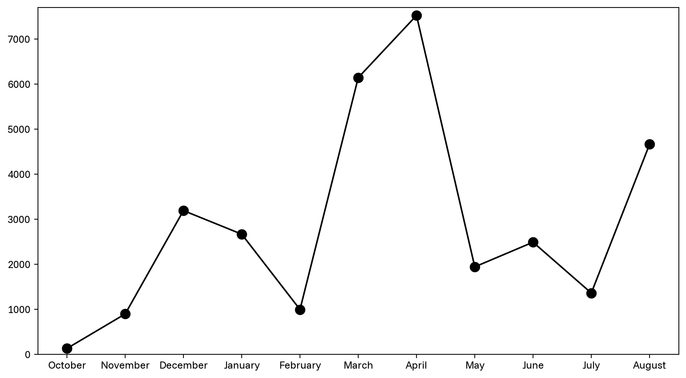
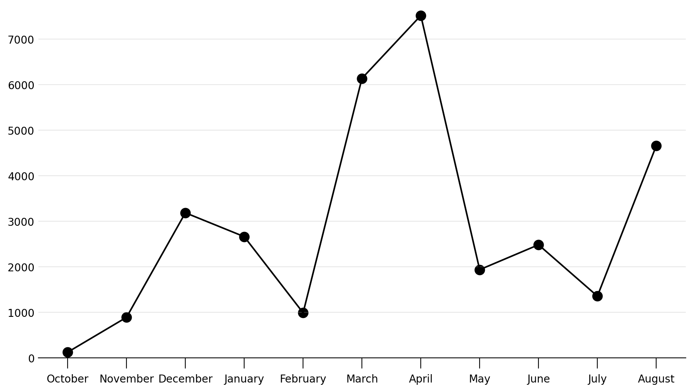
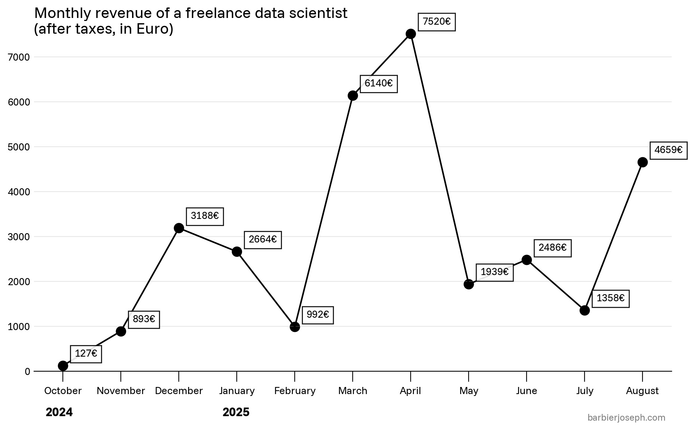

## About

This plot is a line chart showing the salary evolution of [Joseph Barbier](https://www.barbierjoseph.com/), a freelance data scientist. Thanks to him for accepting sharing his work here!

Let's see what the final picture will look like:


## Libraries

We only need `matplotlib` and [pyfonts](https://y-sunflower.github.io/pyfonts/) for this plot, that we can import with:

```python
import matplotlib.pyplot as plt
from pyfonts import set_default_font, load_google_font
```

install pyfonts with `pip install pyfonts`

## Dataset

The data is just 2 Python lists:

```python
months = [
    "October",
    "November",
    "December",
    "January",
    "February",
    "March",
    "April",
    "May",
    "June",
    "July",
    "August",
]

values = [
    127,
    893,
    3188,
    2664,
    992,
    6140,
    7520,
    1939,
    2486,
    1358,
    4659,
]
```

## Basic line chart

We combine `ax.scatter()` with `ax.plot()` to showcase both the variation and individual points in the chart.

```python
fig, ax = plt.subplots(figsize=(11, 6), dpi=200)

ax.plot(months, values, color="black")
ax.scatter(months, values, s=80, color="black")
ax.set_ylim(0, 7700)
plt.show()
```

:::output

:::

## Style the Axes

To make the Axes look better, we:

- remove top, left and right spines
- remove y ticks
- add horizontal background grid

```python
fig, ax = plt.subplots(figsize=(11, 6), dpi=200)

ax.plot(months, values, color="black")
ax.scatter(months, values, s=80, color="black")
ax.set_ylim(0, 7700)

ax.spines[["top", "left", "right"]].set_visible(False)
ax.tick_params(axis="x", pad=5, size=10)
ax.tick_params(axis="y", size=0)
ax.grid(axis="y", zorder=-2, alpha=0.3)

plt.show()
```

:::output

:::

## Labels and fonts

We add individual labels using a simple `for` loop and the `ax.text()` function.

Here we use [pyfonts](https://y-sunflower.github.io/pyfonts/) to load fonts from Google fonts and we set the default font to "Funnel Sans", and load its bold version for the year labels.

```python
font = load_google_font("Funnel Sans")
font_bold = load_google_font("Funnel Sans", weight=800)
set_default_font(font)

fig, ax = plt.subplots(figsize=(11, 6), dpi=200)

ax.set_ylim(0, 7700)
ax.spines[["top", "left", "right"]].set_visible(False)
ax.tick_params(axis="x", pad=5, size=10)
ax.tick_params(axis="y", size=0)
ax.grid(axis="y", zorder=-2, alpha=0.3)

ax.plot(months, values, color="black")
ax.scatter(months, values, s=80, color="black")

for i, value in enumerate(values):
    ax.text(
        x=i + 0.2,
        y=value + 200,
        s=f"{int(value)}€",
        bbox=dict(facecolor="white", alpha=0.9),
        zorder=100,
    )

ax.text(
    x=-0.5,
    y=8100,
    s="Monthly revenue of a freelance data scientist\n(after taxes, in Euro)",
    size=15,
    va="top",
)
ax.text(x=-0.3, y=-1000, s="2024", size=12, font=font_bold)
ax.text(x=2.75, y=-1000, s="2025", size=12, font=font_bold)
ax.text(
    x=10.4,
    y=-1100,
    s="barbierjoseph.com",
    style="italic",
    size=9,
    color="grey",
    ha="right",
)

plt.savefig("../../static/graph/web-minimalist-black-and-white-line-chart.png", dpi=300)
plt.show()
```

:::output

:::

## Going further

- [The connected scatterplot section](/connected-scatter-plot)
- [This advanced example of a similar line chart](/web-stacked-charts)
- [How to create line charts with multiple Axes](/web-small-multiple-with-highlights)
