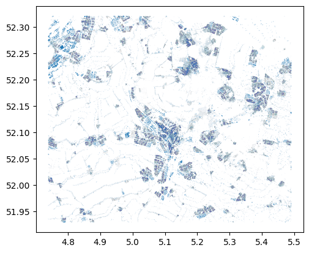
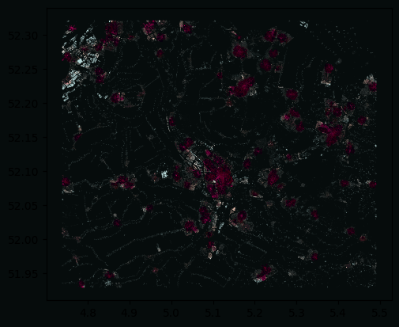
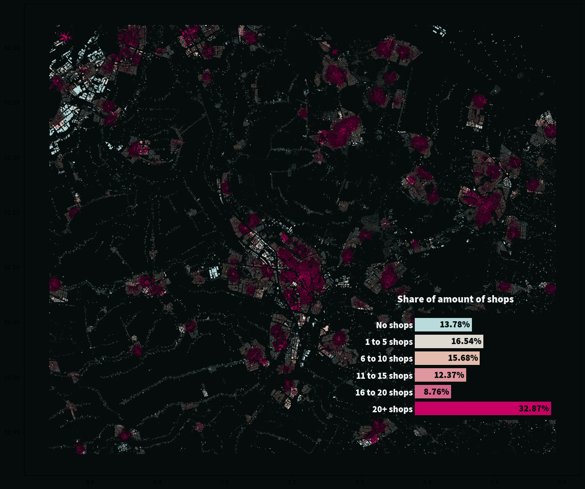
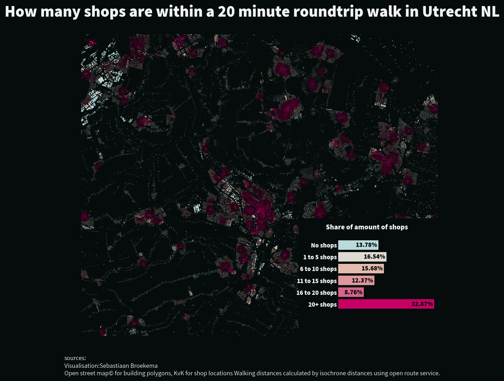

## About

The polygons are extracted from OpenStreetMap using the `pyrosm` package. Travel time is calculated using OpenRouteService, and the shop locations come from a closed-source data vendor selling data from the Dutch Chamber of Commerce (KVK).

The chart was originally made with by [Sebastiaan Broekema](https://github.com/sebastiaanbroekema). Thanks to him for accepting sharing his work here!

## Libraries

First, here are all the imports we will use during the creation of this graph:

- matplotlib
- seaborn
- highlight_text
- geopandas
- pandas
- pyfonts

```python
import matplotlib.pyplot as plt
import seaborn as sns
from highlight_text import fig_text, ax_text
import matplotlib.patches as patches
import geopandas as gpd
import pandas as pd
from pyfonts import load_font
```

> Note that you'll also need `pyarrow` to be installed, but not imported. You can install it with `pip install pyarrow`

## The Data

Since some of the data is proprietary, the base for this graph has already been heavily trimmed down.  
The dataset already contains the polygons we’ll use to plot the final result. It is stored in **GeoParquet** format, so we’ll use **GeoPandas** to read it in.

Let's take a look at the map without any formatting whatsoever. GeoPandas DataFrames automatically plot the geometries when you use the `.plot()` method.

```python
path = "https://raw.githubusercontent.com/holtzy/The-Python-Graph-Gallery/master/static/data/winkels_utrecht.parquet"
path = "../../static/data/winkels_utrecht.parquet"
utrecht = gpd.read_parquet(path)

utrecht.head()
```

:::output
::output-html{src="./output-1.html"}
:::

## Default map

Here is how our data look like:

```python
utrecht.plot()
```

:::output

:::

## Some Observations

- This small plot is not readable; you can't zoom in and see all the little details.
- It already takes 2 minutes to plot the graph.
- The color scheme is not very informative.

On the data side, all we need to do for this dataset is convert the number of shops into the labels we will be using.

We will bin the data into groups of 5. To avoid overwhelming the viewer with too many colors, we will limit the total number of groups to 6.

```python
labels = [
    "No shops",
    "1 to 5 shops",
    "6 to 10 shops",
    "11 to 15 shops",
    "16 to 20 shops",
    "20+ shops",
]

# the final value is just some really large value because the
# .cut method requires an upperbound to be set.
bins = [1, 5, 10, 15, 20, 2500]

utrecht = utrecht.assign(
    quantile_values=pd.cut(utrecht.amount, bins, labels=labels[1:])
    .astype(str)
    .replace("nan", labels[0])
)

colors = ("#badbdb", "#dedad2", "#e4bcad", "#df979e", "#d7658b", "#c80064")
text_color = "#f1f2f6"
background = "#060C0C"

# map the labels to their respective color
color_dict = {i: j for i, j in zip(labels, colors)}

utrecht = utrecht.assign(color=lambda x: x.quantile_values.map(color_dict))
```

```python
fig, ax = plt.subplots()

utrecht.plot(color=utrecht.color, ax=ax)

fig.set_facecolor(background)
ax.set_facecolor(background)

plt.show()
```

:::output

:::

## Adding an upgraded legend

The graph now looks a lot better. However, we still have no idea what we're looking at—what do all the pretty colors mean?  
To address this, we could add a simple legend: a mapping of a colored square and the label it represents. However, I want to create something more interesting.

I want to make a bar graph that functions as a legend. This way, the legend not only explains the colors but also encodes additional information.  
The bar graph will show the percentage of buildings that have a certain number of shops within a 20-minute round-trip walk.

To achieve this, we will insert a child axis into the plot, where we’ll create the bar graph.  
Since this is the first time we’re adding text to the graph, we will load the **Assistant** font using `pyfonts`. We’ll use both the regular and bold styles.

Next, we will create the DataFrame that serves as input for the bar graph.  
After that, we will add a child axis into the main plot where the bar graph will be drawn.

```python
regular = {
    "font": load_font(
        "https://github.com/hafontia-zz/Assistant/blob/master/Fonts/TTF/Assistant-Regular.ttf?raw=true"
    )
}

bold = {
    "font": load_font(
        "https://github.com/hafontia-zz/Assistant/blob/master/Fonts/TTF/Assistant-ExtraBold.ttf?raw=true"
    )
}

# make counts based on labels and add the colors.
bar_frame = (
    utrecht.quantile_values.value_counts()
    .reindex(labels[::-1])
    .reset_index()
    .assign(color=lambda x: x.quantile_values.map(color_dict))
)

# total amount of buildings so we can calculate percentages
total_buildings = bar_frame["count"].sum()

# increase the size of the plot so we can actually see something
fig, ax = plt.subplots(figsize=(20, 15))

utrecht.plot(
    ax=ax,
    legend=False,
    color=utrecht.color,
    zorder=-5,
)

ax_child = ax.inset_axes(
    [0.65, 0.2, 0.175, 0.175],
    zorder=10,
    transform=fig.transFigure,
)

ax_child.barh(
    y=bar_frame.quantile_values.astype(str).index,
    width=bar_frame["count"],
    color=bar_frame.color,
)

sns.despine(ax=ax_child, left=True, bottom=True)
# remove the little dashes at the tick labels
# remove all labels at the x axis
ax_child.tick_params(length=0, labelbottom="off", labelsize=12)
ax_child.set_xticklabels([], **regular)

# loop over all the counts and calculate
for i, count in enumerate(bar_frame["count"]):
    ax_text(
        count,
        i,
        f"{(count / total_buildings) * 100:,.2f}% ",
        va="center",
        ha="right",
        weight="bold",
        **bold,
        size=16,
        color=background,
        ax=ax_child,
    )
# set the labels of the y ticks with the correct formatting
ax_child.set_yticks(
    [0, 1, 2, 3, 4, 5],
    labels=labels[::-1],
    fontweight="bold",
    color=text_color,
    **bold,
    size=16,
)

fig_text(
    x=0.7,
    y=0.39,
    ha="center",
    va="bottom",
    s="Share of amount of shops",
    weight="bold",
    size=18,
    zorder=20,
    color=text_color,
    **bold,
)

ax_child.set_facecolor(background)
fig.set_facecolor(background)
ax.set_facecolor(background)
```

:::output

:::

## Putting It All Together: The Finishing Touches

Finally, we will add some finishing touches:

- Add a title to the graph.
- The labels for the bar chart are overlapping some of the small towns, so we’ll add a small rectangle in that part of the graph to make the labels easier on the eyes.
- Add some information about who made the graph and attribution for the data.
- Save the graph at 1200 DPI so we can view it in very high detail.
- Remove the X and Y axes from the main map.

```python
regular = {
    "font": load_font(
        "https://github.com/hafontia-zz/Assistant/blob/master/Fonts/TTF/Assistant-Regular.ttf?raw=true"
    )
}

bold = {
    "font": load_font(
        "https://github.com/hafontia-zz/Assistant/blob/master/Fonts/TTF/Assistant-ExtraBold.ttf?raw=true"
    )
}

fig, ax = plt.subplots(figsize=(20, 15))
# remove the axis of the main map
ax.axis("off")
utrecht.plot(
    ax=ax,
    legend=False,
    color=utrecht.color,
    zorder=-5,
)

# create the background rectangle so the bar graph
# is fully readable
rect = patches.Rectangle(
    (0.60, -0.1),
    0.5,
    0.5,
    linewidth=0,
    facecolor=background,
    zorder=0,
    transform=ax.transAxes,
)

ax.add_patch(rect)

ax_child = ax.inset_axes(
    [0.65, 0.2, 0.175, 0.175], zorder=10, transform=fig.transFigure
)

ax_child.barh(
    y=bar_frame.quantile_values.astype(str).index,
    width=bar_frame["count"],
    color=bar_frame.color,
)

sns.despine(ax=ax_child, left=True, bottom=True)

ax_child.tick_params(length=0, labelbottom="off", labelsize=12)
ax_child.set_xticklabels([], **regular)

for i, count in enumerate(bar_frame["count"]):
    ax_text(
        count,
        i,
        f"{(count / total_buildings) * 100:,.2f}% ",
        va="center",
        ha="right",
        weight="bold",
        **bold,
        size=16,
        color=background,
        ax=ax_child,
    )

ax_child.set_yticks(
    [0, 1, 2, 3, 4, 5],
    labels=labels[::-1],
    fontweight="bold",
    color=text_color,
    **bold,
    size=16,
)

fig_text(
    x=0.7,
    y=0.39,
    ha="center",
    va="bottom",
    s="Share of amount of shops",
    weight="bold",
    size=18,
    zorder=20,
    color=text_color,
    **bold,
)

fig_text(
    x=0.5,
    y=0.88,
    va="bottom",
    ha="center",
    s="How many shops are within a 20 minute roundtrip walk in Utrecht NL",
    weight="bold",
    size=40,
    color=text_color,
    **bold,
)

fig_text(
    x=0.5,
    y=0.10,
    s="sources:\nVisualisation:Sebastiaan Broekema\nOpen street map© for building polygons, KvK for shop locations Walking distances calculated by isochrone distances using open route service.",
    size=16,
    color=text_color,
    ha="center",
    **regular,
)

ax_child.set_facecolor(background)
fig.set_facecolor(background)
ax.set_facecolor(background)
```

:::output

:::

## Going further

You might be interested in:

- The [map section](https://python-graph-gallery.com/map/)
- The [choropleth map section](https://python-graph-gallery.com/choropleth-map/)
- The [hexbin map section](https://python-graph-gallery.com/hexbin-map/)
