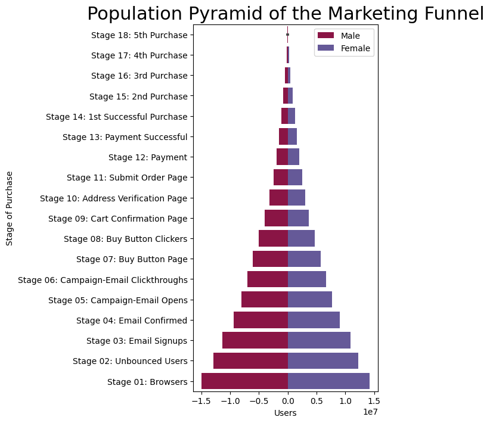

## About population pyramid chart?

### What is it?

A population pyramid chart is like a graph that shows **how many people** of different *ages* and *genders* live in a certain place. It's like looking at the ages and whether they're boys or girls, men or women, all at once.

Imagine you're looking at a **mountain with two sides**: one side is for boys or men, and the other side is for girls or women. If the mountain is **wide at the bottom**, it means there are lots of young people. If it's **wide at the top**, it means there are more old people. The shape of the mountain can tell us if a place has more young people, more old people, or an equal number of all ages.

### Reproduction

In this post, we will reproduce a chart from [Machine Learning Plus](https://www.machinelearningplus.com/plots/top-50-matplotlib-visualizations-the-master-plots-python/#29.-Population-Pyramid). In this case, the population pyramid is used to show the **stage-by-stage** filtering of the population as it is used below to show **how many people pass** through each stage of a marketing funnel.

Let's see what the final picture will look like:


## Libraries

First, you need to install the following librairies:
- [matplotlib](https://python-graph-gallery.com/matplotlib/) is used for creating the chart and for customization
- `pandas` is used to put the data into a dataframe
- `seaborn` will be used for its `barplot()` function.

```python
# Libraries
import matplotlib.pyplot as plt
import seaborn as sns
import pandas as pd
```

## Dataset

The dataset used can be obtained using the url below and then opened using the `read_csv()` function in pandas.

```python
url = "https://raw.githubusercontent.com/holtzy/the-python-graph-gallery/master/static/data/email_campaign_funnel.csv"

# Original url (to be used in case the above one does not work)
url = "https://raw.githubusercontent.com/selva86/datasets/master/email_campaign_funnel.csv"
df = pd.read_csv(url)
```

## Reproducing the chart

This code creates a [barplot](https://python-graph-gallery.com/barplot/) that represents **the progression** of different gender groups through various stages of a marketing funnel. Each bar corresponds to a specific stage, and the **color of the bars** indicates the gender distribution at each stage.

```python
# Create a figure and axis with a specific size
fig, ax = plt.subplots(figsize=(4, 8))

# Define the column in the dataframe that represents the groups/categories
group_col = 'Gender'

# Determine the order of bars on the y-axis by unique values in the 'Stage' column and reversing the order
order_of_bars = df.Stage.unique()[::-1]

# Generate a list of colors for each group, using the Spectral colormap
colors = [plt.cm.Spectral(i / float(len(df[group_col].unique()) - 1)) for i in range(len(df[group_col].unique()))]

# Iterate through each group and plot a bar for each stage within that group
for color, group in zip(colors, df[group_col].unique()):
    
    # Create a bar plot using Seaborn's barplot function
    sns.barplot(x='Users',  # Data for the width of bars
                y='Stage',  # Data for the y-axis (stages of purchase)
                data=df.loc[df[group_col] == group, :],  # Filter data for the current group
                order=order_of_bars,  # Specify the order of stages on the y-axis
                color=color,  # Assign a color to the bar
                label=group,  # Assign a label for the plot legend
                ax=ax,  # Specify the axis to plot on (previously created)
               )

# Set labels and title for the axes
ax.set_xlabel("Users")  # X-axis label
ax.set_ylabel("Stage of Purchase")  # Y-axis label
ax.set_title("Population Pyramid of the Marketing Funnel", fontsize=22) # Plot title

# Display the legend, which shows labels for the groups
ax.legend()

# Display the plot
plt.show()
```

:::output

:::

## Going further

This article explains how to reproduce the pyramid plot from this [article on machinelearningplus.com](https://www.machinelearningplus.com/plots/top-50-matplotlib-visualizations-the-master-plots-python/) (the 29th). 

For more examples of **how to create or customize** your barplots with Python, see the [barplot section](https://python-graph-gallery.com/barplot/). You may also be interested in creating a [barplot with the number of observations](https://python-graph-gallery.com/10-barplot-with-number-of-observation/).
