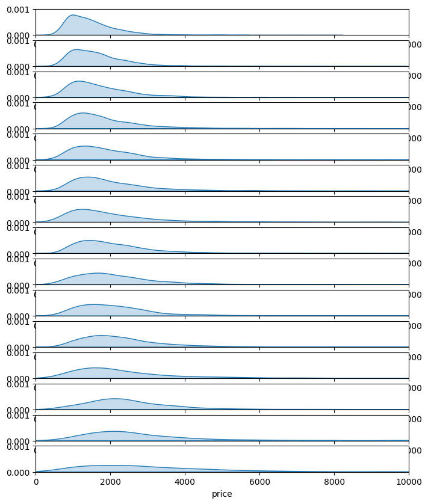
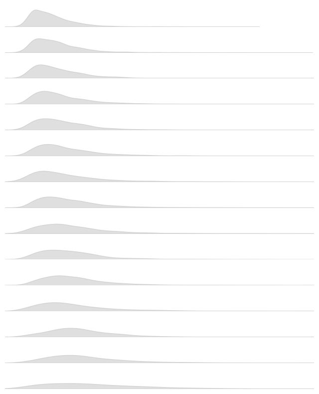
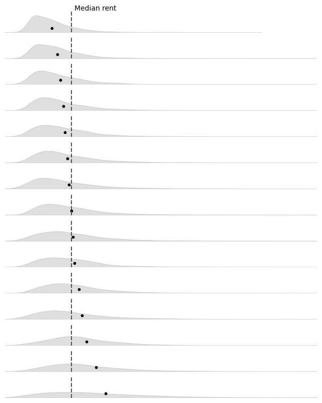
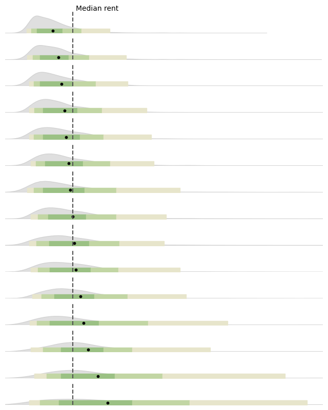

## About

This plot is a [ridgeline](https://python-graph-gallery.com/ridgeline/). It is a way to display the distribution of a **numerical variable for several groups**.

It has been originally designed by [Ansgar Wolsing](https://twitter.com/_ansgar) in R. Here is a reproduction in Python by [Joseph Barbier](https://www.barbierjoseph.com).

As a teaser, here is the plot we’re gonna try building:


## Libraries

For creating this chart, we will need a whole bunch of libraries!

- [matplotlib](https://python-graph-gallery.com/matplotlib/): to customize the appearance of the chart
- [seaborn](https://python-graph-gallery.com/seaborn/): to create the chart
- [pandas](https://python-graph-gallery.com/pandas/): to handle the data

```python
import matplotlib.pyplot as plt
import seaborn as sns
import pandas as pd
import numpy as np
```

## Dataset

The data can be accessed using the **url below**.

The chart mainly relies on `df`, but `rent` and `rent_words` are used for **annotation purposes**.

```python
rent_path = 'https://raw.githubusercontent.com/holtzy/The-Python-Graph-Gallery/master/static/data/rent.csv'
rent = pd.read_csv(rent_path)

rent_words_path = 'https://raw.githubusercontent.com/holtzy/The-Python-Graph-Gallery/master/static/data/rent_title_words.csv'
rent_words = pd.read_csv(rent_words_path)

df_path = 'https://raw.githubusercontent.com/holtzy/The-Python-Graph-Gallery/master/static/data/df_plot.csv'
df = pd.read_csv(df_path)

ngroups = df['word'].nunique()    # Dynamically calculate the number of rows in the chart.

bandwidth = 1                     # Control how smooth you want the graphs
```

## Simple ridgeline plot

Let's start by creating a (relatively) simple [ridgeline plot](https://python-graph-gallery.com/ridgeline/).

Here are the main steps to create the chart:

- initiate a **15 rows and 1 column** grid
- we create a **list of the `words`**, sorted by the average price
- we **iterate over the list of words** to create a subplot for each word with `kdeplot()`
- specify **x and y axis limits** to ensure each plot has the same scale

And that's it!

```python
fig, axs = plt.subplots(nrows=ngroups, ncols=1, figsize=(8, 10))
axs = axs.flatten() # needed to access each individual axis

# iterate over axes
words = df.sort_values('mean_price')['word'].unique().tolist()
for i, word in enumerate(words):

    # subset the data for each word
    subset = df[df['word'] == word]

    # plot the distribution of prices
    sns.kdeplot(
        subset['price'],
        shade=True,
        bw_adjust = bandwidth
        ax=axs[i]
    )

    # set title and labels
    axs[i].set_xlim(0, 10000)
    axs[i].set_ylim(0, 0.001)
    axs[i].set_ylabel('')

plt.show()
```

:::output

:::

## Change color and remove axis

First, we add a `color` and `edgecolor` argument to the `kdeplot()` function to change the **color of the lines** and the **edge** of the area.

Then, we **remove each axis** using `set_axis_off()`.

```python
fig, axs = plt.subplots(nrows=15, ncols=1, figsize=(8, 10))
axs = axs.flatten() # needed to access each individual axis

# iterate over axes
words = df.sort_values('mean_price')['word'].unique().tolist()
for i, word in enumerate(words):

    # subset the data for each word
    subset = df[df['word'] == word]

    # plot the distribution of prices
    sns.kdeplot(
        subset['price'],
        shade=True,
        bw_adjust = bandwidth
        ax=axs[i],
        color='grey',
        edgecolor='lightgrey'
    )

    # set title and labels
    axs[i].set_xlim(0, 10000)
    axs[i].set_ylim(0, 0.001)
    axs[i].set_ylabel('')

    # remove axis
    axs[i].set_axis_off()

plt.show()
```

:::output

:::

## Add mean reference line and points

Now we add a **mean reference line** to each plot using `axvline()` and a **mean point** using `scatter()`, and this for each axis.

```python
fig, axs = plt.subplots(nrows=15, ncols=1, figsize=(8, 10))
axs = axs.flatten() # needed to access each individual axis

# iterate over axes
words = df.sort_values('mean_price')['word'].unique().tolist()
for i, word in enumerate(words):

    # subset the data for each word
    subset = df[df['word'] == word]

    # plot the distribution of prices
    sns.kdeplot(
        subset['price'],
        shade=True,
        bw_adjust = bandwidth
        ax=axs[i],
        color='grey',
        edgecolor='lightgrey'
    )

    # mean value as a reference
    mean = subset['price'].mean()
    axs[i].scatter([mean], [0.0002], color='black', s=10)

    # global mean reference line
    global_mean = rent['price'].mean()
    axs[i].axvline(global_mean, color='#525252', linestyle='--')

    # set title and labels
    axs[i].set_xlim(0, 10000)
    axs[i].set_ylim(0, 0.001)
    axs[i].set_ylabel('')

    # remove axis
    axs[i].set_axis_off()

text = 'Mean rent'
fig.text(
    0.35, 0.88,
    text,
    ha='center',
    fontsize=10
)

plt.show()
```

:::output

:::

## Quantile values on top

In order to **add quantile values** on top of the plot, we need to:

- calculate the **quantile values** for each word with `np.percentile()`
- define a **list of colors** that will be used to fill the space between them
- use the `fill_between()` function with coordinates and colors to **fill the space**

```python
darkgreen = '#9BC184'
midgreen = '#C2D6A4'
lightgreen = '#E7E5CB'
colors = [lightgreen, midgreen, darkgreen, midgreen, lightgreen]

fig, axs = plt.subplots(nrows=15, ncols=1, figsize=(8, 10))
axs = axs.flatten() # needed to access each individual axis

# iterate over axes
words = df.sort_values('mean_price')['word'].unique().tolist()
for i, word in enumerate(words):

    # subset the data for each word
    subset = df[df['word'] == word]

    # plot the distribution of prices
    sns.kdeplot(
        subset['price'],
        shade=True,
        bw_adjust = bandwidth
        ax=axs[i],
        color='grey',
        edgecolor='lightgrey'
    )

    # global mean reference line
    global_mean = rent['price'].mean()
    axs[i].axvline(global_mean, color='#525252', linestyle='--')

    # compute quantiles
    quantiles = np.percentile(subset['price'], [2.5, 10, 25, 75, 90, 97.5])
    quantiles = quantiles.tolist()

    # fill space between each pair of quantiles
    for j in range(len(quantiles) - 1):
        axs[i].fill_between(
            [quantiles[j], # lower bound
             quantiles[j+1]], # upper bound
            0, # max y=0
            0.0002, # max y=0.0002
            color=colors[j]
        )

    # mean value as a reference
    mean = subset['price'].mean()
    axs[i].scatter([mean], [0.0001], color='black', s=10)

    # set title and labels
    axs[i].set_xlim(0, 10000)
    axs[i].set_ylim(0, 0.001)
    axs[i].set_ylabel('')

    # remove axis
    axs[i].set_axis_off()

text = 'Mean rent'
fig.text(
    0.35, 0.88,
    text,
    ha='center',
    fontsize=10
)

plt.show()
```

:::output

:::

## Annotations

### Fonts

In the original chart, the author used a different font named `Fira Sans`. Here is how we load it with [matplotlib](https://python-graph-gallery.com/matplotlib/):

- download the font from [google font service](https://fonts.google.com/specimen/Fira+Sans)
- install the font on your computer (on mac, double click on the downloaded file and click on "install font", then it will be available in the **font book**)
- get the path of the font (you can use the `fc-list | grep "Fira"` command in your terminal to find it OR see the code below)
- import the `FontProperties` class from `matplotlib.font_manager` and use it to set the font of the annotation

And that's it! For this post we need 2 of them: `FiraSans-Regular.ttf` and `FiraSans-SemiBold.ttf`.

```python
from matplotlib import font_manager

for fontpath in font_manager.findSystemFonts(fontpaths=None, fontext='ttf'):
    if 'firasans' in fontpath.lower():
        print(fontpath)
```

:::output
```text
/Users/josephbarbier/Library/Fonts/FiraSans-Thin.ttf
/Users/josephbarbier/Library/Fonts/FiraSans-SemiBoldItalic.ttf
/Users/josephbarbier/Library/Fonts/FiraSans-BlackItalic.ttf
/Users/josephbarbier/Library/Fonts/FiraSans-Black.ttf
/Users/josephbarbier/Library/Fonts/FiraSans-ExtraBoldItalic.ttf
/Users/josephbarbier/Library/Fonts/FiraSans-ExtraLightItalic.ttf
/Users/josephbarbier/Library/Fonts/FiraSans-LightItalic.ttf
/Users/josephbarbier/Library/Fonts/FiraSans-SemiBold.ttf
/Users/josephbarbier/Library/Fonts/FiraSans-ThinItalic.ttf
/Users/josephbarbier/Library/Fonts/FiraSans-ExtraLight.ttf
/Users/josephbarbier/Library/Fonts/FiraSans-Regular.ttf
/Users/josephbarbier/Library/Fonts/FiraSans-Light.ttf
/Users/josephbarbier/Library/Fonts/FiraSans-Italic.ttf
/Users/josephbarbier/Library/Fonts/FiraSans-BoldItalic.ttf
/Users/josephbarbier/Library/Fonts/FiraSans-ExtraBold.ttf
/Users/josephbarbier/Library/Fonts/FiraSans-Medium.ttf
/Users/josephbarbier/Library/Fonts/FiraSans-Bold.ttf
/Users/josephbarbier/Library/Fonts/FiraSans-MediumItalic.ttf
```
:::

```python
from matplotlib.font_manager import FontProperties

personal_path = '/Users/josephbarbier/Library/Fonts/'

font_path = personal_path + 'FiraSans-Regular.ttf'
fira_sans_regular = FontProperties(fname=font_path)

font_path = personal_path + 'FiraSans-SemiBold.ttf'
fira_sans_semibold = FontProperties(fname=font_path)
```

### Add annotations

Now that we have our font, we can **add the annotations**.

This mainly relies on the `text()` function from matplotlib. We just need to specify the **x and y coordinates** of the text, the **text itself**, and the **font properties**.

```python
darkgreen = '#9BC184'
midgreen = '#C2D6A4'
lowgreen = '#E7E5CB'
colors = [lowgreen, midgreen, darkgreen, midgreen, lowgreen]

darkgrey = '#525252'

fig, axs = plt.subplots(nrows=15, ncols=1, figsize=(8, 10))
axs = axs.flatten() # needed to access each individual axis

# iterate over axes
words = df.sort_values('mean_price')['word'].unique().tolist()
for i, word in enumerate(words):

    # subset the data for each word
    subset = df[df['word'] == word]

    # plot the distribution of prices
    sns.kdeplot(
        subset['price'],
        shade=True,
        bw_adjust = bandwidth
        ax=axs[i],
        color='grey',
        edgecolor='lightgrey'
    )

    # global mean reference line
    global_mean = rent['price'].mean()
    axs[i].axvline(global_mean, color=darkgrey, linestyle='--')

    # display average number of bedrooms on left
    rent_with_bed = rent_words[rent_words['beds'] > 0]
    rent_with_bed_filter = rent_with_bed[rent_with_bed['word'] == word]
    avg_bedrooms = rent_with_bed_filter['beds'].mean().round(1)
    axs[i].text(
        -600, 0,
        f'({avg_bedrooms})',
        ha='left',
        fontsize=10,
        fontproperties=fira_sans_regular,
        color=darkgrey
    )

    # display word on left
    axs[i].text(
        -2000, 0,
        word.upper(),
        ha='left',
        fontsize=10,
        fontproperties=fira_sans_semibold,
        color=darkgrey
    )

    # compute quantiles
    quantiles = np.percentile(subset['price'], [2.5, 10, 25, 75, 90, 97.5])
    quantiles = quantiles.tolist()

    # fill space between each pair of quantiles
    for j in range(len(quantiles) - 1):
        axs[i].fill_between(
            [quantiles[j], # lower bound
             quantiles[j+1]], # upper bound
            0, # max y=0
            0.0002, # max y=0.0002
            color=colors[j]
        )

    # mean value as a reference
    mean = subset['price'].mean()
    axs[i].scatter([mean], [0.0001], color='black', s=10)

    # set title and labels
    axs[i].set_xlim(0, 10000)
    axs[i].set_ylim(0, 0.001)
    axs[i].set_ylabel('')

    # x axis scale for last ax
    if i == 14:
        values = [2500, 5000, 7500, 10000]
        for value in values:
            axs[i].text(
                value, -0.0005,
                f'{value}',
                ha='center',
                fontsize=10
            )

    # remove axis
    axs[i].set_axis_off()

# reference line label
text = 'Mean rent'
fig.text(
    0.35, 0.88,
    text,
    ha='center',
    fontsize=10
)

# number of bedrooms label
text = '(Ø bedrooms)'
fig.text(
    0.04, 0.88,
    text,
    ha='left',
    fontsize=10,
    fontproperties=fira_sans_regular,
    color=darkgrey
)

# credit
text = """
Axis capped at 10,000 USD.
Data: Pennington, Kate (2018).
Bay Area Craigslist Rental Housing Posts, 2000-2018.
Retrieved from github.com/katepennington/historic_bay_area_craigslist_housing_posts/blob/master/clean_2000_2018.csv.zip.
Visualization: Ansgar Wolsing
"""
fig.text(
    -0.03, -0.05,
    text,
    ha='left',
    fontsize=8,
    fontproperties=fira_sans_regular
)

# x axis label
text = "Rent in USD"
fig.text(
    0.5, 0.06,
    text,
    ha='center',
    fontsize=14,
    fontproperties=fira_sans_regular
)

# description
text = """
Adjectives used to describe houses and apartments in the San Francisco Bay Area in the titles of rental
posts on Craigslist and how they are related to rental prices. Titles from 198,279 rental posts on Craigslist
between 2000 and 2018. The 15 most frequent adjectives are shown.
"""
fig.text(
    -0.03, 0.9,
    text,
    ha='left',
    fontsize=14,
    fontproperties=fira_sans_regular
)

# title
text = "NICE AND CLEAN - RELATIVELY LOW RENT?"
fig.text(
    -0.03, 1.01,
    text,
    ha='left',
    fontsize=18,
    fontproperties=fira_sans_semibold
)

plt.savefig('../../static/graph/web-ridgeline-by-text-1.png', dpi=300, bbox_inches='tight')
plt.show()
```


## Legend

The legend is the part of the chart that will makes the **result more understandable**.

In this case, we use the `inset_axes()` function to create **axes inside another one**. This function needs:

- the **position** of the new axes (in this case, the top right corner)
- the **width and height** of the new axes
- the **parent axes** (in this case, the top one)

Then we just have to add the **template chart inside this new axes**, and a bunch of **other annotations** to make it look like a legend.

```python
darkgreen = '#9BC184'
midgreen = '#C2D6A4'
lowgreen = '#E7E5CB'
colors = [lowgreen, midgreen, darkgreen, midgreen, lowgreen]

darkgrey = '#525252'

fig, axs = plt.subplots(nrows=15, ncols=1, figsize=(8, 10))
axs = axs.flatten() # needed to access each individual axis

# iterate over axes
words = df.sort_values('mean_price')['word'].unique().tolist()
for i, word in enumerate(words):

    # subset the data for each word
    subset = df[df['word'] == word]

    # plot the distribution of prices
    sns.kdeplot(
        subset['price'],
        shade=True,
        ax=axs[i],
        color='grey',
        edgecolor='lightgrey'
    )

    # global mean reference line
    global_mean = rent['price'].mean()
    axs[i].axvline(global_mean, color=darkgrey, linestyle='--')

    # display average number of bedrooms on left
    rent_with_bed = rent_words[rent_words['beds'] > 0]
    rent_with_bed_filter = rent_with_bed[rent_with_bed['word'] == word]
    avg_bedrooms = rent_with_bed_filter['beds'].mean().round(1)
    axs[i].text(
        -600, 0,
        f'({avg_bedrooms})',
        ha='left',
        fontsize=10,
        fontproperties=fira_sans_regular,
        color=darkgrey
    )

    # display word on left
    axs[i].text(
        -2000, 0,
        word.upper(),
        ha='left',
        fontsize=10,
        fontproperties=fira_sans_semibold,
        color=darkgrey
    )

    # compute quantiles
    quantiles = np.percentile(subset['price'], [2.5, 10, 25, 75, 90, 97.5])
    quantiles = quantiles.tolist()

    # fill space between each pair of quantiles
    for j in range(len(quantiles) - 1):
        axs[i].fill_between(
            [quantiles[j], # lower bound
             quantiles[j+1]], # upper bound
            0, # max y=0
            0.0002, # max y=0.0002
            color=colors[j]
        )

    # mean value as a reference
    mean = subset['price'].mean()
    axs[i].scatter([mean], [0.0001], color='black', s=10)

    # set title and labels
    axs[i].set_xlim(0, 10000)
    axs[i].set_ylim(0, 0.001)
    axs[i].set_ylabel('')

    # x axis scale for last ax
    if i == 14:
        values = [2500, 5000, 7500, 10000]
        for value in values:
            axs[i].text(
                value, -0.0005,
                f'{value}',
                ha='center',
                fontsize=10
            )

    # remove axis
    axs[i].set_axis_off()

text = 'Mean rent'
fig.text(
    0.35, 0.88,
    text,
    ha='center',
    fontsize=10
)

# credit
text = """
Axis capped at 10,000 USD.
Data: Pennington, Kate (2018).
Bay Area Craigslist Rental Housing Posts, 2000-2018.
Retrieved from github.com/katepennington/historic_bay_area_craigslist_housing_posts/blob/master/clean_2000_2018.csv.zip.
Visualization: Ansgar Wolsing
"""
fig.text(
    -0.03, -0.05,
    text,
    ha='left',
    fontsize=8,
    fontproperties=fira_sans_regular
)

# x axis label
text = "Rent in USD"
fig.text(
    0.5, 0.06,
    text,
    ha='center',
    fontsize=14,
    fontproperties=fira_sans_regular
)

# description
text = """
Adjectives used to describe houses and apartments in the San Francisco Bay Area in the titles of rental
posts on Craigslist and how they are related to rental prices. Titles from 198,279 rental posts on Craigslist
between 2000 and 2018. The 15 most frequent adjectives are shown.
"""
fig.text(
    -0.03, 0.9,
    text,
    ha='left',
    fontsize=12,
    fontproperties=fira_sans_regular
)

# title
text = "NICE AND CLEAN - RELATIVELY LOW RENT?"
fig.text(
    -0.03, 1.01,
    text,
    ha='left',
    fontsize=18,
    fontproperties=fira_sans_semibold
)

# number of bedrooms label
text = '(Ø bedrooms)'
fig.text(
    0.04, 0.88,
    text,
    ha='left',
    fontsize=10,
    fontproperties=fira_sans_regular,
    color=darkgrey
)

# legend on the first ax
from mpl_toolkits.axes_grid1.inset_locator import inset_axes
subax = inset_axes(
    parent_axes=axs[0],
    width="40%",
    height="350%",
    loc=1
)
subax.set_xticks([])
subax.set_yticks([])
beautiful_subset = df[df['word'] == 'beautiful']
sns.kdeplot(
    beautiful_subset['price'],
    shade=True,
    ax=subax,
    color='grey',
    edgecolor='lightgrey'
)
quantiles = np.percentile(beautiful_subset['price'], [2.5, 10, 25, 75, 90, 97.5])
quantiles = quantiles.tolist()
for j in range(len(quantiles) - 1):
    subax.fill_between(
        [quantiles[j], # lower bound
         quantiles[j+1]], # upper bound
        0, # max y=0
        0.00004, # max y=0.00004
        color=colors[j]
    )
subax.set_xlim(-500, 7000)
subax.set_ylim(-0.0002, 0.0006)
mean = beautiful_subset['price'].mean()
subax.scatter([mean], [0.00002], color='black', s=10)
subax.text(
    -300, 0.0005,
    'Legend',
    ha='left',
    fontsize=12,
    fontproperties=fira_sans_semibold
)
subax.text(
    4800, 0.00025,
    'Distribution\nof prices',
    ha='center',
    fontsize=7,
    fontproperties=fira_sans_regular
)
subax.text(
    mean+400, 0.00015,
    'Mean',
    ha='center',
    fontsize=7,
    fontproperties=fira_sans_regular
)
subax.text(
    5500, -0.00015,
    "95% of prices",
    ha='center',
    fontsize=6,
    fontproperties=fira_sans_regular
)
subax.text(
    3500, -0.00015,
    "80% of prices",
    ha='center',
    fontsize=6,
    fontproperties=fira_sans_regular
)
subax.text(
    1200, -0.00018,
    "50% of prices\nfall within this range",
    ha='center',
    fontsize=6,
    fontproperties=fira_sans_regular
)

# arrows in the legend
import matplotlib.patches as patches
def add_arrow(head_pos, tail_pos, ax):
    style = "Simple, tail_width=0.01, head_width=1, head_length=2"
    kw = dict(arrowstyle=style, color="k", linewidth=0.2)
    arrow = patches.FancyArrowPatch(
        tail_pos, head_pos,
        connectionstyle="arc3,rad=.5",
        **kw
    )
    ax.add_patch(arrow)
add_arrow((mean, 0.00005), (mean+200, 0.00013), subax) # mean
add_arrow((mean+1000, 0), (mean+1200, -0.00011), subax) # 80%
add_arrow((mean+2400, 0), (mean+2600, -0.00011), subax) # 95%
add_arrow((mean-500, 0), (mean-800, -0.00009), subax) # 50%

# background grey lines
from matplotlib.lines import Line2D
def add_line(xpos, ypos, fig=fig):
    line = Line2D(
        xpos, ypos,
        color='lightgrey',
        lw=0.2,
        transform=fig.transFigure
    )
    fig.lines.append(line)
add_line([0.317, 0.317], [0.1, 0.9])
add_line([0.51, 0.51], [0.1, 0.9])
add_line([0.703, 0.703], [0.1, 0.9])
add_line([0.896, 0.896], [0.1, 0.9])

plt.savefig('../../static/graph/web-ridgeline-by-text.png', dpi=300, bbox_inches='tight')
plt.show()
```


## Going further

This post explains how to create a ridgeline plot with [matplotlib](https://python-graph-gallery.com/matplotlib/) and [seaborn](https://python-graph-gallery.com/seaborn/). You can check the [dedicated section](https://python-graph-gallery.com/ridgeline/) of the gallery for more examples.

You might also be interested in **combining** density plot and boxplot in [raincloud plot](https://python-graph-gallery.com/raincloud-plot-with-matplotlib-and-ptitprince/) or how to have axes with [different scales](https://python-graph-gallery.com/web-stacked-area-charts-on-a-map/).
