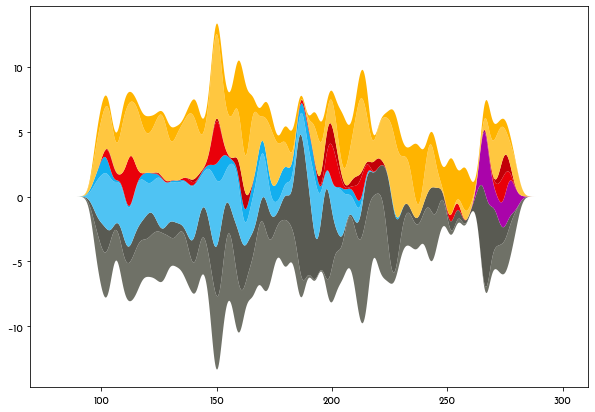
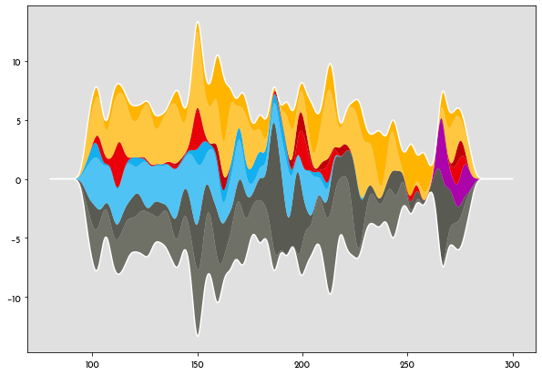
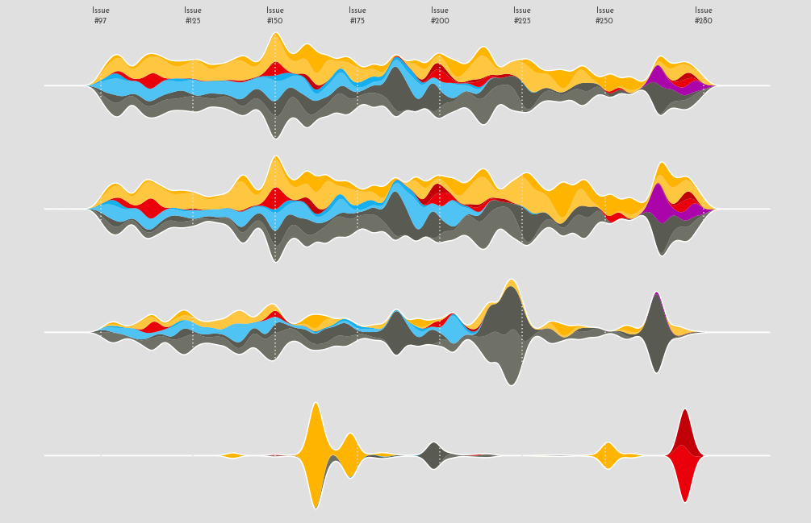
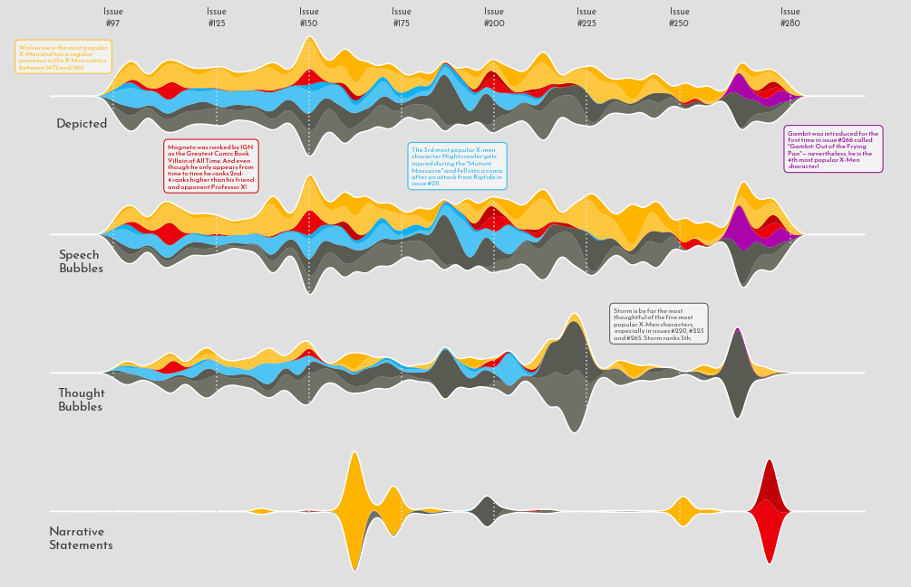
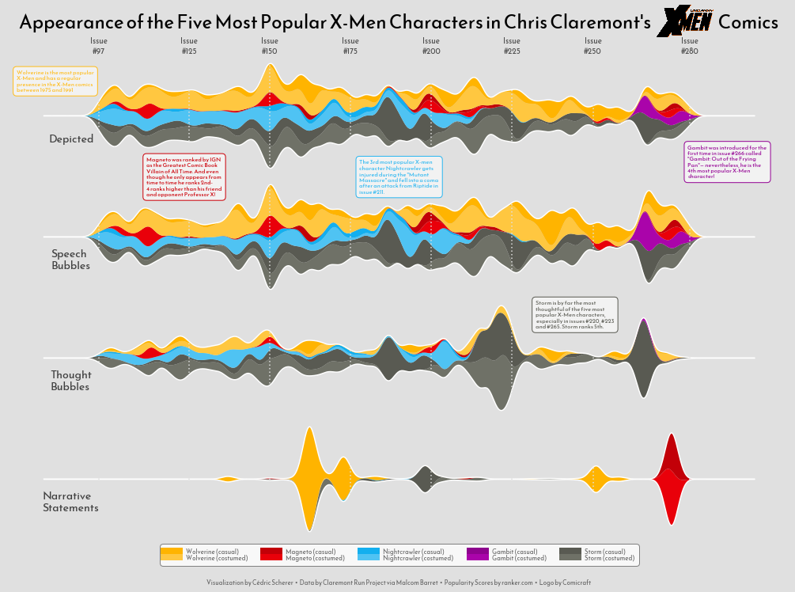

## About

This page showcases the work of [Cedric Scherer](https://www.cedricscherer.com), 
built for the [TidyTuesday](https://github.com/rfordatascience/tidytuesday) 
initiative. You can find the original code on his github repository 
[here](https://github.com/z3tt/TidyTuesday/blob/master/R/2020_27_ClaremontRunXMen.Rmd), written in [R](https://www.r-graph-gallery.com).

Thanks to him for accepting sharing his work here! Thanks also to [Tomás Capretto](https://tomicapretto.github.io/) who translated this work from R to Python! 🙏🙏

As a teaser, here is the plot we’re gonna try building:


## Load libraries

Several libraries and utilities are needed to build today's streamchart. `Line2D` will be used to create the legend, `OffsetImage` and `AnnotationBbox` make it possible to add images to the plot, and the [stats](https://docs.scipy.org/doc/scipy/reference/stats.html) module from the [SciPy](https://docs.scipy.org/doc/scipy/reference/) library is going to help with the smoothing used for the streamchart.

For those who aren't familiar with SciPy, it is one of the main libraries in the machine learning eco-system in Python. It implements a huge variety of probability distributions, functions for numerical computation, and much more. Even if you haven't worked with SciPy directly, it's highly likely you have it installed on your system because it is required by many other relevant libraries.

```python
import matplotlib.image as image
import matplotlib.pyplot as plt
import numpy as np
import pandas as pd

from matplotlib.lines import Line2D
from matplotlib.offsetbox import OffsetImage, AnnotationBbox
from scipy import stats
```

The following sets the default font to `"Reem Kufi"`. For a step-by-step guide on how to install and load custom fonts in Matplotlib, have a look a [this post](https://python-graph-gallery.com/custom-fonts-in-matplotlib).

```python
plt.rcParams.update({"font.family": "Reem Kufi"})
```

And finally, the following utility function is useful to adjust the lightness/darkness of colors.

```python
def adjust_lightness(color, amount=0.5):
    import matplotlib.colors as mc
    import colorsys
    try:
        c = mc.cnames[color]
    except:
        c = color
    c = colorsys.rgb_to_hls(*mc.to_rgb(c))
    return colorsys.hls_to_rgb(c[0], c[1] * amount, c[2])
```

## Load the dataset

This guide shows how to create a highly customized and beautiful streamchart to visualize the number of appearences of the most popular characters in Chris Claremont's sixteen-year run on Uncanny X-Men. 

The original source of data for this week are the [Claremont Run Project](http://www.claremontrun.com/) and [Malcom Barret](https://twitter.com/malco_barrett) who put these datasets into a the R package [cleremontrun](https://github.com/malcolmbarrett/claremontrun). This guide uses the `character_visualization` dataset released for the [TidyTuesday](https://github.com/rfordatascience/tidytuesday) initiative on the week of 2021-06-30. You can find the original announcement and more information about the data [here](https://github.com/rfordatascience/tidytuesday/blob/master/data/2020/2020-06-30/readme.md). Thank you all for making this possible!

```python
df_char_vis = pd.read_csv(
    "https://raw.githubusercontent.com/rfordatascience/tidytuesday/master/data/2020/2020-06-30/character_visualization.csv"
)
```

The following is a data frame that ranks the most popular X-Men characters according to [this source](https://www.ranker.com/list/best-x-men-characters/ranker-comics). Today's chart is based on the top 5 most popular characters.

```python
df_best_chars = pd.DataFrame({
    "rank": np.linspace(1, 10, num=10),
    "char_popular": ["Wolverine", "Magneto", "Nightcrawler", "Gambit",
                     "Storm", "Colossus", "Phoenix", "Professor X", 
                     "Iceman", "Rogue"]
})
```

The `"character"` column in `df_char_vis` contains more information than just the character name. In the next chunk, `df_char_vis` gets a new column, `"character_join"`, that only contains the character name so `df_char_vis` can be merged with `df_best_chars`.

```python
for character in df_best_chars["char_popular"]:
    idxs = df_char_vis["character"].str.contains(character)
    df_char_vis.loc[idxs, "character_join"] = character
```

Next, `df_char_vis` and `df_best_chars` are merged into `df_best_stream`. It also contains, for each issue, the number of appearences by character, costume, and type.

```python
df_best_stream = (
    pd.merge(df_char_vis, df_best_chars, left_on="character_join", right_on="char_popular")
    .groupby(["character", "char_popular", "costume", "rank", "issue"]).agg(
        speech = ("speech", sum),
        thought = ("thought", sum),
        narrative = ("narrative", sum),
        depicted = ("depicted", sum),
    )
    .query("rank <= 5")   # keep only the top 5 characters
    .query("issue < 281") 
    .reset_index()
)
```

To have a feel of how the data looks like...

```python
df_best_stream.head()
```

:::output
::output-html{src="./output-1.html"}
:::

This data is close from its final form. Further manipulations are explained with comments within the code.

```python
# Costume is either 'customed' or 'casual'
df_best_stream["costume"] = np.where(df_best_stream["costume"] == "Costume", "costumed", "casual")

# char_costume contains the name of the character and the costume
df_best_stream["char_costume"] = df_best_stream["char_popular"] + " (" + df_best_stream["costume"] + ")"

# Record the categories of 'char_costume'. 
# This will be used for the order of the areas in the streamchart.
CATEGORIES = df_best_stream.sort_values(by=["rank", "char_costume"])["char_costume"].unique()
CATEGORIES = CATEGORIES[::-1]

# Put the data in long form
df_best_stream = pd.melt(
    df_best_stream,
    id_vars = ["character", "char_popular", "costume", "rank", "issue", "char_costume"],
    value_vars = ["speech", "thought", "narrative", "depicted"],
    var_name = "parameter",
    value_name = "value"
)
```

It's possible there's more than one count for a combination of `"char_costume"`, `"issue"`, and `"parameter"`. The next chunk of code makes sure there's only one value by computing the mean.

```python
df_best_stream = df_best_stream.sort_values(by = ["char_costume", "issue"])
df_best_stream = df_best_stream.groupby(["char_costume", "issue", "parameter"]).agg(
    value = ("value", np.mean)
).reset_index()
```

## Basic streamchart

Today's chart is one of the most beautiful replications in this series. But it's one of the most complex too. Consequently, this guide contains more text and intermediate plots than usual to make it easier to follow and understand what is going on.

As always, it's nice to pre-define the colors and some utilities that are going to be used for the chart. The `IMAGE` is the X-Men logo, which will be included in the title.

```python
PALETTE = [
    adjust_lightness("#595A52", 1.25), "#595A52",
    adjust_lightness("#8E038E", 1.2), "#8E038E",
    adjust_lightness("#13AFEF", 1.25), "#13AFEF",
    adjust_lightness("#C20008", 1.2), "#C20008",
    adjust_lightness("#FFB400", 1.25), "#FFB400"
]

GREY25 = "#404040"
GREY30 = "#4d4d4d"
GREY40 = "#666666"
GREY88 = "#e0e0e0"
GREY95 = "#f2f2f2"

IMAGE = image.imread("uncannyxmen.png")

XTICKS = [97, 125, 150, 175, 200, 225, 250, 280]
```

This first streamchart won't be part of the final visualization. It's here only for demonstrative purposes, which  is going to highlight some key concepts that will be useful later.

For each combination of character and costume, there are a sequence of issues and the number of appearences for each issue. This first chart shows the `"depicted"` appearences only. The number of appearences are smoothed out using the Gaussian smoother defined as `gaussian_smooth()`. In few words, the number of appearences for a given issue is replaced with a weighted average of the number of appearences with the weights computed according to the Gaussian filter. For more information see [here](https://en.wikipedia.org/wiki/Kernel_smoother#Kernel_average_smoother).

Next, the data has to be put in the shape required by `ax.stackplot()`. The first argument, `x`, can be a one dimensional array. In this case, it is going to be the `grid` used to compute the weighted values. Then, `y` is going to be a list. Each element of the `values_smoothed` list is an array with the weigthed values, for each level in `"char_costume"`.

```python
def gaussian_smooth(x, y, grid, sd):
    weights = np.transpose([stats.norm.pdf(grid, m, sd) for m in x])
    weights = weights / weights.sum(0)
    return (weights * y).sum(1)
```

```python
df_depicted = df_best_stream.query("parameter == 'depicted'")

issues = [
    df_depicted[df_depicted["char_costume"] == character]["issue"].values
    for character in CATEGORIES
]
values = [
    df_depicted[df_depicted["char_costume"] == character]["value"].values
    for character in CATEGORIES
]

grid = np.linspace(80, 300, num=1000)
```

`baseline="sym"` means the chart is symmetric around zero.

```python
# Basic stacked area chart.
fig, ax = plt.subplots(figsize=(10, 7))

# sd=2 is the standard deviation of the Gaussian function.
values_smoothed = [gaussian_smooth(x, y, grid, sd=2) for x, y in zip(issues, values)]
ax.stackplot(grid, values_smoothed, colors=PALETTE, baseline="sym");
```

:::output

:::

The next step in this small section is to add a border line that's going to highlight the overall shape of the streamchart.

```python
# Set background color
ax.set_facecolor(GREY88)

# This 'line' is the sum of values for each issue.
line = np.array(values_smoothed).sum(0)
# Two lines are added, one on top, another on the bottom.
# Both have the same height because of `baseline="sym"`
ax.plot(grid, line / 2, lw=1.5, color="white")
ax.plot(grid, -line / 2, lw=1.5, color="white")
fig
```

:::output

:::

So cool! Now that it is clear how to create basic streamcharts, it's time to get started with today's plot.

## Adding more axes

Today's visualization is made of four panels. Each panel contains a streamchart for an appearance type: Depicted, Speech, Thought, and Narrative. 

It would be too cumbersome to repeat the code above four times. So it's a good idea to create a function that encapsulates the steps shown above. On top of that, the function `streamgraph()` in the next chunk also adds some details that are explained in the comments between the code.

```python
def streamgraph(df, parameter, ax, grid, sd=2):
    # Keep rows for the given 'parameter'
    df = df[df["parameter"] == parameter]
    
    # Same logic than above
    issues = [
        df[df["char_costume"] == character]["issue"].values
        for character in CATEGORIES
    ]
    values = [
        df[df["char_costume"] == character]["value"].values
        for character in CATEGORIES
    ]
    # Smooth values
    values_smoothed = [gaussian_smooth(x, y, grid, sd) for x, y in zip(issues, values)]
    
    # Add streamchart
    ax.stackplot(grid, values_smoothed, colors=PALETTE, baseline="sym")
    
    # Add border lines
    line = np.array(values_smoothed).sum(0)
    ax.plot(grid, line / 2, lw=1.5, color="white")
    ax.plot(grid, -line / 2, lw=1.5, color="white")
    
    # Vertical lines
    for x in XTICKS:
        ax.axvline(x, color=GREY88, ls=(0, (1, 2)), zorder=10)
    
    # Change background color and remove both axis
    ax.set_facecolor(GREY88)
    ax.yaxis.set_visible(False)
    ax.xaxis.set_visible(False)
    
    # Also remove all spines
    ax.spines["left"].set_color("none")
    ax.spines["bottom"].set_color("none")
    ax.spines["right"].set_color("none")
    ax.spines["top"].set_color("none")
```

Excited about how it will look? Let's get started!

```python
# Some layout stuff ----------------------------------------------
# sharex=True ensures each panel has the same horizontal range
fig, ax = plt.subplots(4, 1, figsize=(14, 10.5), sharex=True)

# Background color for the figure (not each axis)
fig.patch.set_facecolor(GREY88)

# Adjust space between panels
fig.subplots_adjust(left=0.01, bottom=0.1, right=0.99, top=0.9, hspace=0.05)

# Add streamcharts -----------------------------------------------
# This loops along the four axes in the figure.
grid = np.linspace(80, 300, num=1000)
for idx, parameter in enumerate(["depicted", "speech", "thought", "narrative"]):
    streamgraph(df_best_stream, parameter, ax[idx], grid)


# Add label for horizontal axis ----------------------------------
# Note this is only modifying the labels for `ax[0]`, the top panel.

ax[0].xaxis.set_visible(True)
ax[0].tick_params(axis="x", labeltop=True, length=0)
ax[0].set_xticks(XTICKS)
ax[0].set_xticklabels([f"Issue\n#{x}" for x in XTICKS], color=GREY30);
```

:::output

:::

What a great start! It's much clearer where today's plot is going.

## Add annotations

The plot above looks really well, but it still lacks lots of information. The next step is to add **labels** and **text** to make this chart more insightful.

```python
# Add labels for each panel axis ---------------------------------
# These labels indicate which type of appearence is represented
# on each panel.

levels = ["depicted", "speech", "thought", "narrative"]
labels = pd.DataFrame({
    "issue": [78] * 4,
    "value": [-21, -19, -14, -11],
    "parameter": pd.Categorical(levels, levels),
    "label": ["Depicted", "Speech\nBubbles", "Thought\nBubbles", "Narrative\nStatements"]
})

for idx, row in labels.iterrows():
    ax[idx].text(
        0.08, 
        0.3, 
        row["label"], 
        ha="center",
        va="center",
        ma="left",
        color=GREY25,
        size=14,
        weight=900,
        transform=ax[idx].transAxes,

    )
fig
```

:::output

:::

And this chunk adds very rich pieces of text:

```python
# Add informative text -------------------------------------------

# The dictionaries in TEXTS contain all the information needed
# to add all the text blocks: the text, the axis where
# the text is placed, the xy location, and the color.


TEXTS = [
    {
        "text": 'Gambit was introduced for the\nfirst time in issue #266 called\n"Gambit: Out of the Frying\nPan"— nevertheless, he is the\n4th most popular X-Men\ncharacter!',
        "ax": 0,
        "x": 0.92,
        "y": 0.1,
        "color": adjust_lightness("#8E038E", 1.05)
    },
    {
        "text": 'Wolverine is the most popular\nX-Men and has a regular\npresence in the X-Men comics\nbetween 1975 and 1991',
        "ax": 0,
        "x": 0.06,
        "y": 0.80,
        "color": adjust_lightness("#FFB400", 1.1)
    },
    {
        "text": 'Storm is by far the most\nthoughtful of the five most\npopular X-Men characters,\n especially in issues #220, #223\nand #265. Storm ranks 5th.',
        "ax": 2,
        "x": 0.725,
        "y": 0.875,
        "color": adjust_lightness("#595A52", 1.01)
    },
    {
        "text": "Magneto was ranked by IGN\nas the Greatest Comic Book\nVillain of All Time. And even\nthough he only appears from\ntime to time he ranks 2nd-\n4 ranks higher than his friend\nand opponent Professor X!",
        "ax": 1,
        "x": 0.225,
        "y": 1.02,
        "color": adjust_lightness("#C20008", 1.05)
    },
    {
        "text": 'The 3rd most popular X-men\ncharacter Nightcrawler gets\ninjured during the "Mutant\nMassacre" and fell into a coma\nafter an attack from Riptide in\nissue #211.',
        "ax": 1,
        "x": 0.5,
        "y": 1.02,
        "color": adjust_lightness("#13AFEF", 1.1)
    },
    
]

for d in TEXTS:
    ax[d["ax"]].text(
        x = d["x"],
        y = d["y"],
        s = d["text"], 
        ha="center",
        va="center",
        ma="left",
        fontsize=7.5,
        color=d["color"],
        bbox=dict(
            boxstyle="round", 
            facecolor=GREY95,
            edgecolor=d["color"],
            pad=0.6
        ),
        # This transform means we pass (0, 1) coordinates to locate
        # the text block
        transform=ax[d["ax"]].transAxes,
        zorder=999
    )
    # This ensures the text is on top of everything
    fig.texts.append(ax[d["ax"]].texts.pop())
fig
```

:::output

:::

Those annotations are a game changer!

## Add title and legend

There's been tremendous progress since the first chart. The last step is to add a legend to indicate the meaning
of the colors and a very cool title that will make this marvelous even more attractive. Ready to finish this up? Let's go!

```python
# Add legend -----------------------------------------------------

# A helper function that creates each handle for the legend
def get_handle(label, color):
    line = Line2D(
        [0], 
        [0], 
        color=color, 
        label=label,
        lw=8
    )
    return line

# Create the labels
names = ["Wolverine", "Magneto", "Nightcrawler", "Gambit", "Storm"]
costumes = ["casual", "costumed"]
labels = [f"{name} ({costume})" for name in names for costume in costumes]

# And create the handles
handles = [get_handle(label, color) for label, color in zip(labels, PALETTE[::-1])]

# Now, add the legend. 
legend = fig.legend(
    handles=handles,
    bbox_to_anchor=[0.5, 0.07], # Located in the mid-bottom of the figure.
    edgecolor=GREY40,
    labelspacing=-0.1,
    loc="center", 
    ncol=5 # The 10 handles are splitted between 5 columns
)

# Change size and color of legend labels
for text in legend.get_texts():
    text.set_fontsize(8)   
    text.set_color(GREY40)

# And finally give a rounded appearence to the frame of the legend
legend.get_frame().set_boxstyle("round", rounding_size=0.4, pad=0.1)    


# Add title ------------------------------------------------------
# Note the space in the text. It is where the image will be located.
fig.text(
    0.5,
    0.95,
    "Appearance of the Five Most Popular X-Men Characters in Chris Claremont's                           Comics",
    fontsize=24,
    fontweight="bold",
    ha="center"
)


# Create annotation box to place image.
# It will be added at (0.815, 0.955) in figure coordinates.
# (0, 0) is bottom-left and (1, 1) is top-right.
ab = AnnotationBbox(
    OffsetImage(IMAGE, zoom=0.20), # Add the image with a 20% of its original size.
    (0.815, 0.955), 
    xycoords="figure fraction", 
    box_alignment=(0, 0.5),
    pad=0, 
    frameon=False
)

# Add the annotation box into the figure
fig.add_artist(ab)


# Add caption ----------------------------------------------------
# And finally, the caption that gives credit to the creator of 
# this amazing viz.
fig.text(
    0.5, 
    0.02, 
    "Visualization by Cédric Scherer  •  Data by Claremont Run Project via Malcom Barret  •  Popularity Scores by ranker.com  •  Logo by Comicraft",
    color=GREY40,
    fontsize=8,
    ha="center"

)

# Note: you can use `fig.savefig("plot.png", dpi=300)` to see this with better quality.
fig
```

:::output

:::

What a piece of art!!!
