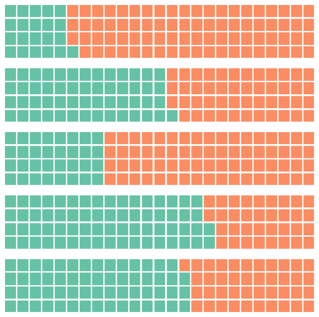
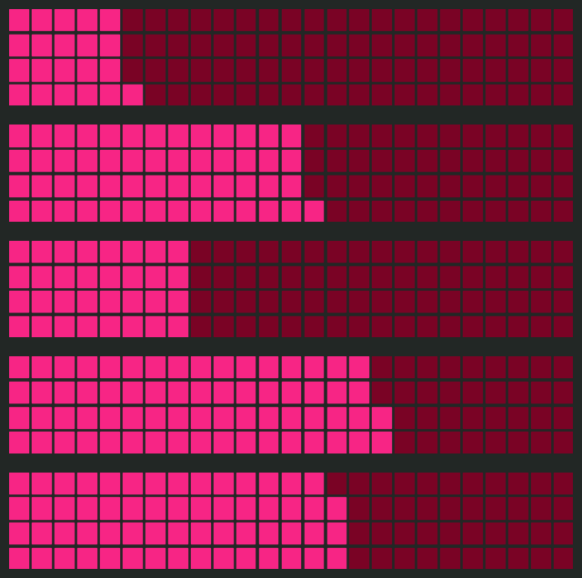
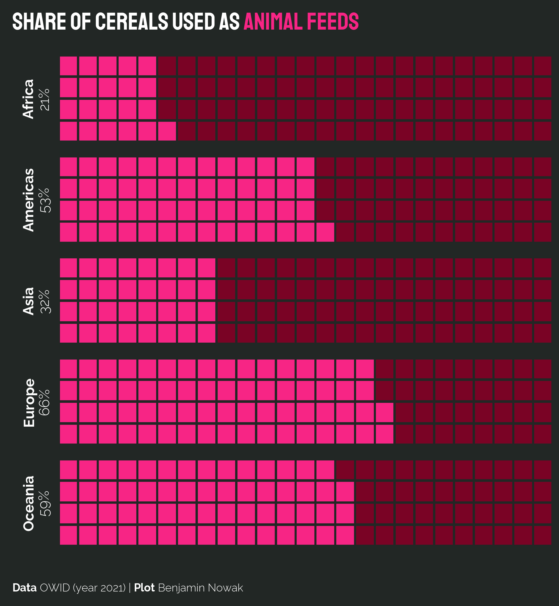

## About

This page showcases the work of [Benjamin Nowak](https://x.com/BjnNowak) who originally [made the chart with R](https://r-graph-gallery.com/web-waffle-chart-share.html). This post is a translation to Python by [Joseph Barbier](https://barbierjoseph.com).
Thanks to him for accepting sharing his work here!

Let's see what the final picture will look like:


## Libraries

First, you need to install the following librairies:

- [matplotlib](https://python-graph-gallery.com/matplotlib/) is used for creating the chart and add customization features
- `pandas` is used to put the data into a dataframe
- `datetime` is used for dealing with the date format of our time variable

And that's it!

```python
# Libraries
import matplotlib.pyplot as plt
import pandas as pd
from pywaffle import Waffle
from highlight_text import fig_text
from pyfonts import load_google_font
```

## Dataset

For this reproduction, we're going to retrieve the data directly from the [gallery's](https://python-graph-gallery.com) Github repo. This means we just need to **give the right url as an argument** to pandas' `read_csv()` function to retrieve the data.

Next, we use the `melt()` function to switch **from one country per column** to a **single column with concatenated countries**, while keeping the values in the original `Time` variable.

```python
path = "https://raw.githubusercontent.com/holtzy/R-graph-gallery/master/DATA/share-cereals.csv"
df = pd.read_csv(path)


def remove_html_tag(s):
    return s.split("</b>")[0][3:]


df["lab"] = df["lab"].apply(remove_html_tag)
df = df[df["type"] == "feed"]
df.reset_index(inplace=True)
df
```

:::output
::output-html{src="./output-1.html"}
:::

## Basic waffle chart

In order to create the following chart, we:

- determine how many charts to create based on the number of rows in the DataFrame

- set up a figure with multiple subplots, one for each row of data (5)

- for **each row** in the DataFrame:

  - It extracts the share.
  - It creates a waffle chart showing this share.

- each waffle chart uses a **4x25 grid** (100 squares total) to represent the percentage.

```python
number_of_bars = len(df)  # one bar per continent

# Init the whole figure and axes
fig, axs = plt.subplots(nrows=number_of_bars, ncols=1, figsize=(8, 8))

# Iterate over each bar and create it
for (i, row), ax in zip(df.iterrows(), axs):
    share = row["percent"]
    values = [share, 100 - share]

    Waffle.make_waffle(ax=ax, rows=4, columns=25, values=values)

plt.show()
```

:::output

:::

## Custom colors

The colors are changed thanks tot he `colors` argument in `Waffle.make_waffle()`, and the `set_facecolor()` for the background

_Note: the colors used are slightly different from the original colors._

```python
background_color = "#222725"
pink = "#f72585"
dark_pink = "#7a0325"

number_of_bars = len(df)  # one bar per continent

# Init the whole figure and axes
fig, axs = plt.subplots(nrows=number_of_bars, ncols=1, figsize=(8, 8))
fig.set_facecolor(background_color)


# Iterate over each bar and create it
for (i, row), ax in zip(df.iterrows(), axs):
    share = row["percent"]
    values = [share, 100 - share]

    Waffle.make_waffle(
        ax=ax,
        rows=4,
        columns=25,
        values=values,
        colors=[pink, dark_pink],
    )

plt.show()
```

:::output

:::

## Title and credit

In order to add annotation, we need 2 new tools:

- `pyfonts` to load the fonts
- `highlight_text` to custom the text style

`highlight_text` provides the `fig_text()` and `ax_text()` functions (you can learn in [this post](/advanced-custom-annotations-matplotlib) that extensively describes how they work.)

```python
font_title = load_google_font("Staatliches")
font_credit = load_google_font("Raleway", weight="light")
bold_font_credit = load_google_font("Raleway", weight="bold")

background_color = "#222725"
pink = "#f72585"
dark_pink = "#7a0325"

number_of_bars = len(df)  # one bar per continent

# Init the whole figure and axes
fig, axs = plt.subplots(nrows=number_of_bars, ncols=1, figsize=(8, 8), dpi=300)
fig.set_facecolor(background_color)
ax.set_facecolor("white")


# Iterate over each bar and create it
for (i, row), ax in zip(df.iterrows(), axs):
    share = row["percent"]
    values = [share, 100 - share]

    Waffle.make_waffle(
        ax=ax,
        rows=4,
        columns=25,
        values=values,
        colors=[pink, dark_pink],
    )

    text = f"{row['lab']}"
    ax.text(
        x=-0.4,
        y=0.5,
        s=text,
        font=bold_font_credit,
        color="white",
        rotation=90,
        ha="center",
        va="center",
        fontsize=13,
    )
    text = f"{share}%"
    ax.text(
        x=-0.2,
        y=0.5,
        s=text,
        font=font_credit,
        color="white",
        rotation=90,
        ha="center",
        va="center",
        fontsize=13,
    )

fig_text(
    x=0.05,
    y=0.95,
    s="SHARE OF CEREALS USED AS <ANIMAL FEEDS>",
    highlight_textprops=[{"color": pink}],
    color="white",
    fontsize=22,
    font=font_title,
)
fig_text(
    x=0.05,
    y=0.05,
    s="<Data> OWID (year 2021) | <Plot> Benjamin Nowak",
    font=font_credit,
    color="white",
    fontsize=10,
    highlight_textprops=[{"font": bold_font_credit}] * 2,
)

plt.savefig("../../static/graph/web-waffle-chart-as-share.png", dpi=300)
plt.show()
```

:::output

:::

## Going further

This article explains how to reproduce a [waffle chart](/waffle-chart) with custom colors and fonts.

You might be interested by:

- the [waffle chart section](/waffle-chart)
- how to [customize block style](/558-waffle-bar-chart)
- how to use waffle charts [to describe London boroughs](/web-waffle-with-small-multiples)
